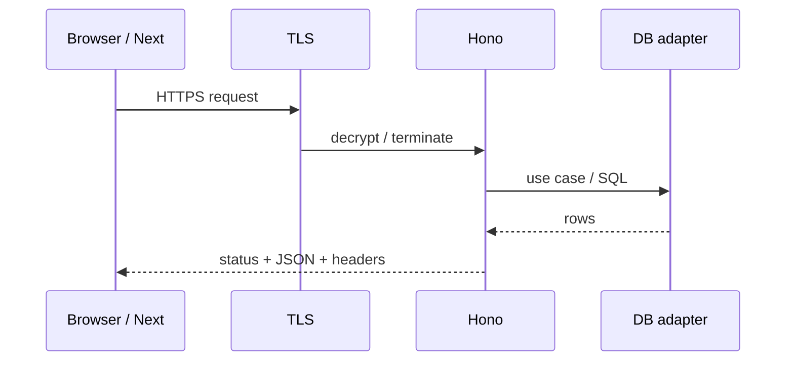

# FD-02 — Networks & HTTP

| Field | Value |
|-------|--------|
| Category | 00-foundations |
| Status | `complete` |
| Stack | Browser / Next.js → Hono API · JSON · TLS |
| Prereqs | FD-01 helpful but not required |
| Related Docs | [`../../tech-space/backend-architecture.md`](../../tech-space/backend-architecture.md) |

## Learning outcomes

- Name the path of a request from browser to Hono and back.
- Choose HTTP methods and status codes that match intent.
- Know which headers matter for APIs (content-type, auth, cache, correlation).
- Explain TLS at “architect enough” depth (trust, termination, not crypto math).

---

## 1. Dummy

HTTP is a **request/response conversation** over TCP (usually with TLS). Your React app talks to Hono mostly with JSON documents.



**Why it exists:** so clients and servers share a boring, universal contract — method, path, headers, body, status.

---

## 2. When to use / when not

### Methods (cheat sheet)

| Method | Meaning | Body? | Idempotent? |
|--------|---------|-------|-------------|
| GET | Read | No (convention) | Yes |
| POST | Create / command | Yes | No (unless you add keys) |
| PUT | Replace resource | Yes | Yes |
| PATCH | Partial update | Yes | Usually |
| DELETE | Remove | Optional | Yes |

### Status families

| Range | Meaning | Example |
|-------|---------|---------|
| 2xx | Success | `201` created, `204` no content |
| 4xx | Client wrong | `400` validation, `401` unauth, `403` forbidden, `404`, `409` conflict, `429` rate limit |
| 5xx | Server / dependency failed | `500` bug, `502/503` upstream, `504` timeout |

### When not

- Inventing private status codes (`999`) clients cannot interpret.
- Returning `200` with `{ ok: false }` for every failure (hides HTTP semantics from caches/gateways).
- Putting secrets in query strings (logs, referrers).

---

## 3. Working

### Worst vs best — Hono

```ts
// ❌ Everything is 200; client must parse magic strings
app.post("/listings", async (c) => {
  const body = await c.req.json();
  if (!body.title) return c.json({ ok: false, error: "bad" }, 200);
  // ...
  return c.json({ ok: true });
});

// ✅ Status matches outcome; body is a typed error shape
app.post("/listings", async (c) => {
  const parsed = createListingSchema.safeParse(await c.req.json());
  if (!parsed.success) {
    return c.json({ code: "VALIDATION", issues: parsed.error.flatten() }, 400);
  }
  try {
    const listing = await createListing(parsed.data, c.get("deps"));
    return c.json(listing, 201);
  } catch (e) {
    if (e instanceof ConflictError) return c.json({ code: "CONFLICT" }, 409);
    throw e; // let error middleware map to 500 + log
  }
});
```

### Headers you will actually use

| Header | Role |
|--------|------|
| `Content-Type: application/json` | Body interpretation |
| `Authorization` / `Cookie` | Who is calling |
| `Idempotency-Key` | Safe retries on POST payments |
| `X-Request-Id` / `traceparent` | Correlate logs across web→API |
| `Cache-Control` | CDN / browser caching for GETs |

### Next.js / fetch side

```ts
const res = await fetch(`${API}/listings`, {
  method: "POST",
  headers: {
    "content-type": "application/json",
    "x-request-id": crypto.randomUUID(),
  },
  body: JSON.stringify(input),
});
if (res.status === 401) redirect("/login");
if (!res.ok) throw await toApiError(res);
return res.json();
```

### TLS (architect view)

- Browser trusts **certificates** via CAs; HTTPS encrypts the hop.
- Often TLS **terminates** at a reverse proxy / load balancer; Hono may see HTTP internally — still treat upstream as trusted network design, not “no security.”
- Local dev: `http://localhost` is fine; production APIs are HTTPS-only.

---

## 4. Rich

### Failure modes

| Symptom | Likely cause | Fix ownership |
|---------|--------------|---------------|
| CORS error in browser | Missing/wrong `Access-Control-*` | API CORS middleware / gateway |
| `415 Unsupported Media Type` | Wrong Content-Type | Client headers |
| Intermittent `502` | Proxy timeout / process crash | Platform + app health |
| Duplicate orders on retry | POST without idempotency | API + client key |
| “Works in Postman, fails in browser” | Cookies / CORS / mixed content | Edge config |

### Test seams

- Contract tests: status + JSON schema for each route.
- Do not unit-test TCP; do test your status mapping table.

### Ops signals

Log: `method`, `path`, `status`, `duration_ms`, `request_id`. Alert on 5xx rate and latency SLO — not on every 404.

---

## 5. Professional / CTO

| Decision | Guidance |
|----------|----------|
| Error format | One envelope (`code`, `message`, `details`) across services |
| Public vs private APIs | Same HTTP discipline; stricter auth & rate limits at edge |
| GraphQL / gRPC | Adopt when HTTP/JSON friction is measured — not fashion |

**ADR triggers:** changing public status semantics · introducing idempotency keys · TLS termination topology · API gateway in front of Hono.

**Automate:** OpenAPI or Zod-to-OpenAPI in CI; contract tests on PR; forbid `return c.json(err, 200)` via lint/review checklist.

---

## Exercises

1. **Dummy:** Draw the sequence for `PATCH /listings/:id` including a `409`.
2. **Working:** In a scratch Hono app, map `VALIDATION` → 400, `NOT_FOUND` → 404, unknown → 500 with `x-request-id`.
3. **CTO memo (½ page):** Should your marketplace use idempotency keys on create-order only, or on all POSTs? Cost vs risk.

## Related

- [FD-03 TypeScript contracts](FD-03-typescript.md) · [FD-06 Debugging](FD-06-debugging.md)
- Backend course: [`../02-backend-hono-bun/README.md`](../02-backend-hono-bun/README.md)
- [`../../knowledge/architecture-styles/api-gateway.md`](../../knowledge/architecture-styles/api-gateway.md)
