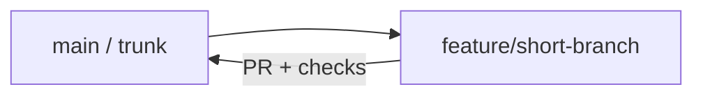

# FD-05 — Git workflows

| Field | Value |
|-------|--------|
| Category | 00-foundations |
| Status | `complete` |
| Stack | Git · GitHub PRs · trunk-friendly monorepo |
| Prereqs | Basic `add` / `commit` / `push` |
| Related Docs | Course CI category · walkthrough CI step |

## Learning outcomes

- Use a **trunk-based** style: short-lived branches, small PRs.
- Recover with `bisect`, `reflog`, and revert — without rewriting shared history casually.
- Write commits and PRs that future architects can audit.
- Know what belongs in git hooks / required checks vs heroics.

---

## 1. Dummy

Git stores **snapshots + history**. Workflow is a social contract: how the team integrates change without breaking `main`.



**Why it exists:** so many people can change one monorepo without irreversible confusion.

---

## 2. When to use / when not

| Practice | Use when | Avoid when |
|----------|----------|------------|
| Short feature branches | Default | Month-long branches (integrate earlier) |
| PR reviews | All production code | Skipping review “because urgent” without pair/hotfix path |
| `rebase -i` locally | Cleaning your unpushed commits | Rewriting already-shared history |
| Force-push to `main` | Almost never | — |
| Gitflow (develop/release) | Rare regulated trains | Small product teams — usually overhead |

---

## 3. Working

### Happy path (this repo)

```bash
git checkout main
git pull
git checkout -b feat/listing-title-validation
# ... edit ...
git add -p
git commit -m "$(cat <<'EOF'
Validate listing titles at the Hono edge.

Keep domain assertTitle free of HTTP types.
EOF
)"
git push -u origin HEAD
# open PR → CI lint/type/test → squash or merge
```

### Commit message bar

- **Why** in the body; subject = intent.
- One logical change when possible (docs-only vs behavior).
- Never commit secrets (`.env`); use examples only.

### Bisect (find the break)

```bash
git bisect start
git bisect bad                # current broken
git bisect good v1.2.0        # known good
# run test each step
git bisect run pnpm test --filter @repo/domain
git bisect reset
```

### Undo without panic

| Situation | Tool |
|-----------|------|
| Bad commit on main already | `git revert` (new commit) |
| Lost a local commit | `git reflog` → checkout / cherry-pick |
| Wrong files in last unpushed commit | `git reset --soft HEAD~1` |

---

## 4. Rich

### Failure modes

| Failure | Discipline |
|---------|------------|
| Huge PR (30 files) | Split by vertical slice / package |
| “Works on my machine” merge | Required CI on PR |
| Secret leaked | Rotate keys; history purge is last resort + announce |
| Merge commits vs squash wars | Document one team default in CONTRIBUTING |

### Monorepo tips

- Path-aware CI (only test changed packages) — see course `06-cicd`.
- CODEOWNERS for `packages/domain`, `packages/contracts`, infra.

---

## 5. Professional / CTO

| Policy | Recommendation for this blueprint |
|--------|-----------------------------------|
| Default branch | `main` protected |
| History on main | Linear-ish (squash or rebase+merge); no force-push |
| Hotfix | Still PR if possible; document emergency break-glass |

**ADR / policy triggers:** changing merge strategy · requiring signed commits · releasing from tags only.

**Automate:** branch protection, required checks, commitlint optional, secret scanning, `graphify`/lint on PR.

---

## Exercises

1. **Dummy:** Draw trunk vs a 4-week feature branch — mark where risk accumulates.
2. **Working:** Practice `git add -p` and write a why-focused commit for a docs-only change.
3. **CTO memo:** Squash-merge vs merge-commit for a 12-person monorepo — pick one and state the audit trade-off.

## Related

- [FD-06 Debugging](FD-06-debugging.md) · [`../06-cicd/README.md`](../06-cicd/README.md)
- [`../../.brain/GRAPHIFY-SETUP.md`](../../.brain/GRAPHIFY-SETUP.md) (hooks mention)
