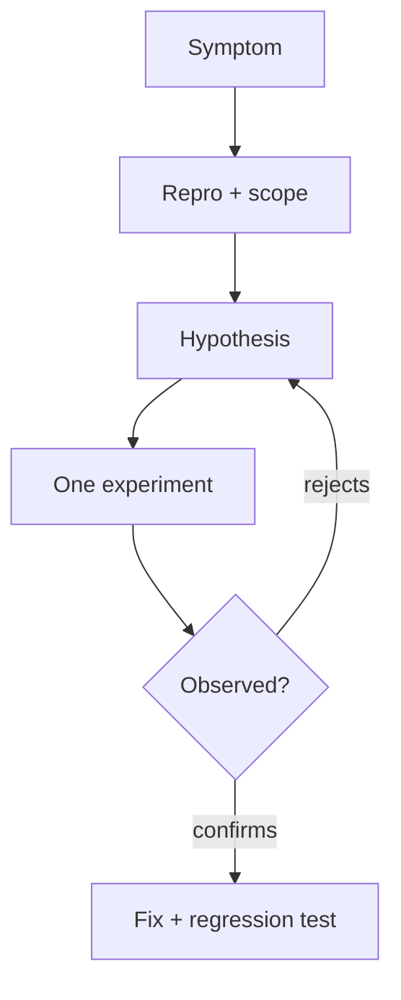

# FD-06 — Debugging & reproduction discipline

| Field | Value |
|-------|--------|
| Category | 00-foundations |
| Status | `complete` |
| Stack | Hono · Next/React · Postgres · browser DevTools |
| Prereqs | [FD-02 HTTP](FD-02-http.md), [FD-05 Git](FD-05-git.md) |
| Related Docs | Observability course · structured logging concepts |

## Learning outcomes

- Turn “it’s broken” into a **repro** (steps, env, IDs) before changing code.
- Use a systematic loop: observe → hypothesize → experiment → conclude.
- Know which tool fits which layer (browser, network, API logs, SQL, bisect).
- Avoid “fix storms” that hide the root cause.

---

## 1. Dummy

Debugging is **scientific method on a system**. Guessing and spraying `console.log` everywhere is not a strategy.



**Why it exists:** so you spend time on the fault, not on random edits.

---

## 2. When to use / when not

| Approach | Use | Avoid |
|----------|-----|-------|
| Repro notes in ticket/PR | Always | “See Slack” as the only record |
| Binary search / bisect | Regressions after merges | When you never had a green baseline |
| Debugger breakpoints | Local logic bugs | Production without care |
| More logging | Intermittent / distributed | Logging PII or huge payloads |
| Rewrite module | Never as first debug step | — |

---

## 3. Working

### Reproduction template (copy this)

```text
Env: local / staging / prod
Commit / image: …
Actor: user id / role
Request-id / trace: …
Steps:
  1.
  2.
Expected:
Actual:
Frequency: always / intermittent (n/m)
Workaround:
```

### Layer checklist (this stack)

| Layer | Tool |
|-------|------|
| UI | React DevTools, Next error overlay |
| Network | Browser Network tab — status, CORS, payload |
| API | Hono logs with `request_id`; hit route via curl/httpie |
| Domain | Unit test the pure function in isolation |
| DB | Log SQL (dev), `EXPLAIN`, check constraints |
| History | `git bisect` + failing test |

### Worst vs best

```ts
// ❌ Fix by coincidence
app.use(async (c, next) => {
  try { await next(); } catch { return c.json({ ok: false }, 200); }
});

// ✅ Preserve signal; map known errors; log unknown with id
app.onError((err, c) => {
  const requestId = c.get("requestId");
  if (err instanceof DomainError) {
    return c.json({ code: err.code, requestId }, err.httpStatus);
  }
  console.error({ requestId, err });
  return c.json({ code: "INTERNAL", requestId }, 500);
});
```

### Minimal experiment rule

Change **one** variable per experiment (config, input, code path). If you change five things and it “works,” you learned nothing.

---

## 4. Rich

### Failure modes

| Trap | Better |
|------|--------|
| Heisenbug (goes away when logging) | Timing/race — add deterministic test, tracing |
| Works locally only | Compare env, migrations, seed data, feature flags |
| Blaming the framework first | Prove with a 20-line repro outside the app |
| Infinite local fixes in prod | Feature flag / revert; debug on staging with data scrubbing |

### Test seams after a fix

Always add a **regression** at the cheapest layer that would have caught it (domain unit > HTTP integration > e2e).

### Ops signals

Prefer searchable fields: `request_id`, `user_id` (careful PII), `route`, `error_code`. Debugging production without correlation IDs is archaeology.

---

## 5. Professional / CTO

| Practice | Org impact |
|----------|------------|
| Repro required for Sev bugs | Faster MTTR, better handoffs |
| Blameless postmortems | People report issues early |
| Timebox rabbit holes | Escalate / pair after N minutes |

**ADR / policy triggers:** mandatory `request_id` propagation · PII redaction in logs · “no fix without regression test” for Sev-1/2.

**Automate:** error tracking (e.g. Sentry) with release tags; CI flaky-test quarantine policy; staging data refresh runbooks.

---

## Exercises

1. **Dummy:** Fill the repro template for “create listing returns 500 intermittently.”
2. **Working:** Break a pure `assertTitle` on purpose; catch it with a unit test before touching Hono.
3. **CTO memo:** Should Sev-1 require a regression test in the same PR as the fix? Trade speed vs learning.

## Related

- [FD-02 HTTP](FD-02-http.md) · [FD-05 Git](FD-05-git.md)
- [`../08-observability/README.md`](../08-observability/README.md)
- [`../../knowledge/solid/01-S.md`](../../knowledge/solid/01-S.md) (separate reasons to change ↔ separate debug surfaces)
