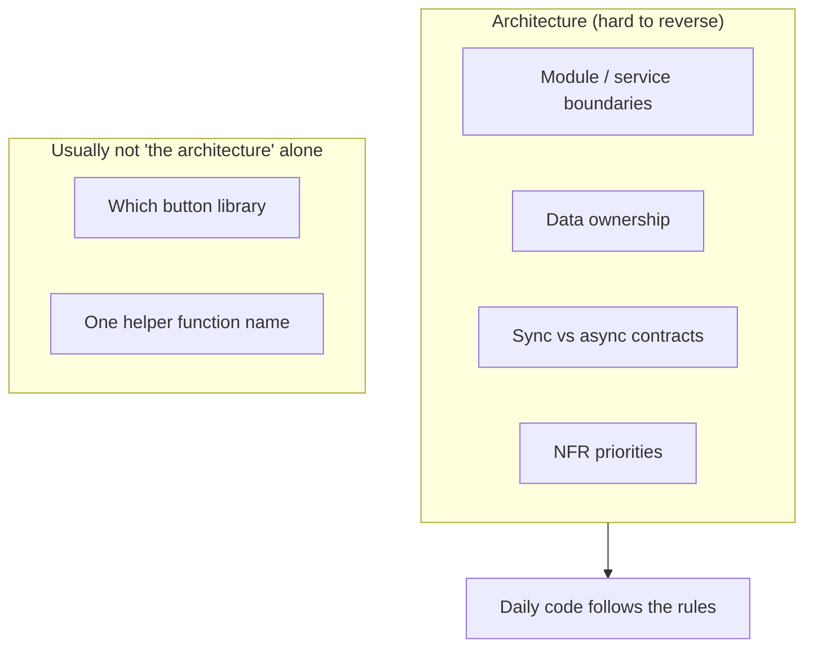

# SA-01 — What architecture is (and is not)

| Field | Value |
|-------|--------|
| Category | 01-system-architecture |
| Status | `complete` |
| Stack | This blueprint (Next + Hono + modular packages) |
| Prereqs | [FD-02](../00-foundations/FD-02-http.md), [FD-03](../00-foundations/FD-03-typescript.md) |
| Related Docs | [`../../tech-space/project-blueprint.md`](../../tech-space/project-blueprint.md) · [`../../knowledge/COURSE.md`](../../knowledge/COURSE.md) |

## Learning outcomes

- Define architecture as **significant decisions** that are costly to reverse.
- Separate architecture from “framework choice fashion” and from low-level coding.
- Name what you must document (context, quality goals, boundaries, trade-offs).
- Know when a decision needs an ADR vs a chat message.

---

## 1. Dummy

Architecture is the set of **structural decisions** that shape how the system can change: boundaries, deploy units, data ownership, and how parts talk.



**Why it exists:** so teams don’t accidentally paint themselves into a corner while “just shipping.”

---

## 2. When to use / when not

### Architecture *is*

| Concern | Example in this repo |
|---------|----------------------|
| Deploy shape | One API process vs many services |
| Package boundaries | `packages/domain` cannot import Hono |
| Data ownership | Module owns its tables |
| Integration style | In-process call vs event |
| Cross-cutting policy | Auth at edge, errors envelope |

### Architecture *is not* (by itself)

- Rewriting a component in a new CSS approach every sprint.
- Memorizing every GoF pattern name without a problem.
- Copying “Clean Architecture” folders with no import rules.

### When not to “big design”

- Unknown product: prefer a **modular monolith** + vertical slices; document open questions.
- One-person spike: still keep domain pure if you expect to keep the code.

---

## 3. Working

### Decision checklist (use before coding a “big” change)

1. What **quality attribute** is at risk? (see [SA-02](SA-02-nfrs.md))
2. What becomes **harder** if we pick A vs B?
3. What is the **blast radius** (packages, deploys, data)?
4. Can we reverse it in &lt; 1 week / 1 month / never?
5. Do we need an **ADR**?

### Worst vs best

```text
❌ “We’ll use microservices because FAANG does.”
✅ “We’ll keep one deployable with module public APIs until billing needs independent scale/compliance — ADR-00xx.”

❌ Architecture = folder names only
✅ Architecture = enforced boundaries (lint/CI) + documented trade-offs
```

### Where decisions live here

| Artifact | Role |
|----------|------|
| `tech-space/project-blueprint.md` | Current intended shape |
| `tech-space/decisions/` | ADRs |
| `knowledge/architecture-styles/architecture-rules.md` | Enforceable rules |
| `course/` + `knowledge/COURSE.md` | Learning paths |

---

## 4. Rich

### Failure modes

| Failure | Signal | Remedy |
|---------|--------|--------|
| Architecture astronautics | Specs, no shipping | Timebox design; ship a slice |
| Big ball of mud | Every change touches everything | Reintroduce boundaries; fitness checks |
| Distributed monolith | Many deploys, shared DB | Fix data ownership first |
| Shadow architecture | Real system ≠ docs | Update blueprint/ADR or change code |

### Fitness (preview of SA-11)

Even simple checks count as architecture: “domain package imports zero frameworks.”

---

## 5. Professional / CTO

| Stance | Guidance |
|--------|----------|
| Ownership | Architects *enable*; they don’t gatekeep every PR |
| Cadence | Revisit principles quarterly; ADRs when irreversible forks appear |
| Language | One vocabulary per team (hexagonal vs clean rings — pick and map) |

**ADR triggers:** new deployable · new data store · cross-module coupling exception · public API breakage.

**Automate:** boundary lint, CI path filters, ADR template in repo.

---

## Exercises

1. **Dummy:** List 3 decisions in this blueprint that would hurt to reverse.
2. **Working:** Open `project-blueprint.md` and mark each major choice as easy / medium / hard to reverse.
3. **CTO memo:** Who may approve an exception to `architecture-rules.md` — and how is it recorded?

## Related

- [SA-02 NFRs](SA-02-nfrs.md) · [SA-03 C4](SA-03-c4.md) · [knowledge tracks index](knowledge-tracks.md)
- [`../../knowledge/architecture-styles/modular-monolith.md`](../../knowledge/architecture-styles/modular-monolith.md)
