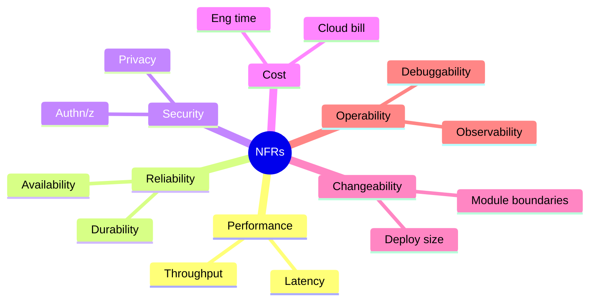

# SA-02 — Quality attributes / NFRs

| Field | Value |
|-------|--------|
| Category | 01-system-architecture |
| Status | `complete` |
| Stack | Marketplace-shaped modular monolith |
| Prereqs | [SA-01](SA-01-what-architecture-is.md) |
| Related Docs | [`../../knowledge/architecture-styles/architecture-rules.md`](../../knowledge/architecture-styles/architecture-rules.md) · OBS / SEC course categories |

## Learning outcomes

- Name the main **quality attributes** (NFRs) and say which ones matter for a given feature.
- Turn fuzzy goals (“fast”, “secure”) into testable or observable targets.
- Spot **trade-offs** (you rarely maximize all NFRs).
- Tie NFRs to architecture choices (caching, sync vs async, isolation).

---

## 1. Dummy

Functional requirements say *what* the system does. **NFRs** say *how well* it must do it: latency, cost, safety, operability, …



**Why it exists:** architecture is mostly negotiating NFRs under constraints.

---

## 2. When to use / when not

### Core attribute set (architect’s short list)

| Attribute | Question | Example metric |
|-----------|----------|----------------|
| Latency | How long for p95 checkout? | p95 &lt; 300ms API |
| Throughput | Peak orders/sec? | 50 RPS sustained |
| Availability | Allowed downtime? | 99.9% monthly |
| Consistency | Stale search OK? | Search lag &lt; 30s |
| Security | Who can see PII? | Role checks + audit |
| Cost | Budget ceiling? | DB &lt; $X/mo |
| Maintainability | Time to add a slice? | &lt; 1 day typical |
| Portability | Lock-in OK? | Multi-DB adapters |

### When not

- Writing 40 NFRs nobody measures.
- Copying “five nines” for an internal MVP.
- Optimizing cost before product-market fit *and* ignoring security basics.

---

## 3. Working

### NFR card (per critical journey)

```text
Journey: Place order
Priority NFRs: correctness > latency > cost
Targets:
  - p95 POST /orders < 400ms excluding payment provider
  - payment decline never marks paid (correctness)
  - idempotent retries (reliability)
Out of scope now: multi-region active-active
```

### Map NFR → structure (this stack)

| If you prioritize… | Lean toward… |
|--------------------|--------------|
| Changeability / team speed | Modular monolith + vertical slices |
| Independent scale of search | Extract search later; events for index |
| Strict domain testability | Hexagonal ports at DB/payment |
| Lowest ops for MVP | Compose locally; managed Postgres |
| Strong isolation / compliance | Separate service + data (costly) |

### Worst vs best

```text
❌ “Make it scalable” (no number, no bottleneck)
✅ “Support 20 rps create-listing with p95 < 250ms on staging dataset N”

❌ Security = “we use HTTPS”
✅ Threats for listing PII + authz on mutate + secret handling ADR
```

---

## 4. Rich

### Trade-off matrix (examples)

| Push this | Often pays with |
|-----------|-----------------|
| Latency | Cost (more replicas/cache) or consistency (staleness) |
| Strong consistency | Availability / latency under partition |
| Many microservices | Operability cost, failure modes |
| Extreme flexibility | Accidental complexity |

### Failure modes

| Failure | Fix |
|---------|-----|
| NFR only in slides | Put targets in ADR + dashboards |
| Conflicting silent goals | Explicit priority order per journey |
| Local perf win, global mess | Measure end-to-end with `request_id` |

### Test / observe seams

- Correctness: domain unit tests.
- Latency: smoke + staging load on critical routes.
- Security: checklist + automated scans (later SEC course).

---

## 5. Professional / CTO

| Practice | Guidance |
|----------|----------|
| Priority list | Top 3 NFRs per product stage (MVP ≠ scale-up) |
| Error budgets | Pair with SLOs ([OBS course](../08-observability/README.md)) |
| Reviews | Design review asks “which NFR does this buy?” |

**ADR triggers:** changing consistency model · multi-region · paid cache tier · lowering auth guarantees for speed.

**Automate:** SLO dashboards; CI performance budgets on key endpoints when stable.

---

## Exercises

1. **Dummy:** Pick create-listing vs search-listings — different NFR priorities?
2. **Working:** Fill an NFR card for “seller publishes listing.”
3. **CTO memo:** For year-1 marketplace, rank cost vs latency vs security — justify for investors *and* eng.

## Related

- [SA-03 C4](SA-03-c4.md) · [SA-10 Capacity](SA-10-capacity.md)
- [`../../knowledge/architecture-styles/microservices.md`](../../knowledge/architecture-styles/microservices.md) (availability/isolation trade-offs)
