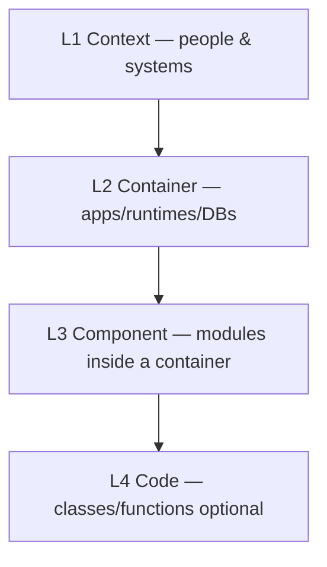
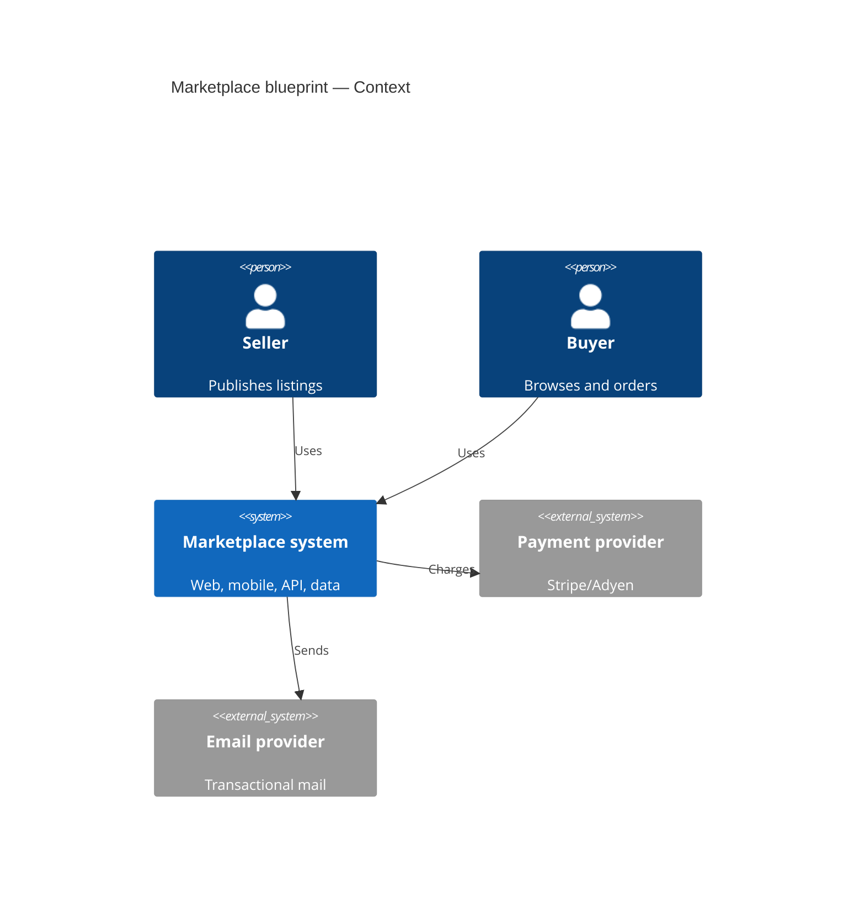
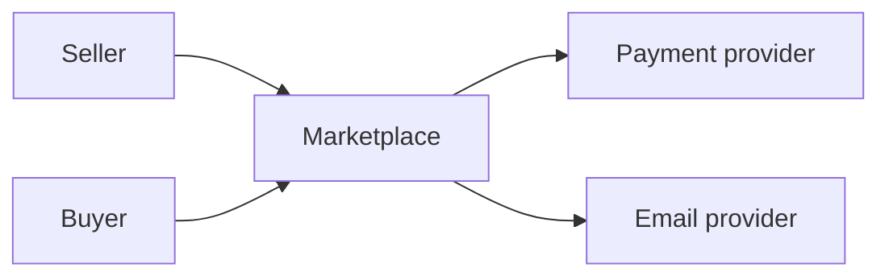
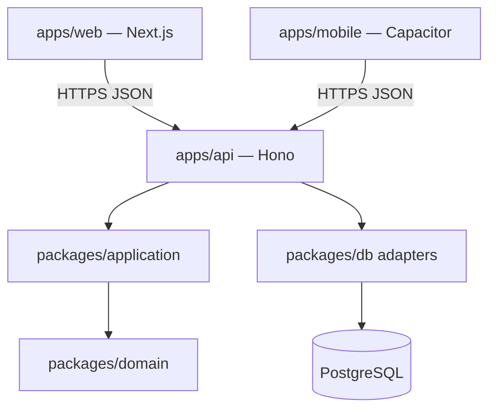
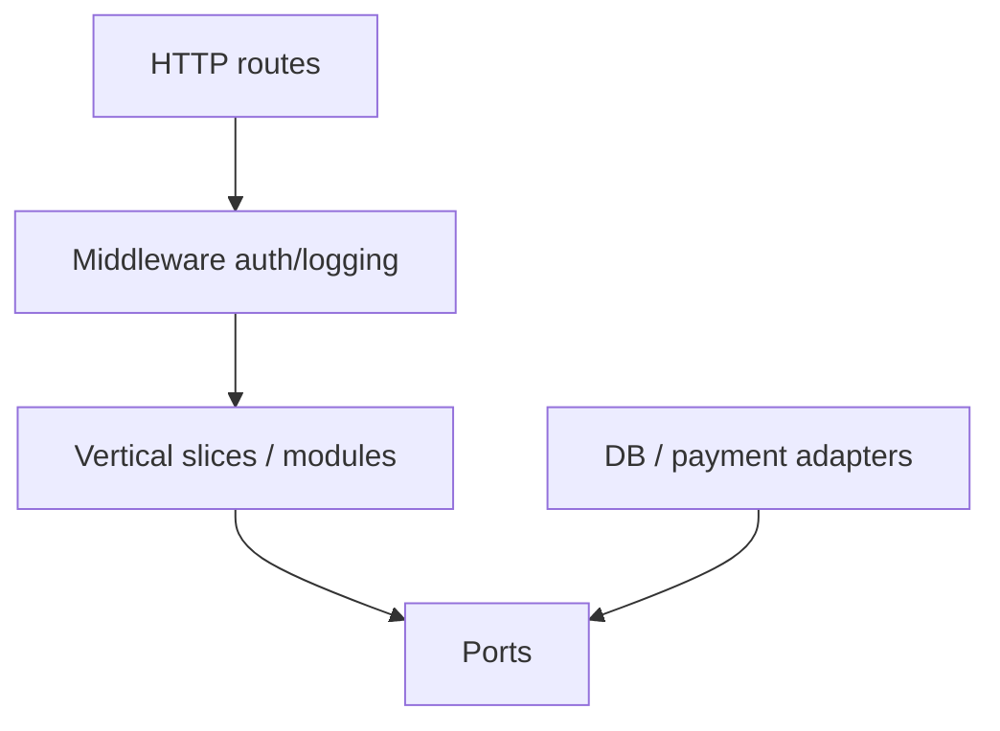

# SA-03 — C4 model (context → code)

| Field | Value |
|-------|--------|
| Category | 01-system-architecture |
| Status | `complete` |
| Stack | Next.js web · Capacitor mobile · Hono API · DB adapters · optional gateway |
| Prereqs | [SA-01](SA-01-what-architecture-is.md), [FD-02](../00-foundations/FD-02-http.md) |
| Related Docs | [`../../tech-space/project-blueprint.md`](../../tech-space/project-blueprint.md) · skills: `c4-architecture`, `design-doc-mermaid` |

## Learning outcomes

- Draw **C4** at four zoom levels: Context, Container, Component, Code.
- Match containers to this monorepo’s `apps/` and major `packages/`.
- Use diagrams in ADRs and reviews without drowning in class UML.
- Know when Component/Code diagrams are worth the ink.

---

## 1. Dummy

C4 is a **zoom lens** for software diagrams. Start with people + systems; zoom into deployable containers; only then into components/code.



**Why it exists:** so stakeholders and engineers share one picture at the right altitude.

---

## 2. When to use / when not

| Level | Audience | When |
|-------|----------|------|
| Context | Exec, product, new hires | Any system overview / ADR |
| Container | Architects, platform | Deploy & trust boundaries |
| Component | Team owning an app | Module layout inside API/web |
| Code | Pairing / complex algorithm | Rare — prefer short sequence + link to code |

### When not

- Starting with class diagrams for a greenfield MVP.
- One mega-diagram with 80 boxes (split by level instead).

---

## 3. Working

### L1 — Context (this blueprint)



If Mermaid C4 isn’t available in your viewer, equivalent flowchart:



### L2 — Containers (map to repo)



| Container | Repo path | Responsibility |
|-----------|-----------|----------------|
| Web | `apps/web` | UI + BFF-ish Next edge |
| Mobile | `apps/mobile` | Native shell + shared UI/domain use |
| API | `apps/api` | HTTP, auth, composition root |
| Domain/App | `packages/*` | Rules & use cases (not a separate deploy) |
| Database | Postgres/MariaDB/SQLite | State |

### L3 — Components inside `apps/api` (example)



### L4 — Code

Skip unless teaching a tricky algorithm. Prefer linking to `capture-order-payment.ts` + a sequence diagram.

### Worst vs best

```text
❌ One slide: “Frontend — Backend — DB” with no trust or ownership edges
✅ Context for execs; Container in ADR; Component only for the module under change
```

---

## 4. Rich

### Failure modes

| Failure | Fix |
|---------|-----|
| Diagram ≠ reality | Update with the PR that changes boundaries |
| Containers that are only folders | Containers ≈ deploy/runtime/data store |
| Showing every npm package | Hide libraries; show systems you operate |

### Review use

Attach **Container** to ADRs that change deploy shape; attach **Component** when module public APIs change.

---

## 5. Professional / CTO

| Practice | Guidance |
|----------|----------|
| Source of truth | Diagrams next to ADRs / blueprint — not only Notion screenshots |
| Tooling | Mermaid in git beats inaccessible proprietary boards for this repo |
| Depth tax | Cap review decks at L1+L2 unless asking for L3 approval |

**ADR triggers:** adding a new container (e.g. worker service) · splitting DB · introducing external system.

**Automate:** optional Structurizr/LikeC4 later; for now Mermaid in Docs is enough.

---

## Exercises

1. **Dummy:** Draw L1 for this blueprint including payment.
2. **Working:** Produce L2 naming real `apps/` and the primary DB.
3. **CTO memo:** Should mobile talk only to Hono, or also to Next BFF routes? Draw both and pick with NFR priorities.

## Related

- [SA-10 Capacity](SA-10-capacity.md) · [knowledge tracks](knowledge-tracks.md)
- Capstone hint: SA-14 will combine C4 + ADR set
- [`../../knowledge/architecture-styles/bff.md`](../../knowledge/architecture-styles/bff.md)
