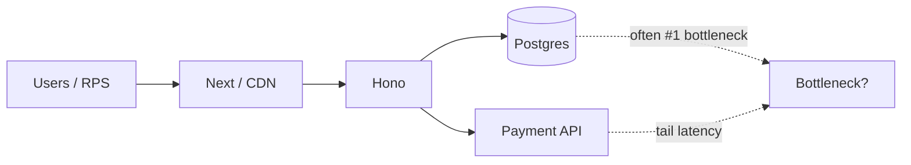

# SA-10 — Capacity, back-of-envelope, bottlenecks

| Field | Value |
|-------|--------|
| Category | 01-system-architecture |
| Status | `complete` |
| Stack | Hono API · Postgres · Next.js · optional cache/queue |
| Prereqs | [SA-02](SA-02-nfrs.md), [FD-02](../00-foundations/FD-02-http.md) |
| Related Docs | [`../../knowledge/architecture-styles/modular-monolith.md`](../../knowledge/architecture-styles/modular-monolith.md) · platform / observability courses |

## Learning outcomes

- Do a **back-of-envelope** estimate before proposing microservices or huge infra.
- Find likely **bottlenecks** (CPU, IO, DB locks, external APIs, chatty UIs).
- Translate traffic assumptions into connections, QPS, and storage growth.
- Know when measurement must replace guessing.

---

## 1. Dummy

Capacity thinking asks: **where does the system bend first** under load — and is that OK for our NFRs?



**Why it exists:** so you don’t “scale” the wrong tier or split services for imaginary load.

---

## 2. When to use / when not

### Use

- Before buying K8s complexity or extracting a service.
- When setting SLOs and sizing connection pools.
- In design reviews for high-traffic journeys (search, checkout).

### When not

- Premature optimization of cold paths.
- Fake precision (“we need exactly 847 pods”) without data.
- Ignoring product uncertainty — size for a range, not a fantasy point.

---

## 3. Working

### Back-of-envelope recipe

1. **Peak actors:** e.g. 1 000 DAU, 10% concurrent in peak minute → ~100 concurrent.
2. **Actions/sec:** each concurrent does 1 request / 10s → ~10 RPS average; peak 5× → **50 RPS**.
3. **Amplification:** 1 page view = 1 SSR + 3 API calls → **200 RPS** at API.
4. **Per-request work:** DB queries (2), cache hits, external payment (checkout only).
5. **Compare to limits:** single Postgres on small VM often handles hundreds of light QPS — until locks/N+1.

### Example — listing browse

```text
Assumption: peak 50 RPS page views
Amplification: 1 Next document + 2 API GETs = ~150 RPS API
Each GET: 1 indexed query ~2ms CPU + 5ms IO (order of magnitude)
DB: 150 QPS trivial if indexed; death if full table scans
Bottleneck candidates: missing index, SSR fan-out, huge payloads
```

### Example — checkout (external bound)

```text
10 RPS checkout
Each: 1 DB write + 1 Stripe call (~200–800ms)
API threads/async: fine on Node/Bun
User latency dominated by Stripe — scaling Hono replicas won’t fix p95
Mitigations: async confirm + webhooks, timeouts, idempotency
```

### Worst vs best

```text
❌ “We’ll need Kafka and 12 microservices for launch.”
✅ “Launch estimate 50 RPS browse; bottleneck risk = search ILIKE; plan index + later read model.”

❌ Scale API replicas while DB pool = 5 and queries lock
✅ Measure DB; fix queries; then size pools/replicas
```

### Connection pool sketch

```text
API instances = 3
poolMax per instance = 10
=> up to 30 DB connections
Postgres max_connections must leave headroom for admin/migrations
```

---

## 4. Rich

### Bottleneck cheat sheet

| Symptom | Suspect |
|---------|---------|
| High API CPU, low DB | JSON/CPU work, tight loops |
| High DB CPU / sequential scans | Missing indexes, bad queries |
| Low CPU, high latency | External I/O, locks, pool exhaustion |
| Errors at peak only | Pool limits, rate limits, GC pauses |
| Good API, slow LCP | Frontend waterfalls / fat JS |

### Failure modes

| Failure | Remedy |
|---------|--------|
| N+1 queries | Batch; DataLoader-style; slice-level SQL review |
| Thundering herd | Cache TTL + jitter; collapse identical reads |
| Over-sharding early | Vertical optimize first |

### Measure

Staging load with production-like data shape; APM/traces; `EXPLAIN ANALYZE` on hot queries. Guess → **validate**.

---

## 5. Professional / CTO

| Decision | Guidance |
|----------|----------|
| Year-1 default | Modular monolith + one primary DB; prove hotspots |
| Spend | Buy observability before exotic topology |
| Narrative | Board hears ranges + risks, not fake precision |

**ADR triggers:** introducing Redis/Kafka “for scale” · read replicas · multi-region · service extract for capacity.

**Automate:** dashboards for RPS, p95, DB connections, slow query log; capacity review checklist in design template.

---

## Exercises

1. **Dummy:** Mark the bottleneck on a diagram for “search while typing.”
2. **Working:** Estimate API RPS if 200 concurrent users each poll every 5s (and propose a better design than poll).
3. **CTO memo:** Refuse or accept a proposal to split “listing service” at 30 RPS — criteria?

## Related

- [SA-02 NFRs](SA-02-nfrs.md) · [SA-03 C4](SA-03-c4.md)
- [`../../knowledge/architecture-styles/cqrs.md`](../../knowledge/architecture-styles/cqrs.md) · [`../05-platform-infra/README.md`](../05-platform-infra/README.md)
