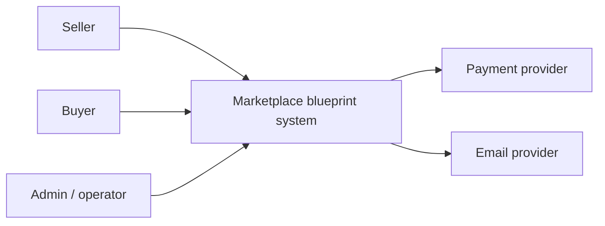
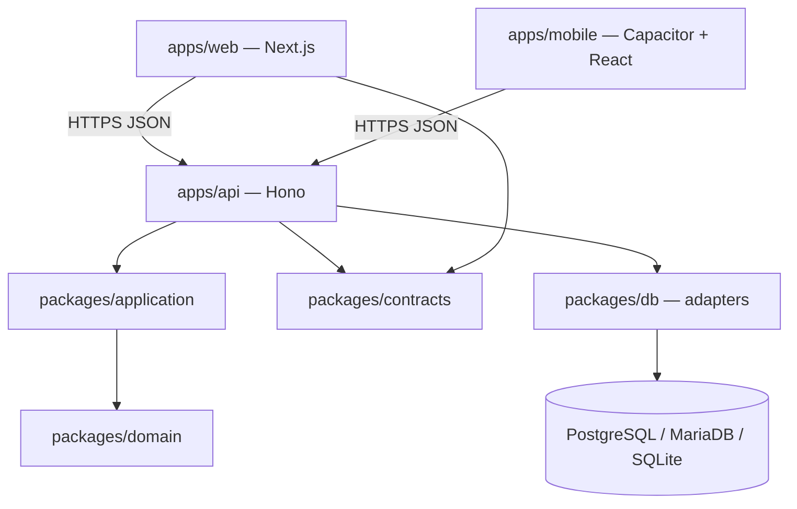
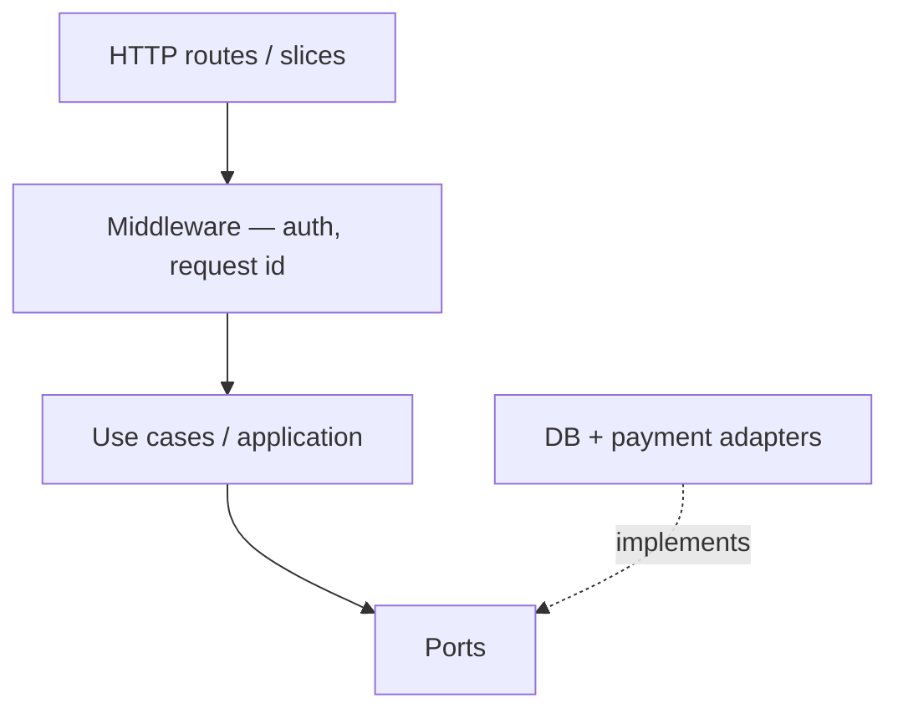

# SA-14 — Capstone: C4 + ADR set for this blueprint

| Field | Value |
|-------|--------|
| Category | 01-system-architecture |
| Status | `complete` |
| Stack | Full-Stack Architecture Blueprint (Next/React · Hono · multi-DB) |
| Prereqs | [SA-01](SA-01-what-architecture-is.md) · [SA-02](SA-02-nfrs.md) · [SA-03](SA-03-c4.md) · [SA-10](SA-10-capacity.md) · [knowledge-tracks](knowledge-tracks.md) sprint |
| Related Docs | [`../../tech-space/project-blueprint.md`](../../tech-space/project-blueprint.md) · [`../../tech-space/decisions/`](../../tech-space/decisions/README.md) · [`../../knowledge/architecture-styles/architecture-rules.md`](../../knowledge/architecture-styles/architecture-rules.md) |

## Learning outcomes

- Produce **C4 Context + Container** diagrams that match this blueprint (not generic 3-tier slides).
- Optionally sketch **Component** view for `apps/api` (or current Hono server).
- Assemble a **mini ADR set**: reuse existing ADRs + draft one new decision.
- Write a short **CTO memo**: what we defer (microservices, Kafka, multi-region) and why.
- Self-grade against a rubric so Phase 1 is “closed.”

---

## 1. Dummy

A capstone proves you can **see** the system and **decide** under trade-offs — diagrams + written decisions, not more folder theory.


**Why it exists:** architects ship clarity others can build and challenge.

---

## 2. When to use / when not

### Use this capstone when

- You finished wave 1.1–1.2 and skimmed knowledge Track B (layered → modular monolith).
- You are about to implement more monorepo code and need a shared picture.

### When not

- Skipping SA-03 and inventing a new diagram language.
- Drawing microservices you have not earned ([SA-10](SA-10-capacity.md)).

---

## 3. Working — deliverables

### Deliverable A — C4 Context (L1)

Actors + this system + external systems.



**Your job:** rewrite in your own words (1 paragraph) what sits *inside* MP vs outside.

### Deliverable B — C4 Container (L2)

Map to **intended** blueprint paths (teaching target). If your clone already uses `apps/market-place-app` + `clouds/market-place-server`, add a one-line note: “current scaffold names → blueprint names.”



**Your job:** mark trust boundaries (browser untrusted; DB trusted network; payment external).

### Deliverable C — Component sketch (L3, optional but recommended)

Inside the API container only:



### Deliverable D — ADR set

| ADR | Action |
|-----|--------|
| [0001 Monorepo tooling](../../tech-space/decisions/0001-monorepo-tooling.md) | **Read** — summarize in 3 bullets |
| [0002 Database adapters](../../tech-space/decisions/0002-database-adapters.md) | **Read** — name the port/adapter consequence |
| [0003 Package scope](../../tech-space/decisions/0003-package-scope-and-boundaries.md) | **Read** — one hard ban you will enforce |
| **NEW draft** (your file, e.g. `docs-local` or PR to `decisions/0004-…`) | Pick **one** open fork below |

**Suggested ADR topics (pick one):**

1. Keep **modular monolith** as default deployable through marketplace MVP.  
2. Next.js may act as **BFF** for web-only aggregation — domain rules still live in API/packages.  
3. **Idempotency keys** required on create-order (and which POSTs are out of scope).  
4. Local **Docker Compose** is the supported laptop path; K8s deferred until Phase 5.

ADR shape (minimum):

```markdown
# ADR 0004 — Title
## Status
Proposed
## Context
## Decision
## Consequences
### Positive
### Negative / follow-ups
```

### Deliverable E — CTO memo (½–1 page)

Answer:

1. Top **3 NFRs** for year-1 marketplace ([SA-02](SA-02-nfrs.md)).  
2. What we **defer** (services, event bus, multi-region) and the **trigger** to revisit ([SA-10](SA-10-capacity.md)).  
3. One **fitness check** you want in CI (e.g. domain cannot import `hono`).

---

## 4. Rich — worked reference (this repo)

### NFR priorities (teaching default)

| Priority | Attribute | Implication |
|----------|-----------|-------------|
| 1 | Changeability / teachability | Modular monolith + clear packages |
| 2 | Correctness at money/auth edges | Ports, tests without Stripe/DB when possible |
| 3 | Operability for a small team | One API deploy; Compose locally |

Latency and extreme scale are **not** year-1 primary goals unless a lesson needs them.

### Existing decisions already “in the set”

You do not rewrite 0001–0003 — you **cite** them in your memo so reviewers see continuity.

### Failure modes of a weak capstone

| Weak artifact | What’s missing |
|---------------|----------------|
| Boxes with no edges | Trust and data flow |
| Containers = npm libraries | Containers ≈ apps/runtimes/DBs you operate |
| ADR with no alternative | No decision — only preference |
| “We’ll use Kafka” with no RPS | Skipped capacity thinking |

### Where to paste your work

Preferred for this repo:

1. Personal notes OK while learning.  
2. When solid: add diagrams into a short note under `Docs/thinking/` **or** extend blueprint with a “C4 snapshot” section via PR.  
3. New ADR → `Docs/tech-space/decisions/` following the index numbering.

---

## 5. Professional / CTO

| Lens | Capstone bar |
|------|----------------|
| Clarity | New engineer finds L1/L2 in &lt; 10 minutes |
| Reversibility | Deferred items have explicit revisit triggers |
| Enforcement | At least one boundary rule is automatable |
| Honesty | Diagram matches *intended* architecture; scaffold name drift is called out |

**ADR triggers after this capstone:** first production deploy shape · extracting billing · adding a worker process as a new container.

**Automate next:** ESLint boundaries; contract tests; link C4 Mermaid in PR template for boundary-changing PRs.

---

## Rubric (self-grade / Phase 1 exit)

Score each 0–2 (0 missing · 1 partial · 2 solid). Pass ≥ **10 / 12**.

| Criterion | 0–2 |
|-----------|-----|
| L1 Context has actors + ≥1 external system | |
| L2 names real apps/packages (or mapped scaffold names) | |
| Trust/data edges labeled (HTTPS, adapters→DB) | |
| Existing ADRs 0001–0003 summarized accurately | |
| New ADR has context / decision / consequences | |
| CTO memo has NFR priority + defer triggers + fitness check | |

**Phase 1 complete when:** rubric ≥ 10 and you can explain modular monolith default without apologizing for “not doing microservices yet.”

---

## Exercises (required path)

1. **Dummy:** Redraw L1 from memory in 5 minutes.  
2. **Working:** Produce L2 Mermaid + 3-bullet summaries of ADR 0001–0003 + draft ADR 0004.  
3. **CTO:** Write the memo; list two capacity numbers that would force a revisit (even if estimated).

## Related

- [SA-03 C4](SA-03-c4.md) · [SA-10 Capacity](SA-10-capacity.md) · [knowledge-tracks](knowledge-tracks.md)
- [`../../knowledge/architecture-styles/modular-monolith.md`](../../knowledge/architecture-styles/modular-monolith.md)
- [`../../../resume-architect.md`](../../../resume-architect.md) — next: Phase 2 wave 2.1
