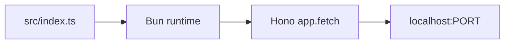

# BE-01 — Bun runtime

| Field | Value |
|-------|--------|
| Category | 02-backend-hono-bun |
| Status | `complete` |
| Stack | Bun · TypeScript · `clouds/market-place-server` |
| Prereqs | [FD-03 TypeScript](../00-foundations/FD-03-typescript.md) · Phase 1 capstone helpful |
| Related Docs | [`../../walkthrough/hono-server-setup/README.md`](../../walkthrough/hono-server-setup/README.md) · this package’s `package.json` |

## Learning outcomes

- Install Bun and run a TypeScript entryfile without a separate compile step for local DX.
- Read this repo’s scripts (`dev` / `start`) and explain what Bun is doing.
- Compare **Bun vs Node** for local vs production honestly.
- Know what must stay portable (Hono `createApp`) vs runtime-specific (serve entry).

---

## 1. Dummy

Bun is a **JavaScript runtime** (like Node) with a fast local story: runs TypeScript, has a bundler/test runner, and can serve HTTP. This marketplace server already uses it for `dev` and `start`.



**Why it exists:** fewer moving parts while learning Hono — `bun run src/index.ts` instead of tsc-watch + node.

---

## 2. When to use / when not

| Prefer Bun when | Prefer Node when |
|-----------------|------------------|
| Local DX and teaching speed | Host only supports Node |
| Team accepts Bun as a dependency | Max “works everywhere” for OSS contributors |
| You isolate serve entry from app | You need a mature native addon ecosystem |

### When not

- Locking production to Bun **before** checking your host (Fly, Railway, containers, serverless).
- Mixing Bun APIs deep inside domain code (`Bun.file` in `packages/domain`) — keep domain portable.

---

## 3. Working

### Install (once per machine)

```bash
# https://bun.sh — pick the installer for your OS
bun --version
```

### This repo’s scripts

From [`clouds/market-place-server/package.json`](../../../clouds/market-place-server/package.json):

```json
{
  "scripts": {
    "dev": "bun run --watch src/index.ts",
    "start": "bun run src/index.ts"
  },
  "devDependencies": {
    "@types/bun": "^1.4.5"
  }
}
```

```bash
# from repo root (pnpm workspace)
pnpm --filter @marketplace/market-place-server dev
```

Or:

```bash
cd clouds/market-place-server
bun run dev
```

### Entrypoint pattern (runtime-specific)

```ts
// clouds/market-place-server/src/index.ts — Bun.serve style via default export
import { createApp } from "./create-app";

const port = Number(process.env.PORT ?? 3000);
const app = createApp({
  corsOrigin: process.env.CORS_ORIGIN ?? "http://localhost:5173",
});

export default {
  port,
  fetch: app.fetch,
};
```

`createApp` stays framework-portable; **only** `index.ts` knows Bun’s export shape.

### Worst vs best

```ts
// ❌ Domain imports Bun
import { file } from "bun"; // inside packages/domain — lock-in

// ✅ Runtime only at the edge
// index.ts / adapters may use Bun; domain stays pure TS
```

### Node alternative (awareness)

If you switch later:

```ts
import { serve } from "@hono/node-server";
serve({ fetch: app.fetch, port });
```

Same `createApp`; different entryfile — see walkthrough “Bun vs Node.”

---

## 4. Rich

### Failure modes

| Symptom | Check |
|---------|-------|
| `bun: command not found` | Install Bun; restart shell PATH |
| Watch not reloading | Use `bun run --watch`; confirm you’re editing the right package |
| Types missing for Bun globals | `@types/bun` in devDependencies |
| Works on Bun, fails on Node host | You used Bun-only APIs outside the entry/adapters |

### Test seams

- Unit-test `createApp` with Hono’s request helper — **no Bun required** in pure app tests.
- Smoke: `GET /health` after `bun run start`.

### Ops signals

Log runtime + version at boot in production (`Bun.version` or `process.version`) so incidents aren’t “which runtime?”

---

## 5. Professional / CTO

| Decision | Guidance for this blueprint |
|----------|-----------------------------|
| Local default | **Bun** (already chosen in market-place-server) |
| Production | Confirm host; container with Bun **or** Node entry — ADR if you diverge |
| Portability rule | Hono app + domain/application must not import `bun` |

**ADR triggers:** mandating Bun in CI for all packages · deploying Bun to production · forbidding Node contributors.

**Deeper lock-in discussion:** later [BE-14](README.md) (planned) / Phase 2.4.

**Automate:** CI job that runs `createApp` tests on Node **and** smoke on Bun if both matter.

---

## Exercises

1. **Dummy:** Draw where Bun sits vs `createApp` vs domain.
2. **Working:** Run `pnpm --filter @marketplace/market-place-server dev` and hit `/health`.
3. **CTO memo:** One paragraph — keep Bun for prod in year 1, or Bun-local / Node-prod? Name the risk you accept.

## Related

- [BE-02 Hono hello](BE-02-hono-hello.md) · [BE-03 Routing & middleware](BE-03-routing-middleware.md)
- [`../../walkthrough/hono-server-setup/README.md`](../../walkthrough/hono-server-setup/README.md)
