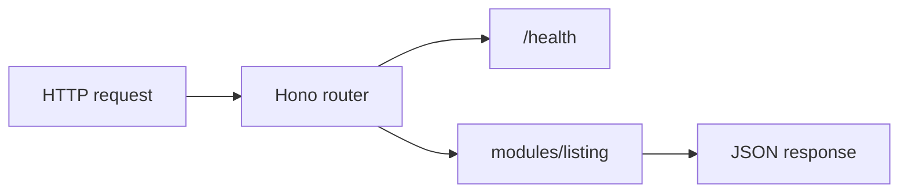

# BE-02 — Hono hello & project layout

| Field | Value |
|-------|--------|
| Category | 02-backend-hono-bun |
| Status | `complete` |
| Stack | Hono 4 · Bun · `clouds/market-place-server` |
| Prereqs | [BE-01](BE-01-bun-runtime.md) |
| Related Docs | [`../../tech-space/backend-architecture.md`](../../tech-space/backend-architecture.md) · [`../../clouds/market-place-server/01-folder-structure.md`](../../clouds/market-place-server/01-folder-structure.md) |

## Learning outcomes

- Explain Hono as a **thin HTTP edge**: route → handler → JSON, not a home for SQL/business rules.
- Navigate this server’s layout: `index.ts` · `create-app.ts` · `modules/`.
- Add a health route and understand why `createApp(deps)` exists.
- Map current `clouds/market-place-server` to the teaching blueprint’s `apps/api`.

---

## 1. Dummy

Hono is a small web framework: you register paths, middleware, and return responses. Business rules should not live in the route forever — they move inward as the course progresses.



**Why it exists:** one explicit place to compose HTTP without Nest-sized magic.

---

## 2. When to use / when not

### Use Hono here when

- You want a **separate cloud API** from the React app (`clouds/` vs `apps/`).
- Teaching composition root + vertical slices.
- Multiple clients (web/mobile) share one HTTP contract.

### When not

- Ultra-throwaway single file with no learning goal (fine for a 5-minute spike — not this repo’s stance).
- Putting all product logic in `app.get` forever (outgrows into a ball of mud).

---

## 3. Working

### Layout (this repo today)

```text
clouds/market-place-server/
  package.json
  src/
    index.ts           # runtime entry (Bun) — env, listen
    create-app.ts      # composition: middleware + routes
    modules/
      listing/
        public.ts      # module public API
        create-listing/
        list-listings/
```

Blueprint teaching names: `apps/api` ≈ this package. Same idea — HTTP edge + modules.

### Hello: health + createApp

From [`create-app.ts`](../../../clouds/market-place-server/src/create-app.ts):

```ts
import { Hono } from "hono";
import { cors } from "hono/cors";
import { createListingModule } from "./modules/listing/public";

export type CreateAppDeps = {
  corsOrigin: string;
};

export function createApp(deps: CreateAppDeps) {
  const app = new Hono();

  app.use("*", cors({ origin: [deps.corsOrigin] }));

  app.get("/health", (c) =>
    c.json({ ok: true as const, service: "market-place-server" }),
  );

  app.route("/v1/listings", createListingModule());

  return app;
}
```

### Try it

```bash
pnpm --filter @marketplace/market-place-server dev
curl -s http://localhost:3000/health
# {"ok":true,"service":"market-place-server"}
```

### Worst vs best

```ts
// ❌ Global app singleton imported everywhere with hidden env
export const app = new Hono();
app.get("/health", ...);

// ✅ Factory — tests pass fake deps; index wires real env
export function createApp(deps: CreateAppDeps) { ... }
```

```ts
// ❌ SQL inside the health-era “hello” forever
app.post("/listings", async (c) => {
  await db.execute("INSERT ..."); // skip ports — technical debt
});

// ✅ Mount a module; grow handlers toward use cases (later BE waves)
app.route("/v1/listings", createListingModule());
```

---

## 4. Rich

### Failure modes

| Failure | Fix |
|---------|-----|
| CORS blocks the React app | `CORS_ORIGIN` matches Vite/Next origin (default `http://localhost:5173`) |
| Logic stuck in `create-app.ts` | Extract modules; keep create-app as wiring only |
| Can’t test without listening | Call `app.request("/health")` in Vitest (next QA/BE-12) |

### Pipeline (target architecture)

From tech-space (you’ll flesh this in later waves):

```text
middleware → validate → use case → map to JSON
```

Today: cors + health + listing routes. Tomorrow: request id, Zod, typed errors.

### Folder rule of thumb

| File | May know |
|------|----------|
| `index.ts` | Env, runtime serve |
| `create-app.ts` | Middleware list, mount points, deps type |
| `modules/*/public.ts` | That module’s routes only |
| Handlers | Application/domain — not Bun |

---

## 5. Professional / CTO

| Stance | Guidance |
|--------|----------|
| Framework | Hono stays — thin edge, interview-clear |
| Package location | `clouds/*` for deployable APIs in this marketplace path |
| Growth | Modules + public.ts before microservices |

**ADR triggers:** moving API under Next Route Handlers only · replacing Hono with Nest · merging create-app into index permanently.

**Automate:** `/health` check in Compose/K8s probes later (Phase 5).

---

## Exercises

1. **Dummy:** Label index vs create-app vs module on a napkin diagram.
2. **Working:** Add `GET /health/ready` returning `{ ready: true }` via `createApp` (keep it tiny).
3. **CTO memo:** Why not make Next.js the only API for this teaching marketplace?

## Related

- [BE-01 Bun](BE-01-bun-runtime.md) · [BE-03 Routing & middleware](BE-03-routing-middleware.md)
- [`../../clouds/market-place-server/README.md`](../../clouds/market-place-server/README.md)
