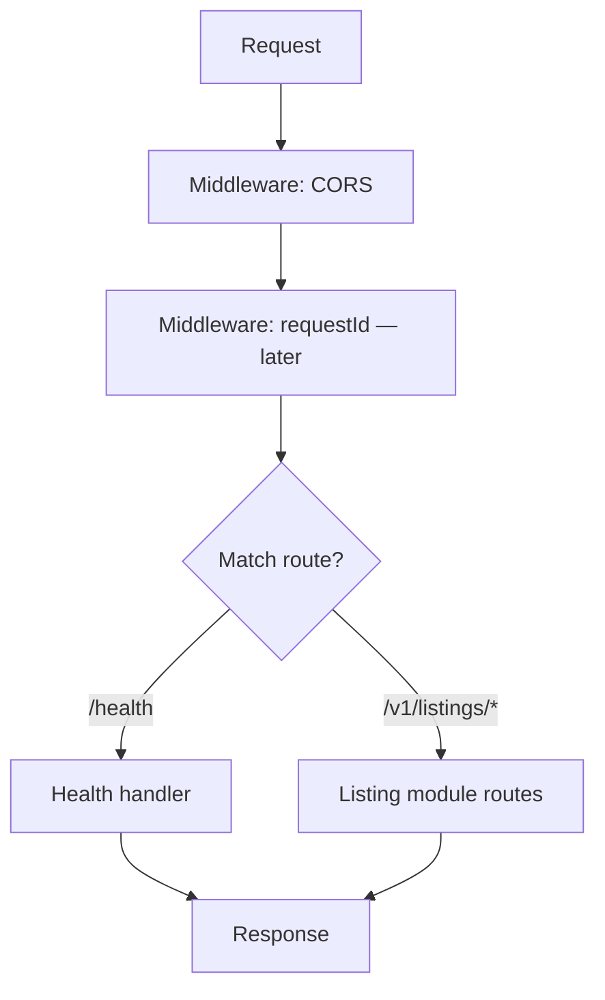

# BE-03 — Routing, groups & middleware pipeline

| Field | Value |
|-------|--------|
| Category | 02-backend-hono-bun |
| Status | `complete` |
| Stack | Hono · `app.route` · `app.use` · listing module |
| Prereqs | [BE-02](BE-02-hono-hello.md) · [FD-02 HTTP](../00-foundations/FD-02-http.md) |
| Related Docs | [`../../tech-space/backend-architecture.md`](../../tech-space/backend-architecture.md) · [`../../knowledge/design-patterns/chain-of-responsibility.md`](../../knowledge/design-patterns/chain-of-responsibility.md) |

## Learning outcomes

- Mount **sub-apps** with `app.route(prefix, module)` and keep module URLs clean.
- Order **middleware** deliberately (CORS, request id, auth — later waves).
- See middleware as a **pipeline** (Chain of Responsibility), not random hooks.
- Avoid god-middleware that owns business rules.

---

## 1. Dummy

A request falls through a **pipeline**: middleware can run before/after the route handler. Routes are grouped so `/v1/listings` owns listing URLs only.



**Why it exists:** cross-cutting concerns stay out of every handler; features stay in modules.

---

## 2. When to use / when not

| Pattern | Use | Avoid |
|---------|-----|-------|
| `app.route("/v1/listings", mod)` | Feature/module boundaries | One flat file of 80 `app.get` |
| `app.use("*", mw)` | Truly global concerns | Auth that should be per-group only |
| Nested `Hono()` in module | Slice routes inside a module | Deep nesting with unclear prefixes |
| Middleware for SQL/transactions | Rarely — prefer use-case/unit of work | Hiding domain in middleware |

---

## 3. Working

### Mounting a module (this repo)

```ts
// create-app.ts
app.route("/v1/listings", createListingModule());
```

```ts
// modules/listing/public.ts
export function createListingModule() {
  const listing = new Hono();
  listing.route("/", listListingsRoute);   // GET /
  listing.route("/", createListingRoute);  // POST /
  return listing;
}
```

Effective paths: `GET /v1/listings`, `POST /v1/listings` (depending on how child routes declare paths).

### Middleware registration

```ts
app.use("*", cors({ origin: [deps.corsOrigin] }));
```

Order matters: first registered ≈ outer layer for incoming requests.

### Add request id (pattern for later code)

```ts
import { createMiddleware } from "hono/factory";

const requestId = createMiddleware(async (c, next) => {
  const id = c.req.header("x-request-id") ?? crypto.randomUUID();
  c.set("requestId", id);
  await next();
  c.header("x-request-id", id);
});

app.use("*", requestId);
app.use("*", cors({ origin: [deps.corsOrigin] }));
```

(You’ll wire typing for `c.get("requestId")` when you adopt Hono Variables — fine to sketch now.)

### Worst vs best

```ts
// ❌ Business rule in middleware
app.use("/v1/listings/*", async (c, next) => {
  if (c.req.method === "POST") {
    const body = await c.req.json();
    if (!body.title?.trim()) return c.json({ error: "nope" }, 400);
  }
  await next();
});

// ✅ Middleware = cross-cutting; validation in route/use case (BE-04)
app.use("*", requestId);
// route: Zod parse → handler
```

```ts
// ❌ Duplicate prefix confusion
app.route("/v1/listings", listing);
// inside listing: listing.get("/v1/listings")  // → /v1/listings/v1/listings

// ✅ Child routes use "/" relative paths
listing.get("/", listHandler);
```

---

## 4. Rich

### Pipeline target (tech-space)

```text
requestId → logger → security headers → cors
→ route match → Zod validate → use case → JSON map
→ onError mapper
```

Wave 2.1 owns **routing + cors (+ requestId sketch)**. Validation/errors/auth = wave 2.2+.

### Failure modes

| Failure | Cause |
|---------|-------|
| CORS preflight fails | Middleware order / wrong origin / missing OPTIONS handling |
| 404 on mounted route | Child path includes full prefix again |
| Middleware runs too late | Registered after routes that needed it (Hono: register `use` before relying on it for those paths) |
| Can’t test module alone | Export `createListingModule()` — `module.request("GET", "/")` |

### Relation to Chain of Responsibility

Each middleware decides to handle, reject, or call `next()` — same idea as the design-pattern lesson, applied at the HTTP edge.

---

## 5. Professional / CTO

| Policy | Guidance |
|--------|----------|
| URL versioning | `/v1/...` prefix at mount — compatibility story in BE-09 |
| Middleware budget | Prefer few global mws; feature checks in routes/modules |
| Auth placement | Group-level `app.use("/v1/admin/*", auth)` later — not optional anonymity on money routes |

**ADR triggers:** global auth middleware vs per-route · API gateway stripping paths · changing `/v1` strategy.

**Automate:** route list snapshot in tests; lint for `app.get` outside modules if you want strict structure.

---

## Exercises

1. **Dummy:** Order four middlewares (requestId, logger, cors, auth) for a public `GET` and a protected `POST`.
2. **Working:** Trace one request from `create-app` → `createListingModule` → a route file in the repo; write the full path.
3. **CTO memo:** Should listing routes live under `/v1/listings` or unversioned `/listings` at MVP? Trade-off.

## Related

- [BE-02 Hono hello](BE-02-hono-hello.md) · next wave BE-04 validation
- [`../../knowledge/design-patterns/chain-of-responsibility.md`](../../knowledge/design-patterns/chain-of-responsibility.md)
- [`../../../clouds/market-place-server/src/modules/listing/public.ts`](../../../clouds/market-place-server/src/modules/listing/public.ts)
