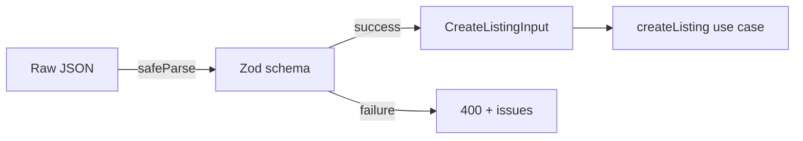

# BE-04 — Validation with Zod & typed routes

| Field | Value |
|-------|--------|
| Category | 02-backend-hono-bun |
| Status | `complete` |
| Stack | Hono · Zod · shared contracts (target: `packages/contracts`) |
| Prereqs | [BE-03](BE-03-routing-middleware.md) · [FD-03 TypeScript](../00-foundations/FD-03-typescript.md) |
| Related Docs | [`../../walkthrough/05-config-and-contracts/README.md`](../../walkthrough/05-config-and-contracts/README.md) · listing stub in `create-listing.handler.ts` |

## Learning outcomes

- Parse untrusted JSON at the **HTTP edge** with Zod before calling use cases.
- Share schemas between API and web via a contracts package (not copy-paste types).
- Separate **DTO validation** from **domain invariants**.
- Wire the current marketplace listing stub toward real parse → handler flow.

---

## 1. Dummy

The client can send anything. Zod turns unknown JSON into a **typed value** or a structured failure — before your use case runs.



**Why it exists:** TypeScript types erase at runtime; HTTP needs a runtime gate.

---

## 2. When to use / when not

| Use Zod when | Prefer something else when |
|--------------|----------------------------|
| HTTP/query/env boundaries | Pure domain already validated inward |
| Shared web ↔ API shapes | Ultra-local one-off with no client share (still Zod is fine) |
| Rejecting unknown keys intentionally | You need OpenAPI-first codegen as source of truth (heavier) |

### When not

- Replacing domain rules with “string min 1” only (titles may need richer rules later).
- Parsing deep inside SQL adapters — too late; garbage already entered the flow.

---

## 3. Working

### Target shape for create listing

Today’s stub ([`create-listing.handler.ts`](../../../clouds/market-place-server/src/modules/listing/create-listing/create-listing.handler.ts)) still returns `501`. Target:

```ts
import { z } from "zod";

export const createListingBody = z
  .object({
    titleEn: z.string().trim().min(1).max(120),
    titleFa: z.string().trim().min(1).max(120),
  })
  .strict(); // reject unknown fields intentionally

export type CreateListingBody = z.infer<typeof createListingBody>;
```

```ts
// create-listing.handler.ts — best practice sketch
export async function createListingHandler(c: Context) {
  const raw = await c.req.json();
  const parsed = createListingBody.safeParse(raw);
  if (!parsed.success) {
    return c.json(
      { code: "VALIDATION", issues: parsed.error.flatten() },
      400,
    );
  }
  const listing = await createListing(parsed.data);
  return c.json(listing, 201);
}
```

### Worst vs best

```ts
// ❌ Trust the body; hope fields exist
const body = await c.req.json();
await createListing({ titleEn: body.titleEn, titleFa: body.titleFa });

// ❌ Manual typeof sprawl
if (typeof body.titleEn !== "string" || !body.titleEn.trim()) ...

// ✅ One schema; infer type; fail closed on junk keys with .strict()
```

### Contracts package (this monorepo)

```text
packages/contracts/listings.ts   # Zod + z.infer — web + API import
clouds/.../create-listing.handler.ts  # parse only
apps/web forms                         # same schema for client UX (optional mirror)
packages/domain                        # may re-assert richer rules — not HTTP Zod
```

Until `packages/contracts` exists, keep the schema next to the slice — then **move** it (walkthrough 05).

### Domain vs DTO

| Layer | Example |
|-------|---------|
| Zod DTO | `titleEn` length 1–120, required string |
| Domain | “Marketplace listing must have both locales non-empty after normalize” — can stay a function `assertListingTitles` |

Zod can call domain helpers inside `superRefine` sparingly; don’t turn schemas into the whole domain model.

---

## 4. Rich

### Failure modes

| Failure | Fix |
|---------|-----|
| `z.object` strips unknown keys silently | Use `.strict()` for public APIs if you want 400 on extras |
| Schema drift web vs API | Single contracts package + CI typecheck both |
| Huge payloads | `z.string().max` + body size limit at reverse proxy |
| `parse` throws in handler | Prefer `safeParse` + map to 400 (or central error helper — BE-05) |

### Test seams

```ts
expect(createListingBody.safeParse({ titleEn: "", titleFa: "الف" }).success).toBe(false);
expect(createListingBody.safeParse({ titleEn: "A", titleFa: "ب", hack: 1 }).success).toBe(false);
```

---

## 5. Professional / CTO

| Decision | Guidance |
|----------|----------|
| Library | Zod as provisional standard (walkthrough 05) |
| Source of truth | Contracts package over OpenAPI-first for this teaching repo |
| Unknown keys | Document `.strict()` vs strip — pick one public policy |

**ADR triggers:** switching Valibot/ArkType · OpenAPI codegen as primary · relaxing `.strict()` globally.

**Automate:** contract package in CI; optional OpenAPI emit from Zod later.

---

## Exercises

1. **Dummy:** Mark where Zod runs vs where domain `assertTitle` would run.
2. **Working:** Write `createListingBody` and three failing fixtures (empty, too long, extra key).
3. **CTO memo:** Zod-first vs OpenAPI-first for a 5-dev marketplace — pick one failure mode of the loser.

## Related

- [BE-05 Errors](BE-05-error-model.md) · [BE-06 Auth](BE-06-auth-session-jwt.md)
- [`../../knowledge/solid/02-O.md`](../../knowledge/solid/02-O.md) (extend via schema variants carefully)
