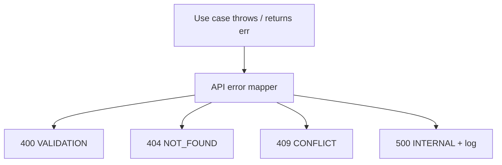

# BE-05 — Error model & HTTP mapping

| Field | Value |
|-------|--------|
| Category | 02-backend-hono-bun |
| Status | `complete` |
| Stack | Hono `onError` · domain/application errors · stable `code` |
| Prereqs | [BE-04](BE-04-zod-validation.md) · [FD-02 HTTP](../00-foundations/FD-02-http.md) · [FD-06 Debugging](../00-foundations/FD-06-debugging.md) |
| Related Docs | [`../../tech-space/backend-architecture.md`](../../tech-space/backend-architecture.md) |

## Learning outcomes

- Separate **domain/application errors** from **HTTP status mapping**.
- Return a stable JSON envelope (`code`, optional `issues`/`message`, `requestId`).
- Use one `onError` (or mapper) instead of ad-hoc try/catch per route.
- Never leak stack traces or internals to clients in production.

---

## 1. Dummy

Handlers fail for different reasons. The API edge translates meaning → **status + safe body**; logs keep the detail.



**Why it exists:** clients, gateways, and humans need predictable failures — not random strings.

---

## 2. When to use / when not

| Pattern | Use | Avoid |
|---------|-----|-------|
| Typed error classes / result codes | Cross-cutting API | Throwing bare `Error("oops")` everywhere |
| Central `app.onError` | All uncaught errors | Duplicating status tables in every handler |
| `safeParse` → 400 inline | Validation at boundary | Mapping Zod failures as 500 |
| Problem+JSON / custom envelope | Pick one public style | Mixing `{ error }` and `{ message }` and `{ code }` |

---

## 3. Working

### Error taxonomy (teaching default)

| Kind | Who throws | HTTP |
|------|------------|------|
| Validation | Edge (Zod) or domain | 400 |
| Unauthorized | Auth middleware | 401 |
| Forbidden | Authz check | 403 |
| Not found | Application/domain | 404 |
| Conflict | Domain (duplicate slug) | 409 |
| Upstream / bug | Unknown | 500 |

### Domain error (portable)

```ts
export class AppError extends Error {
  constructor(
    readonly code: string,
    message: string,
    readonly httpStatus: number = 400,
  ) {
    super(message);
  }
}

export class NotFoundError extends AppError {
  constructor(code = "NOT_FOUND") {
    super(code, "Resource not found", 404);
  }
}

export class ConflictError extends AppError {
  constructor(code = "CONFLICT") {
    super(code, "Conflict", 409);
  }
}
```

### Hono mapper

```ts
app.onError((err, c) => {
  const requestId = c.get("requestId") ?? "unknown";

  if (err instanceof AppError) {
    return c.json({ code: err.code, message: err.message, requestId }, err.httpStatus);
  }

  console.error({ requestId, err });
  return c.json({ code: "INTERNAL", requestId }, 500);
});
```

### Handler style

```ts
// ❌ Swallow and lie
try {
  await createListing(data);
} catch {
  return c.json({ ok: false }, 200);
}

// ✅ Let AppError bubble to onError; or map known cases once
const listing = await createListing(parsed.data);
return c.json(listing, 201);
```

### Worst vs best envelopes

```ts
// ❌ Unstable
{ error: "something went wrong" }
{ msg: "nope" }
{ ok: false }

// ✅ Stable contract
{ code: "VALIDATION", issues: {...}, requestId: "…" }
{ code: "NOT_FOUND", requestId: "…" }
```

---

## 4. Rich

### Failure modes

| Failure | Fix |
|---------|-----|
| Stack trace in JSON | Map unknown → 500 body without `err.stack` |
| 404 vs 403 leakage | Don’t reveal existence of other users’ resources when policy says hide |
| Zod error as 500 | Catch `ZodError` or always `safeParse` |
| Logging passwords | Redact body fields in logger middleware |

### Test seams

- Unit: mapper(AppError) → status/code.
- Integration: POST invalid listing → 400 + `VALIDATION`.
- Assert **no** `stack` key in production-shaped responses.

### Tie to debugging

Always include `requestId` (BE-03 sketch) so FD-06 repros work across web→API.

---

## 5. Professional / CTO

| Policy | Guidance |
|--------|----------|
| Public error codes | Versioned list in contracts; don’t rename casually |
| Localization | `code` stable; `message` may be localized later |
| Multi-service | Same envelope if you ever split — start now |

**ADR triggers:** adopting RFC 7807 Problem Details · exposing validation issue paths to clients · changing 401 vs 403 policy.

**Automate:** contract tests for error shapes; log redaction lint/checklist.

---

## Exercises

1. **Dummy:** Map five failure kinds to status codes for create-listing.
2. **Working:** Sketch `onError` + throw `ConflictError` from a fake `createListing`.
3. **CTO memo:** Should validation `issues` be shown to end users or only logged? Product vs security.

## Related

- [BE-04 Zod](BE-04-zod-validation.md) · [BE-06 Auth](BE-06-auth-session-jwt.md)
- [`../../knowledge/design-patterns/chain-of-responsibility.md`](../../knowledge/design-patterns/chain-of-responsibility.md) (middleware + onError pipeline)
