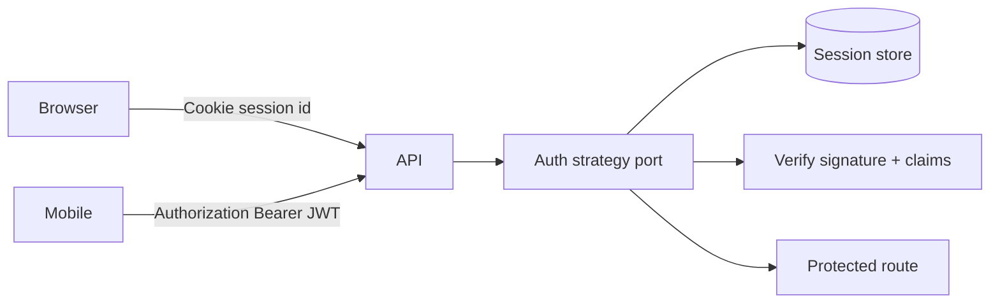

# BE-06 — Auth: session cookies vs JWT

| Field | Value |
|-------|--------|
| Category | 02-backend-hono-bun |
| Status | `complete` |
| Stack | Hono middleware · HttpOnly cookies and/or Bearer JWT · strategy port |
| Prereqs | [BE-03](BE-03-routing-middleware.md) · [BE-05](BE-05-error-model.md) |
| Related Docs | [`../../examples/auth-session/README.md`](../../examples/auth-session/README.md) · [`../../walkthrough/14-auth-session/README.md`](../../walkthrough/14-auth-session/README.md) · [`../../tech-space/security-observability.md`](../../tech-space/security-observability.md) |

## Learning outcomes

- Distinguish **authentication** (who) from **authorization** (what they’re allowed to do).
- Compare **server session + cookie** vs **JWT bearer** for web and mobile.
- Place verification in **middleware / ports**, never “React context only.”
- Know the security baseline: HttpOnly, CSRF plan, no secrets in the client bundle.

---

## 1. Dummy

Auth answers: is this request from a known principal? The API must **verify every protected request** — the UI cannot be the security boundary.



**Why it exists:** marketplace writes (create listing, orders) must fail closed when unauthenticated.

---

## 2. When to use / when not

| Approach | Good fit | Watch-outs |
|----------|----------|------------|
| **Session + HttpOnly cookie** | First-party web (Next/Vite same-site or configured CORS+CSRF) | CSRF for cookie-based mutations; mobile needs a plan |
| **JWT access token (Bearer)** | Mobile / SPA calling API cross-origin | Theft via XSS; refresh rotation; don’t put secrets in JWT that must stay server-only |
| **Both behind a port** | Web cookie + mobile bearer | Two adapters; one `AuthUser` type |

### When not

- JWT secret in `VITE_` / `NEXT_PUBLIC_` env.
- “Logged in” only as React state with no server check.
- Rolling your own crypto instead of vetted libraries.

### Phase guidance

Don’t block the **first** listing/Todo slice on full OAuth — but design the **port** early (walkthrough 14). This lesson teaches the decision; implementation follows the example track.

---

## 3. Working

### Port (composition-root friendly)

```ts
export type AuthUser = { id: string; roles: string[] };

export interface AuthVerifier {
  fromRequest(headers: Headers, cookies: Map<string, string>): Promise<AuthUser | null>;
}
```

```ts
// middleware
const requireAuth = createMiddleware(async (c, next) => {
  const user = await c.get("authVerifier").fromRequest(c.req.raw.headers, /* cookies */);
  if (!user) return c.json({ code: "UNAUTHORIZED", requestId: c.get("requestId") }, 401);
  c.set("user", user);
  await next();
});

app.use("/v1/listings/*", requireAuth); // tighten: only POST if GET is public
```

### Session cookie sketch (web)

```text
Set-Cookie: session=…; HttpOnly; Secure; SameSite=Lax; Path=/
Server stores session id → user id (memory/DB/Redis)
Logout = destroy server session + clear cookie
```

**CSRF:** for cookie sessions on mutating routes, use SameSite carefully and/or CSRF token / double-submit — document the plan in security notes.

### JWT bearer sketch (mobile / SPA)

```text
Authorization: Bearer <access_token>
API verifies signature (secret/JWKS), exp, aud
Short-lived access + refresh rotation preferred
```

### Worst vs best

```ts
// ❌ Security in the client only
if (!localStorage.token) navigate("/login");
// server still accepts POST /v1/listings from anyone

// ✅ Server middleware rejects; client UX is convenience only
```

```ts
// ❌ JWT in localStorage + long-lived + sensitive PII claims
// ✅ Prefer HttpOnly session for web; careful token storage on mobile; minimal claims
```

---

## 4. Rich

### Failure modes

| Failure | Mitigation |
|---------|------------|
| XSS steals Bearer token | CSP, sanitize, prefer HttpOnly cookies for web |
| CSRF on cookie session | SameSite + CSRF strategy for state-changing requests |
| Confused deputy | Bind session to user agent carefully; rotate on login |
| AuthZ bug (IDOR) | Check resource ownership in use case — authn ≠ authz |
| Logging tokens | Redact `Authorization` and cookie headers |

### Authn vs authz

| Check | Example |
|-------|---------|
| Authn | `401` — no valid session/token |
| Authz | `403` — valid user, not seller of this listing |

### Test seams

- Unauthenticated POST → 401.
- Authenticated but wrong owner → 403.
- Strategy swap in tests: fake `AuthVerifier` returning a fixed user (DIP).

---

## 5. Professional / CTO

| Stage | Recommendation for this blueprint |
|-------|-----------------------------------|
| Teaching MVP | Session cookie for web API demos; document mobile path |
| Multi-client | `AuthVerifier` port + cookie adapter + bearer adapter |
| Scale / SSO | Consider external IdP later — don’t start there |

**ADR triggers:** choosing cookie vs JWT as primary · introducing refresh tokens · OAuth provider · sharing auth with Next Auth.js only on web (risk of dual sources of truth).

**Automate:** security checklist on PR; tests for 401 on protected writes; secret scanning.

---

## Exercises

1. **Dummy:** Draw web cookie path vs mobile bearer path into the same `requireAuth`.
2. **Working:** List which listing routes should be public vs protected for a marketplace MVP.
3. **CTO memo:** Pick session-first or JWT-first for year 1 with both web and Capacitor — name one cost you accept.

## Related

- [BE-05 Errors](BE-05-error-model.md) · next [BE-07](README.md) composition root (inject verifier)
- [`../../knowledge/design-patterns/strategy.md`](../../knowledge/design-patterns/strategy.md) · [`../../knowledge/solid/05-D.md`](../../knowledge/solid/05-D.md)
- Course security: [`../07-security/README.md`](../07-security/README.md)
