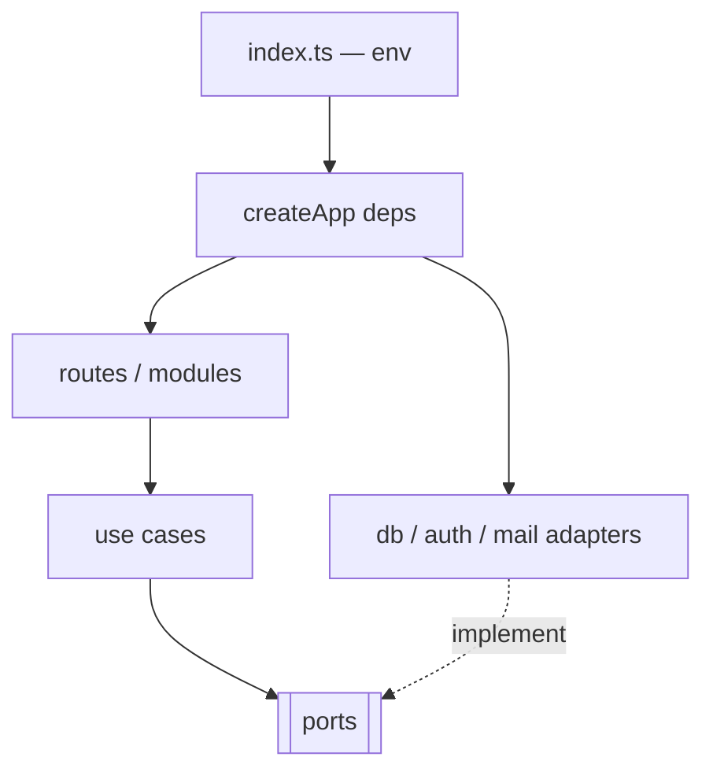

# BE-07 — Composition root & DI

| Field | Value |
|-------|--------|
| Category | 02-backend-hono-bun |
| Status | `complete` |
| Stack | Hono `createApp(deps)` · manual DI · ports |
| Prereqs | [BE-02](BE-02-hono-hello.md) · [BE-06](BE-06-auth-session-jwt.md) · [FD-03](../00-foundations/FD-03-typescript.md) |
| Related Docs | [`../../knowledge/design-patterns/dependency-injection.md`](../../knowledge/design-patterns/dependency-injection.md) · [`../../knowledge/solid/05-D.md`](../../knowledge/solid/05-D.md) · [`../../clouds/market-place-server/01-folder-structure.md`](../../clouds/market-place-server/01-folder-structure.md) |

## Learning outcomes

- Name the **composition root** (`index.ts` + `createApp`) as the only place that builds concrete adapters.
- Grow `CreateAppDeps` as the API gains db, auth, clock, logger.
- Distinguish **DI** (how you pass deps) from **DIP** (depend on ports you own).
- Test the app with fakes without standing up Postgres or Stripe.

---

## 1. Dummy

Wire the real world **once at the edge**. Handlers and use cases receive what they need — they do not `new Postgres()` themselves.



**Why it exists:** tests and production share the same holes; only the plugged objects change.

---

## 2. When to use / when not

| Use manual `createApp(deps)` when | Reach for a DI container when |
|-----------------------------------|-------------------------------|
| Teaching / small–mid API | Huge graph with many lifetimes (still optional) |
| Clear module mounts | Team already standardized on one container |
| You want readable wiring | — |

### When not

- Service locator (`container.get`) inside domain.
- Passing 30 deps through every function — compose facades/modules instead.
- Nest-style magic for a three-route teaching API.

---

## 3. Working

### Today in this repo

```ts
// create-app.ts — already a mini composition root
export type CreateAppDeps = {
  corsOrigin: string;
  // db?: Db;
  // authVerifier?: AuthVerifier;
  // clock?: () => Date;
  // logger?: Logger;
};

export function createApp(deps: CreateAppDeps) {
  const app = new Hono();
  app.use("*", cors({ origin: [deps.corsOrigin] }));
  app.get("/health", ...);
  app.route("/v1/listings", createListingModule(/* deps later */));
  return app;
}
```

```ts
// index.ts — only runtime + env
const app = createApp({
  corsOrigin: process.env.CORS_ORIGIN ?? "http://localhost:5173",
});
```

### Grown shape (target)

```ts
export type CreateAppDeps = {
  corsOrigin: string;
  listings: ListingRepository;      // port
  authVerifier: AuthVerifier;       // port
  clock: () => Date;
  logger: Logger;
};

export function createApp(deps: CreateAppDeps) {
  const app = new Hono();
  app.use("*", requestId);
  app.use("*", cors({ origin: [deps.corsOrigin] }));
  app.use("*", async (c, next) => {
    c.set("deps", deps);
    await next();
  });
  app.route("/v1/listings", createListingModule());
  app.onError(errorMapper);
  return app;
}
```

```ts
// production wiring (index or main)
const db = createPostgres(process.env.DATABASE_URL!);
const app = createApp({
  corsOrigin: env.CORS_ORIGIN,
  listings: createPostgresListingRepository(db),
  authVerifier: createCookieSessionVerifier(db),
  clock: () => new Date(),
  logger: pino(),
});
```

### Worst vs best

```ts
// ❌ Handler reaches for globals
import { db } from "../../db";
await db.insert(listings).values(...);

// ✅ Handler uses injected port
const { listings, clock } = c.get("deps");
await createListing(parsed.data, { listings, clock });
```

### Test without Bun listen

```ts
const app = createApp({
  corsOrigin: "http://test",
  listings: new InMemoryListings(),
  authVerifier: { async fromRequest() { return { id: "u1", roles: ["seller"] }; } },
  clock: () => new Date("2026-01-01T00:00:00Z"),
  logger: silentLogger,
});
const res = await app.request("http://x/v1/listings", { method: "POST", body: ... });
```

---

## 4. Rich

### Failure modes

| Failure | Fix |
|---------|-----|
| `create-app.ts` imports Stripe SDK | Keep SDK in adapter file; pass port |
| Deps type becomes a god object | Group by module (`listingDeps`) or split apps |
| Tests still need Docker | You injected a concrete Postgres by habit |
| Hidden `process.env` in use cases | Parse env only in index/config package |

### DIP vs DI reminder

| Term | Meaning |
|------|---------|
| DIP | Use case depends on `ListingRepository` interface |
| DI | `createApp` passes the Postgres implementation into that hole |

---

## 5. Professional / CTO

| Stance | This blueprint |
|--------|----------------|
| Default | Manual composition root — readable, interview-clear |
| Container | Only if wiring pain is proven |
| Boundary | No framework DI in `packages/domain` |

**ADR triggers:** adopting Nest/tsyringe · multiple processes sharing a container · request-scoped deps (AsyncLocalStorage).

**Automate:** lint ban on `packages/domain` importing `pg`/`stripe`/`hono`.

---

## Exercises

1. **Dummy:** List five things that should appear on `CreateAppDeps` for a real marketplace API.
2. **Working:** Sketch how `createListingModule` would receive `listings` without importing Postgres.
3. **CTO memo:** Manual DI vs Nest for a 6-engineer team — pick one and name the failure mode of the other.

## Related

- [BE-08 Workers](BE-08-workers-queues.md) · [BE-09 Versioning](BE-09-api-versioning.md)
- [`../../../clouds/market-place-server/src/create-app.ts`](../../../clouds/market-place-server/src/create-app.ts)
