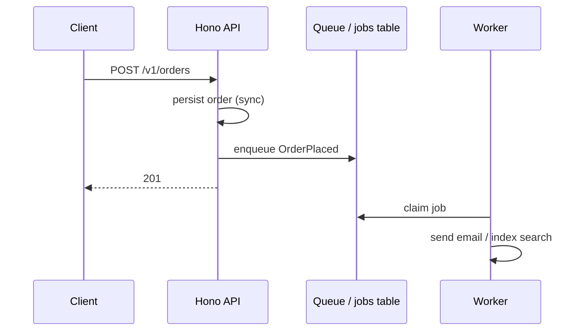

# BE-08 — Background work: queues / cron

| Field | Value |
|-------|--------|
| Category | 02-backend-hono-bun |
| Status | `complete` |
| Stack | Hono API + worker process · queue (conceptual) · cron |
| Prereqs | [BE-07](BE-07-composition-root-di.md) · [SA-02 NFRs](../01-system-architecture/SA-02-nfrs.md) |
| Related Docs | [`../../knowledge/architecture-styles/event-driven.md`](../../knowledge/architecture-styles/event-driven.md) · react-next-hono async notes |

## Learning outcomes

- Know what belongs **in the request** vs **after the response** (email, search index, webhooks retry).
- Sketch a **worker** that reuses module public APIs / use cases — not route files.
- Compare in-process `waitUntil`, DB-backed jobs, and external queues.
- Name failure modes: dual-write, at-least-once delivery, poison messages.

---

## 1. Dummy

HTTP should acknowledge the user fast. Slow or flaky side effects go to a **queue / worker / cron** so checkout isn’t blocked on SMTP.



**Why it exists:** protect latency and isolate retries from the user-facing request.

---

## 2. When to use / when not

| Put in request path when | Move async when |
|--------------------------|-----------------|
| User needs the result to continue | Email, PDF, search reindex, webhook fan-out |
| Tiny work (&lt; tens of ms) | Anything that talks to flaky third parties |
| Strong consistency required in same TX | Best-effort notifications |

### When not

- Premature Kafka for 5 emails/day.
- Fire-and-forget `void sendEmail()` with no retry/visibility.
- Worker importing `createListingRoute` (HTTP types in background).

---

## 3. Working

### Pattern A — outbox / jobs table (good teaching default)

```text
1. API transaction: insert order + insert job row (same DB)
2. Worker polls FOR UPDATE SKIP LOCKED / listens
3. Worker runs use case SendOrderEmail
4. Mark job done or retry with backoff
```

Keeps dual-write risk lower than “write DB then push Redis without a TX.”

### Pattern B — external queue (Redis/SQS/BullMQ)

```text
API enqueues message after commit (or via outbox relay)
Worker concurrency / retries configured in queue product
```

Use when volume or multi-instance workers need it.

### Worker composition root

```ts
// clouds/market-place-worker/src/index.ts (future)
const deps = {
  listings: createPostgresListingRepository(db),
  mail: createSmtpMailer(env),
  clock: () => new Date(),
};
await runWorker({
  handlers: {
    "listing.published": (job) => indexListing(job.payload, deps),
  },
});
```

Same ports as the API — **DIP/DI again**.

### Cron

```text
Schedule: nightly expire drafts
Entrypoint: bun run src/cron/expire-drafts.ts
Calls: application use case, not raw SQL in crontab curl hacks only
```

### Worst vs best

```ts
// ❌ Block the HTTP response on SMTP
await smtp.send(...);
return c.json(order, 201);

// ❌ Orphan fire-and-forget
void smtp.send(...); // failures invisible
return c.json(order, 201);

// ✅ Persist + enqueue; worker retries
await placeOrder(...);
await jobs.enqueue("order.placed", { orderId });
return c.json(order, 201);
```

---

## 4. Rich

### Failure modes

| Failure | Design |
|---------|--------|
| At-least-once delivery | Handlers **idempotent** (same job twice = safe) |
| Poison message | Max retries → dead-letter + alert |
| Dual write (DB ok, queue fail) | Transactional outbox |
| Worker downtime | Queue backlog; API still accepts writes |
| Shared mutable state with API | Prefer separate process; share DB carefully |

### Observability

Log `jobId`, `type`, `attempt`, `requestId`/`correlationId` from the originating HTTP call.

### Monorepo placement

```text
clouds/market-place-server/   # HTTP
clouds/market-place-worker/   # optional later — same packages/*
packages/application/         # use cases both call
```

Don’t invent the worker package until you have a real job — but know the seam.

---

## 5. Professional / CTO

| Stage | Guidance |
|-------|----------|
| MVP | Sync OK for rare admin emails; document debt |
| Early production | Jobs table or managed queue; idempotent handlers |
| Scale | Dedicated workers, DLQ, SLOs on lag |

**ADR triggers:** introducing Redis/Bull · separating worker deploy · choosing outbox vs after-commit enqueue.

**Automate:** lag metrics; failed job alerts; load test that HTTP p95 stays flat when mail provider is slow.

---

## Exercises

1. **Dummy:** List three marketplace actions that should be async after create-listing.
2. **Working:** Sketch an outbox row shape `{ id, type, payload, status, attempts }`.
3. **CTO memo:** Jobs table vs BullMQ at 50 orders/day — which and why?

## Related

- [BE-07 Composition root](BE-07-composition-root-di.md) · [BE-11](README.md) idempotency (planned)
- [`../../knowledge/architecture-styles/event-driven.md`](../../knowledge/architecture-styles/event-driven.md)
