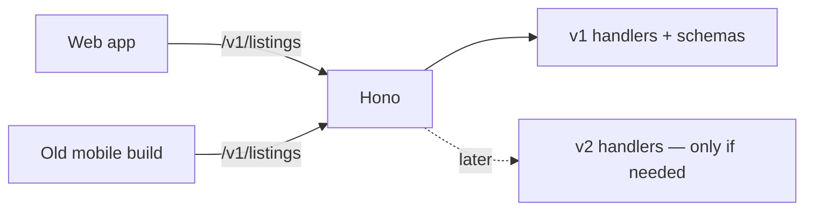

# BE-09 — API versioning & compatibility

| Field | Value |
|-------|--------|
| Category | 02-backend-hono-bun |
| Status | `complete` |
| Stack | Hono `/v1` mounts · contracts package · additive change rules |
| Prereqs | [BE-03](BE-03-routing-middleware.md) · [BE-04](BE-04-zod-validation.md) |
| Related Docs | [`../../knowledge/architecture-styles/api-gateway.md`](../../knowledge/architecture-styles/api-gateway.md) · packages/contracts idea |

## Learning outcomes

- Explain why this repo mounts `/v1/listings` instead of unversioned paths.
- Prefer **additive** changes; know when a new version is required.
- Version **contracts** together with routes (web/mobile don’t silently break).
- Plan deprecation without surprise breakages.

---

## 1. Dummy

Clients remember shapes. Versioning is a **compatibility promise**: old callers keep working while you evolve.



**Why it exists:** mobile stores and cached SPAs don’t update on your deploy day.

---

## 2. When to use / when not

| Strategy | Use when | Avoid when |
|----------|----------|------------|
| URL prefix `/v1` | Public/multipart clients (this blueprint) | Internal-only prototype you’ll throw away |
| Header versioning | Want stable URLs | Extra client complexity for teaching |
| No version + “just break” | True throwaway spike | Anything with external consumers |

### When a new major version is justified

- Removing/renaming a required field.
- Changing meaning of a field (price dollars → cents) without a new name.
- Changing auth scheme incompatibly.

### Prefer additive instead

- Add optional fields.
- Add new endpoints.
- Widen enums carefully with defaults.

---

## 3. Working

### This repo today

```ts
app.route("/v1/listings", createListingModule());
```

Child routes stay relative (`POST /` → `POST /v1/listings`).

### Evolving create listing safely

```ts
// v1 schema — keep working
z.object({
  titleEn: z.string().min(1),
  titleFa: z.string().min(1),
});

// additive: optional description — old clients omit it
z.object({
  titleEn: z.string().min(1),
  titleFa: z.string().min(1),
  descriptionEn: z.string().max(2000).optional(),
});
```

### Breaking change → v2 mount (only if needed)

```ts
app.route("/v1/listings", createListingModuleV1());
app.route("/v2/listings", createListingModuleV2());
```

Share domain use cases; **different** Zod DTOs and mappers.

### Worst vs best

```ts
// ❌ Rename titleEn → title_en in place; mobile crashes
// ❌ Reuse field price as cents without version or new field name

// ✅ Add priceCents; deprecate price with docs + sunset date
// ✅ Or ship /v2 with migration notes
```

### Contracts package

```text
packages/contracts/listings-v1.ts
apps/web + clouds/server both import v1
When v2 exists: listings-v2.ts — don’t silently change v1 exports
```

---

## 4. Rich

### Compatibility checklist

| Change | Safe? |
|--------|-------|
| Add optional response field | Usually yes |
| Make required field optional | Usually yes for readers; writers need care |
| Remove field | No — version or long deprecation |
| Change status code meaning | No without docs + version |
| Tighten validation (max length ↓) | Risky for existing clients |

### Failure modes

| Failure | Fix |
|---------|-----|
| Two versions forever | Sunset policy + metrics on `/v1` traffic |
| Gateway strips `/v1` inconsistently | Document edge rewrite rules |
| Only TypeScript updated, runtime Zod not | Same contracts package in CI |

### Deprecation playbook

1. Announce in changelog + response header `Deprecation` / `Sunset` (optional).  
2. Dual-run if needed.  
3. Metrics: % traffic still on old version.  
4. Remove after date — with ADR.

---

## 5. Professional / CTO

| Stance | Guidance |
|--------|----------|
| Default | `/v1` from day one for marketplace API |
| Cost | Supporting two majors is real eng cost — avoid vanity versions |
| Mobile | Assume store review lag — compatibility matters more than web |

**ADR triggers:** introducing `/v2` · changing versioning strategy (URL vs header) · breaking public error `code` strings.

**Automate:** contract tests pinned to v1 fixtures; CI fails if v1 schema removes fields without version bump process.

---

## Exercises

1. **Dummy:** Why is `/v1/listings` already better than `/listings` for Capacitor later?
2. **Working:** Propose an additive change to create-listing JSON and a breaking change that would require `/v2`.
3. **CTO memo:** How long do you support `/v1` after `/v2` ships for a marketplace with iOS + Android?

## Related

- [BE-03 Routing](BE-03-routing-middleware.md) · [BE-04 Zod](BE-04-zod-validation.md) · [BE-07 DI](BE-07-composition-root-di.md)
- [`../../knowledge/architecture-styles/bff.md`](../../knowledge/architecture-styles/bff.md)
