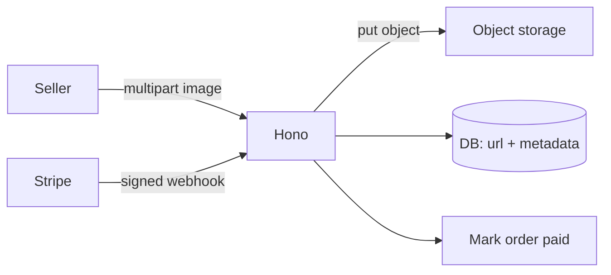

# BE-10 — File uploads, streams & webhooks

| Field | Value |
|-------|--------|
| Category | 02-backend-hono-bun |
| Status | `complete` |
| Stack | Hono · multipart / streams · signed webhooks (Stripe-style) |
| Prereqs | [BE-04](BE-04-zod-validation.md) · [BE-05](BE-05-error-model.md) · [BE-08](BE-08-workers-queues.md) |
| Related Docs | Marketplace payments notes · security observability |

## Learning outcomes

- Upload listing images without loading entire files into memory carelessly.
- Prefer **object storage + signed URLs** over stuffing blobs in Postgres.
- Verify **webhooks** with signatures and idempotent handling.
- Keep raw body available for signature checks (don’t parse JSON first).

---

## 1. Dummy

Two special HTTP shapes: **big binary in** (uploads) and **provider callbacks** (webhooks). Both need careful edges — size limits, trust, and retries.



**Why it exists:** marketplaces deal with media and payment events; naive `req.json()` breaks both.

---

## 2. When to use / when not

| Pattern | Use | Avoid |
|---------|-----|-------|
| Direct upload to API | Small files, simple MVP | Multi‑MB images on the API process |
| Presigned URL to storage | Production media | Skipping auth on the “get upload URL” route |
| Webhooks | Provider truth (paid/failed) | Trusting client “I paid” alone |
| Sync process in webhook | Tiny ack + enqueue | Heavy work before returning 200 |

---

## 3. Working

### Uploads — teaching progression

```ts
// MVP: multipart with size guard (sketch)
app.post("/v1/listings/:id/images", async (c) => {
  const body = await c.req.parseBody({ all: true });
  const file = body["file"];
  if (!(file instanceof File)) return c.json({ code: "VALIDATION" }, 400);
  if (file.size > 5_000_000) return c.json({ code: "PAYLOAD_TOO_LARGE" }, 413);
  // store via storage port — not Buffer in domain
  const url = await c.get("deps").storage.putListingImage(c.req.param("id"), file);
  return c.json({ url }, 201);
});
```

```ts
// Better: API issues presigned PUT; browser uploads to storage
POST /v1/listings/:id/images/upload-url → { uploadUrl, publicUrl }
// client PUT bytes to uploadUrl
// client confirms POST /v1/listings/:id/images { publicUrl, contentType }
```

### Webhooks — signature first

```ts
app.post("/v1/webhooks/stripe", async (c) => {
  const raw = await c.req.text(); // raw body for HMAC
  const sig = c.req.header("stripe-signature");
  const event = c.get("deps").payments.verifyWebhook(raw, sig); // throws if invalid

  await c.get("deps").jobs.enqueue("stripe.event", {
    id: event.id, // idempotency key
    type: event.type,
    payload: event.data,
  });
  return c.json({ received: true }, 200);
});
```

### Worst vs best

```ts
// ❌ JSON.parse then verify signature — body already mutated/lost
// ❌ Store images as BYTEA in primary DB forever
// ❌ Return 500 and make Stripe retry forever on poison payload without DLQ

// ✅ Verify on raw body → enqueue → 200 quickly
// ✅ Object storage + DB metadata
```

---

## 4. Rich

### Failure modes

| Failure | Mitigation |
|---------|------------|
| Memory blowup | Stream / size caps / presigned uploads |
| Webhook replay | Idempotent by provider event id ([BE-11](BE-11-rate-limits-idempotency.md)) |
| Forged webhook | Signature + secret rotation |
| Orphan files | Lifecycle rules; confirm step before publish |

### Test seams

- Fixture raw webhook payloads + valid/invalid signatures.
- Upload URL route returns 401 when unauthenticated.

---

## 5. Professional / CTO

| Decision | Guidance |
|----------|----------|
| Media | Object storage early if images matter |
| Payments | Webhooks = source of settlement truth |
| PII in uploads | Scan/retention policy |

**ADR triggers:** choosing S3/R2/MinIO · max upload size · synchronous virus scan vs async.

**Automate:** webhook signature tests in CI; storage bucket private by default.

---

## Exercises

1. **Dummy:** Draw seller upload vs Stripe webhook into the API.
2. **Working:** Write the three steps of a presigned upload flow.
3. **CTO memo:** Postgres BYTEA vs object storage at 10k listings with 5 images each.

## Related

- [BE-08 Workers](BE-08-workers-queues.md) · [BE-11 Idempotency](BE-11-rate-limits-idempotency.md)
