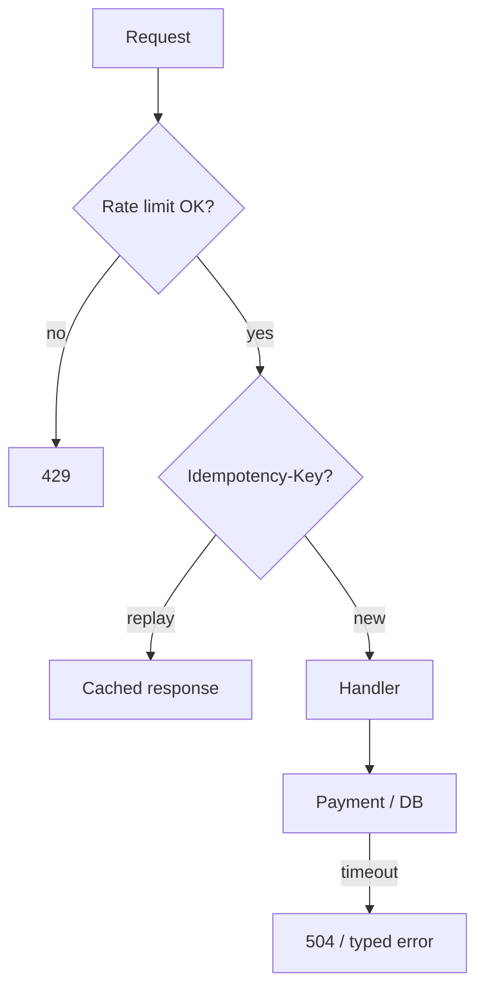

# BE-11 — Rate limits, idempotency & timeouts

| Field | Value |
|-------|--------|
| Category | 02-backend-hono-bun |
| Status | `complete` |
| Stack | Hono middleware · Idempotency-Key · AbortSignal / upstream timeouts |
| Prereqs | [BE-03](BE-03-routing-middleware.md) · [BE-05](BE-05-error-model.md) · [FD-02](../00-foundations/FD-02-http.md) |
| Related Docs | FD-02 headers · BE-08 at-least-once jobs |

## Learning outcomes

- Protect the API with **rate limits** (per IP / user / route class).
- Make unsafe retries safe with **Idempotency-Key** on payments and creates.
- Set **timeouts** on outbound calls so one slow Stripe can’t stall everything.
- Map limit/timeout failures to clear HTTP statuses (`429`, `504`).

---

## 1. Dummy

Clients retry. Attackers scrape. Dependencies hang. These three controls keep the system **bounded**.



**Why it exists:** correctness under retry + fairness under load.

---

## 2. When to use / when not

| Control | Use on | Skip / light touch |
|---------|--------|-------------------|
| Rate limit | Public auth, search, create | Internal health checks |
| Idempotency-Key | POST pay, create order | Pure GET |
| Timeouts | All outbound HTTP/DB | Only if you enjoy wedged workers |

---

## 3. Working

### Rate limit (sketch)

```ts
// per-user or per-IP token bucket — store in memory (single instance) or Redis
app.use("/v1/*", async (c, next) => {
  const key = c.get("user")?.id ?? c.req.header("x-forwarded-for") ?? "anon";
  if (!(await c.get("deps").rateLimiter.allow(key))) {
    return c.json({ code: "RATE_LIMITED", requestId: c.get("requestId") }, 429);
  }
  await next();
});
```

### Idempotency-Key

```ts
app.post("/v1/orders", async (c) => {
  const key = c.req.header("idempotency-key");
  if (!key) return c.json({ code: "IDEMPOTENCY_KEY_REQUIRED" }, 400);

  const cached = await c.get("deps").idempotency.get(key);
  if (cached) return c.json(cached.body, cached.status);

  const order = await placeOrder(...);
  const body = { id: order.id };
  await c.get("deps").idempotency.put(key, { status: 201, body });
  return c.json(body, 201);
});
```

Rules: same key + same request fingerprint → same result; same key + different body → `409`.

### Timeouts

```ts
const ctrl = new AbortController();
const t = setTimeout(() => ctrl.abort(), 3_000);
try {
  await payments.charge({ ..., signal: ctrl.signal });
} catch (e) {
  if (e.name === "AbortError") throw new AppError("UPSTREAM_TIMEOUT", "Payment timed out", 504);
  throw e;
} finally {
  clearTimeout(t);
}
```

### Worst vs best

```ts
// ❌ Infinite fetch to Stripe with default timeout
// ❌ POST /orders without idempotency; double-charge on retry
// ✅ Key required on money paths; bounded outbound time; 429 with Retry-After when possible
```

---

## 4. Rich

### Failure modes

| Failure | Fix |
|---------|-----|
| In-memory limiter with 5 API replicas | Shared store (Redis) or edge limiter |
| Idempotency store never expires | TTL + storage budget |
| Timeout too aggressive | Measure p99; separate connect vs total timeout |
| 429 without guidance | Optional `Retry-After` header |

### Tie to webhooks

Provider retries are at-least-once — treat event id as idempotency key ([BE-10](BE-10-uploads-webhooks.md)).

---

## 5. Professional / CTO

| Policy | Guidance |
|--------|----------|
| Money routes | Idempotency **required** |
| Public scrape surfaces | Rate limit + caching |
| SLOs | Track 429 rate and upstream timeout rate separately |

**ADR triggers:** Redis for limits/idempotency · global vs route-specific budgets · charging for higher limits.

**Automate:** integration test double-POST with same key; chaos: kill payment mid-flight and retry.

---

## Exercises

1. **Dummy:** Which listing routes need rate limits vs idempotency?
2. **Working:** Specify idempotency record fields `{ key, hash, status, body, createdAt }`.
3. **CTO memo:** In-memory vs Redis rate limits at 3 API instances — pick one.

## Related

- [BE-08 Workers](BE-08-workers-queues.md) · [BE-10 Webhooks](BE-10-uploads-webhooks.md) · [BE-05 Errors](BE-05-error-model.md)
