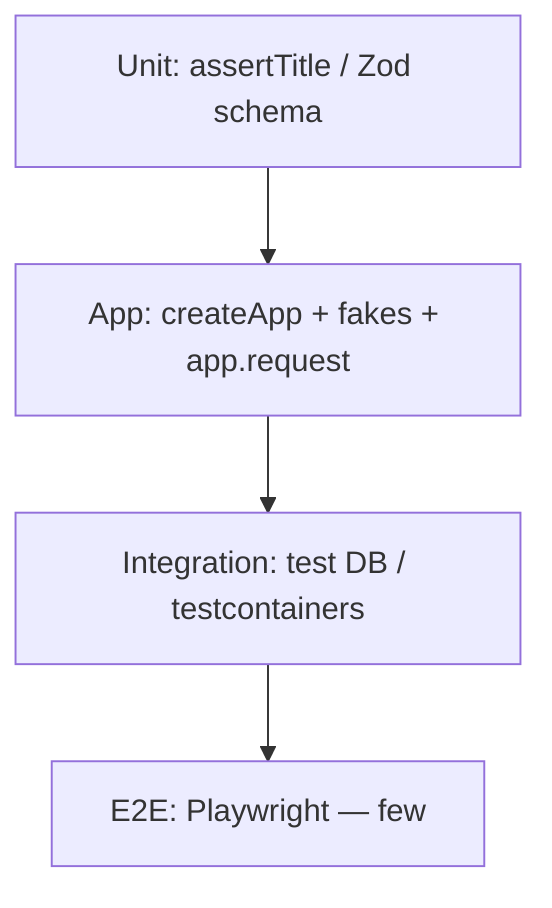

# BE-12 — Testing Hono (unit + integration)

| Field | Value |
|-------|--------|
| Category | 02-backend-hono-bun |
| Status | `complete` |
| Stack | Vitest · `app.request` · fakes via `createApp(deps)` |
| Prereqs | [BE-07](BE-07-composition-root-di.md) · [BE-04](BE-04-zod-validation.md) · [BE-05](BE-05-error-model.md) |
| Related Docs | [`../../knowledge/architecture-styles/architecture-rules.md`](../../knowledge/architecture-styles/architecture-rules.md) testing · course `09-quality-testing` |

## Learning outcomes

- Test Hono **without listening** on a port (`app.request`).
- Layer tests: domain unit → handler/use case with fakes → HTTP integration.
- Use composition root to inject in-memory repos and auth.
- Avoid e2e-only confidence for API rules.

---

## 1. Dummy

If you can only test by clicking Postman, you don’t have a regression net. Hono apps are functions — call them in Vitest.



**Why it exists:** fast feedback on validation, authz, and status mapping.

---

## 2. When to use / when not

| Layer | Use for | Don’t use for |
|-------|---------|---------------|
| Unit | Domain + Zod | Full HTTP CORS matrix |
| `app.request` | Status codes, headers, JSON envelope | Real Postgres durability |
| DB integration | Repository adapters | Every UI click |
| E2E | One happy marketplace journey | Replacing unit tests |

---

## 3. Working

### Health (smoke)

```ts
import { describe, expect, it } from "vitest";
import { createApp } from "../src/create-app";

describe("GET /health", () => {
  it("returns ok", async () => {
    const app = createApp({ corsOrigin: "http://test" });
    const res = await app.request("http://localhost/health");
    expect(res.status).toBe(200);
    expect(await res.json()).toMatchObject({ ok: true });
  });
});
```

### Validation + auth with fakes (target shape)

```ts
const app = createApp({
  corsOrigin: "http://test",
  listings: new InMemoryListings(),
  authVerifier: {
    async fromRequest() {
      return { id: "seller-1", roles: ["seller"] };
    },
  },
  clock: () => new Date("2026-01-01"),
  logger: silent,
});

it("rejects empty titles", async () => {
  const res = await app.request("http://localhost/v1/listings", {
    method: "POST",
    headers: { "content-type": "application/json" },
    body: JSON.stringify({ titleEn: "", titleFa: "الف" }),
  });
  expect(res.status).toBe(400);
  expect((await res.json()).code).toBe("VALIDATION");
});
```

### Worst vs best

```ts
// ❌ Only manual curl before release
// ❌ Mocking Hono internals instead of deps
// ✅ Fake ports + real router; few tests against real Postgres adapter
```

---

## 4. Rich

### Failure modes

| Failure | Fix |
|---------|-----|
| Tests hit real Stripe | Payment port fake |
| Order-dependent suite | Isolate in-memory stores per test |
| Flaky timing | Inject `clock` |
| Snapshot of full HTML errors | Assert `code` + status only |

### Suggested cases for listing module

| Case | Expect |
|------|--------|
| Valid create | 201 |
| Invalid body | 400 VALIDATION |
| Unauthenticated POST | 401 |
| Duplicate conflict | 409 |
| Health | 200 |

---

## 5. Professional / CTO

| Policy | Guidance |
|--------|----------|
| PR gate | Unit + `app.request` on changed modules |
| Coverage vanity | Prefer critical path tests over % theater |
| Contract | Share Zod fixtures with web later |

**ADR triggers:** adopting Pact · mandating testcontainers for all PRs.

**Automate:** `pnpm --filter @marketplace/market-place-server test` in CI (when script exists).

---

## Exercises

1. **Dummy:** Place four test ideas on the pyramid for create-listing.
2. **Working:** Write the `/health` Vitest above against current `createApp`.
3. **CTO memo:** How many Playwright tests vs `app.request` tests for the API in year 1?

## Related

- [BE-07 DI](BE-07-composition-root-di.md) · [`../09-quality-testing/README.md`](../09-quality-testing/README.md)
