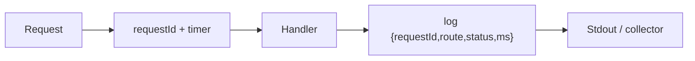

# BE-13 — Observability hooks at the edge

| Field | Value |
|-------|--------|
| Category | 02-backend-hono-bun |
| Status | `complete` |
| Stack | Hono middleware · structured logs (pino) · requestId · metrics/traces hooks |
| Prereqs | [BE-03](BE-03-routing-middleware.md) · [BE-05](BE-05-error-model.md) · [FD-06](../00-foundations/FD-06-debugging.md) |
| Related Docs | [`../../tech-space/security-observability.md`](../../tech-space/security-observability.md) · [`../08-observability/README.md`](../08-observability/README.md) |

## Learning outcomes

- Propagate **`requestId`** (and optionally trace context) across logs.
- Log **structured** fields: route, status, duration — not string soup.
- Redact secrets from logs.
- Know where metrics/traces attach without coupling domain to Datadog.

---

## 1. Dummy

If production breaks and logs can’t join web→API→DB, you’re debugging blind. The HTTP edge is where correlation starts.



**Why it exists:** MTTR depends on correlatable telemetry.

---

## 2. When to use / when not

| Do | Don’t |
|----|-------|
| Log every request summary at info/debug appropriately | Log full bodies with passwords/tokens |
| Always return `requestId` on errors | Invent a new id format per module |
| Measure latency histograms for hot routes | Only average latency in a spreadsheet |

---

## 3. Working

### Middleware sketch

```ts
app.use("*", async (c, next) => {
  const requestId = c.req.header("x-request-id") ?? crypto.randomUUID();
  c.set("requestId", requestId);
  c.header("x-request-id", requestId);
  const start = performance.now();
  await next();
  const ms = Math.round(performance.now() - start);
  c.get("deps").logger.info({
    requestId,
    method: c.req.method,
    path: c.req.path,
    status: c.res.status,
    ms,
  });
});
```

### Error path

Include the same `requestId` in JSON ([BE-05](BE-05-error-model.md)).

### Traces (concept)

```text
Incoming traceparent → run handler as span → outbound Stripe span child
Keep instrumentation in middleware/adapters — not domain entities
```

### Worst vs best

```ts
// ❌ console.log("error " + JSON.stringify(req))
// ❌ No id; “user said it failed around noon”
// ✅ Structured JSON + requestId + duration + route
```

---

## 4. Rich

### Failure modes

| Failure | Fix |
|---------|-----|
| Log volume $$$ | Sample successful GETs; always keep 5xx |
| PII leakage | Redaction list; never log `Authorization` |
| Clocks skew | Prefer monotonic `performance.now` for duration |
| Multi-instance | Ship to collector; don’t SSH one box |

### Health vs ready

| Endpoint | Meaning |
|----------|---------|
| `/health` | Process up |
| `/health/ready` | DB/pool reachable (when you add deps) |

---

## 5. Professional / CTO

| Policy | Guidance |
|--------|----------|
| Stdout JSON | Container-friendly default |
| SLOs | p95 latency + error rate on `/v1/listings` |
| On-call | Dashboards before exotic APM shopping |

**ADR triggers:** vendor APM · OpenTelemetry mandate · log retention.

**Automate:** CI check that `onError` responses include `requestId` (contract test).

---

## Exercises

1. **Dummy:** List five fields every request log should have.
2. **Working:** Add requestId middleware sketch to notes for `create-app`.
3. **CTO memo:** Log all 2xx at info vs sample — cost vs debuggability.

## Related

- [BE-12 Testing](BE-12-testing-hono.md) · [`../08-observability/README.md`](../08-observability/README.md)
