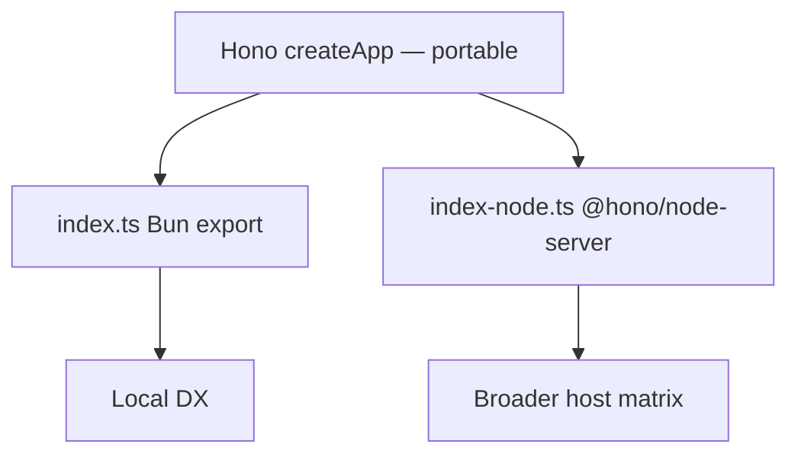

# BE-14 — CTO: Bun adoption risks & lock-in

| Field | Value |
|-------|--------|
| Category | 02-backend-hono-bun |
| Status | `complete` |
| Stack | Bun local (this repo) · Node-portable Hono app · hosting choices |
| Prereqs | [BE-01](BE-01-bun-runtime.md) · [BE-07](BE-07-composition-root-di.md) · [SA-02](../01-system-architecture/SA-02-nfrs.md) |
| Related Docs | [`../../walkthrough/hono-server-setup/README.md`](../../walkthrough/hono-server-setup/README.md) |

## Learning outcomes

- Separate **DX choice** (Bun for `dev`) from **production runtime** commitment.
- List concrete lock-in risks (APIs, CI images, hiring, host support).
- Write an ADR-ready recommendation for this marketplace blueprint.
- Keep `createApp` portable so runtime swaps stay an entryfile change.

---

## 1. Dummy

Bun is a bet on speed of development. Production is a bet on **ops reality**. Good architecture lets those bets differ.



**Why it exists:** CTOs fund risk, not Twitter benchmarks alone.

---

## 2. When to use / when not

| Bun in production when | Prefer Node production when |
|------------------------|-----------------------------|
| Host officially supports Bun | Contributors/hosts are Node-first |
| Team small; you control images | Need obscure native addons |
| You’ve load-tested *your* app | Compliance vendor only certifies Node |

### When not

- Spreading `Bun.*` APIs through domain/application.
- Mandating Bun for the whole monorepo (Next, tooling) without checking each package.

---

## 3. Working — decision record sketch

### Current facts (this repo)

- `clouds/market-place-server` scripts use `bun run`.
- App logic lives in Hono `createApp` — good portability signal.
- Walkthrough already allows Bun **or** Node.

### Recommendation template

```markdown
## Decision
Local: Bun. Production year-1: <Bun container | Node container>.

## Consequences
- CI matrix: …
- Hiring/onboarding: …
- Rollback: swap entryfile + image …
```

### Risk register

| Risk | Likelihood | Impact | Mitigation |
|------|------------|--------|------------|
| Host drops Bun | Med | High | Keep Node entryfile tested in CI |
| Bun/Node behavior drift | Med | Med | `app.request` tests on both runtimes |
| Hiring unfamiliarity | Low–Med | Low | Document scripts; don’t require Bun for frontend |
| Supply chain / rapid releases | Med | Med | Pin versions; read changelogs |

### Worst vs best

```text
❌ “We rewrote everything with Bun.sqlite in domain”
✅ “Bun for DX; ports for DB; CI smoke on Node weekly”
```

---

## 4. Rich

### Failure modes

| Failure | Symptom | Fix |
|---------|---------|-----|
| Green locally, red in Node CI | Used Bun-only API | Gatekeep imports; dual CI |
| Prod image outdated | Security CVE | Dependabot/renovate on runtime image |
| Split-brain docs | Half the team on Node | Single ADR + README runtime section |

### Fitness checks

- `rg "from \"bun\"" packages/domain` → empty.
- Optional: `node --import tsx` smoke of `createApp` tests.

---

## 5. Professional / CTO

| Stage | Stance for this blueprint |
|-------|---------------------------|
| Teaching / portfolio | Bun local is fine and on-brand |
| Production MVP | Prefer **documented** choice; Node if host uncertain |
| Scale | Revisit with load + ops metrics — not hype cycles |

**ADR triggers:** first production deploy · changing default CI runtime · adopting Bun for Next too.

**Board narrative:** “We optimize for portable app code; runtime is a replaceable adapter at the edge.”

---

## Exercises

1. **Dummy:** Circle what must stay Bun-free in the monorepo.
2. **Working:** Draft a 6-line ADR decision (local vs prod).
3. **CTO memo:** Pick prod Bun vs Node for year-1 marketplace hosting on a generic VPS/K8s — justify with two risks.

## Related

- [BE-01 Bun runtime](BE-01-bun-runtime.md) · Phase 2 complete → [`../03-frontend-react-next/README.md`](../03-frontend-react-next/README.md)
- [`../../../resume-architect.md`](../../../resume-architect.md)
