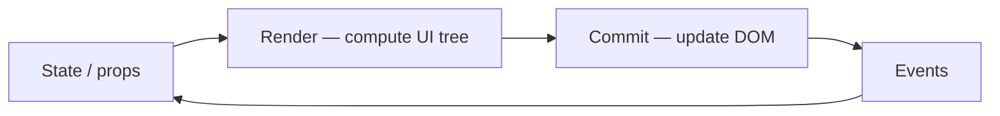

# FE-01 — React mental model (modern)

| Field | Value |
|-------|--------|
| Category | 03-frontend-react-next |
| Status | `complete` |
| Stack | Function components · hooks · (Next) Server vs Client Components |
| Prereqs | [FD-03 TypeScript](../00-foundations/FD-03-typescript.md) · Phase 2 API awareness helpful |
| Related Docs | [`../../knowledge/react-rendering/modern-lifecycle.md`](../../knowledge/react-rendering/modern-lifecycle.md) · [`../../tech-space/frontend-architecture.md`](../../tech-space/frontend-architecture.md) |

## Learning outcomes

- Describe React as **UI = f(state)** with a render → commit cycle (not jQuery DOM patching).
- Prefer **function components + hooks** as the default in this repo.
- Know where **Server Components** vs **Client Components** fit (detail in FE-05).
- Keep **domain rules** out of presentational components when possible.

---

## 1. Dummy

React recalculates the UI description from state/props, then updates the DOM. You declare *what* the screen should look like; React schedules *how* to update.



**Why it exists:** predictable UI under changing data — marketplace listings, carts, forms.

**Deep dive:** [`modern-lifecycle.md`](../../knowledge/react-rendering/modern-lifecycle.md) (Dummy→CTO already).  
**Legacy contrast only:** [`legacy-class-lifecycle.md`](../../knowledge/react-rendering/legacy-class-lifecycle.md).

---

## 2. When to use / when not

| Use React when | Prefer simpler when |
|----------------|---------------------|
| Interactive UI, shared components, SPA/Next app | Static marketing page with almost no JS |
| This blueprint’s web + Capacitor shell | — |

### Mental rules

- **Render must be pure-ish:** same props/state → same UI description (side effects in effects / event handlers).
- **Don’t mutate state in place** — replace immutably so React can detect change.
- **Class components:** learning/history only unless maintaining legacy.

---

## 3. Working

### Worst vs best

```tsx
// ❌ Imperative soup
useEffect(() => {
  document.querySelector("#title")!.textContent = listing.title;
}, [listing]);

// ✅ Declarative
return <h1>{listing.titleEn}</h1>;
```

```tsx
// ❌ Domain validation only in onChange with duplicated API rules forever
// ✅ Share Zod contract / call API as source of truth; optional client mirror (BE-04 / FE-03)
```

### Server vs Client (preview)

| Kind | Runs | Can use hooks / browser APIs? |
|------|------|-------------------------------|
| Server Component (Next) | Server | No |
| Client Component | Browser (hydrate) | Yes |

Default for interactive listing forms: Client. Default for static shell/data read in Next: Server when possible (FE-05/FE-06).

### Where UI lives in this monorepo

```text
apps/web or apps/market-place-app  # screens
packages/ui                        # presentational shared
packages/domain                    # pure rules — not React imports
clouds/.../API                     # source of truth for writes
```

---

## 4. Rich

### Failure modes

| Failure | Fix |
|---------|-----|
| Infinite re-render | State update during render; unstable deps |
| Stale closure | Functional updates / correct effect deps |
| God component | Split presentational vs data hooks (FE-02/FE-03) |
| Business rules only in UI | Drift from Hono validation — share contracts |

### Test seams

- Pure components: props in → text/roles out (Testing Library).
- Don’t need full Next for presentational tests.

---

## 5. Professional / CTO

| Stance | Guidance |
|--------|----------|
| Default stack | React + TypeScript |
| Next vs Vite SPA | FE-14 / wave 3.4 — Next when SSR/RSC/SEO matter |
| Design system | Extract `packages/ui` when duplication hurts |

**ADR triggers:** adopting a new UI library · forbidding Server Components · class-component revival.

**Automate:** ESLint react-hooks rules; ban `@ts-nocheck` in UI packages.

---

## Exercises

1. **Dummy:** Redraw render→commit→event from memory.
2. **Working:** Read the first half of `modern-lifecycle.md` and list 3 “do not” rules.
3. **CTO memo:** Why this teaching repo refuses class components as the default.

## Related

- [FE-02 Hooks & state](FE-02-hooks-state.md) · [FE-03 Data fetching](FE-03-data-fetching.md)
