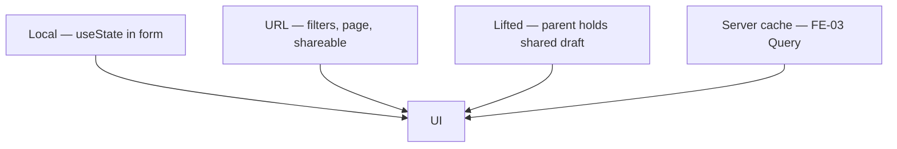

# FE-02 — Hooks & state

| Field | Value |
|-------|--------|
| Category | 03-frontend-react-next |
| Status | `complete` |
| Stack | useState · useReducer · URL search params · context (sparingly) |
| Prereqs | [FE-01](FE-01-react-mental-model.md) |
| Related Docs | [`../../tech-space/frontend-architecture.md`](../../tech-space/frontend-architecture.md) · TanStack Query in [FE-03](FE-03-data-fetching.md) |

## Learning outcomes

- Choose **where state lives**: local UI · URL · lifted shared · server cache (FE-03).
- Use hooks correctly (rules of hooks); prefer deriving over syncing.
- Lift state only when siblings must share; don’t invent global stores early.
- Keep server authority for business invariants — client state is UX.

---

## 1. Dummy

State is data that changes over time and causes re-render. Put each piece of state in the **narrowest place that still works**.



**Why it exists:** wrong state location causes prop drilling, lost shareable links, or duplicate sources of truth.

---

## 2. When to use / when not

| Kind | Use for | Avoid for |
|------|---------|-----------|
| `useState` | Input text, open/closed, tabs | Remote listing list (use query) |
| `useReducer` | Multi-step wizard, complex local transitions | Every toggle |
| URL state | Filters, pagination, selected id (share/bookmark) | Ephemeral hover |
| Context | Theme, auth session **view**, i18n | High-frequency mouse coords |
| Global store (Zustand/Redux) | Rare cross-app client state | Default for API data |

### Rules of hooks

- Only call hooks at top level of function components / custom hooks.
- Same order every render — no conditional `useState`.

---

## 3. Working

### Local vs derived

```tsx
// ❌ Sync state that can be computed
const [fullName, setFullName] = useState("");
useEffect(() => setFullName(`${first} ${last}`), [first, last]);

// ✅ Derive during render
const fullName = `${first} ${last}`;
```

### URL for marketplace filters

```tsx
"use client";
import { useSearchParams, useRouter, usePathname } from "next/navigation";

function useListingQ() {
  const sp = useSearchParams();
  const router = useRouter();
  const pathname = usePathname();
  const q = sp.get("q") ?? "";
  function setQ(next: string) {
    const params = new URLSearchParams(sp);
    if (next) params.set("q", next); else params.delete("q");
    router.replace(`${pathname}?${params}`);
  }
  return { q, setQ };
}
```

(Vite/React Router: same idea with `useSearchParams`.)

### Lift sparingly

```tsx
// Parent owns draft only if CreateForm and Preview both need it
function CreateListingPage() {
  const [draft, setDraft] = useState({ titleEn: "", titleFa: "" });
  return (
    <>
      <ListingForm value={draft} onChange={setDraft} />
      <ListingPreview value={draft} />
    </>
  );
}
```

### Worst vs best

```tsx
// ❌ Redux for one form’s title field
// ❌ Copy server listing into useState and never refetch (stale)
// ✅ Local for draft; Query for server list; URL for shareable filters
```

---

## 4. Rich

### Failure modes

| Failure | Fix |
|---------|-----|
| Prop drilling 6 levels | Composition / slot props; context only if many consumers |
| Stale form after navigation | Key form by id; reset on param change |
| Effects to keep two states equal | Single source + derive |
| Auth only in Context | Context mirrors server; API still verifies (BE-06) |

### Custom hooks

```tsx
function useDisclosure(initial = false) {
  const [open, setOpen] = useState(initial);
  return {
    open,
    onOpen: () => setOpen(true),
    onClose: () => setOpen(false),
    toggle: () => setOpen((v) => !v),
  };
}
```

Name hooks after **capability**, not after a single component.

---

## 5. Professional / CTO

| Policy | Guidance |
|--------|----------|
| Default | Local + URL + server cache — no global store until proven |
| Design system | Controlled components with clear value/onChange |
| Mobile | Same rules; deep links = URL/state discipline |

**ADR triggers:** introducing Redux/Zustand · mandating all filters in URL · client-only auth store.

**Automate:** eslint-plugin-react-hooks; ban `useEffect` setState sync patterns via review checklist.

---

## Exercises

1. **Dummy:** Place “search q”, “modal open”, “listings from API” on the four buckets.
2. **Working:** Implement `useListingQ` mentally for Vite or Next — write the replace URL line.
3. **CTO memo:** When would you approve a global client store in this monorepo?

## Related

- [FE-03 Data fetching](FE-03-data-fetching.md) · [FE-06 forms](README.md) (wave 3.2)
