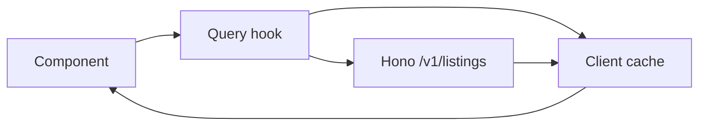

# FE-03 — Data fetching (client cache)

| Field | Value |
|-------|--------|
| Category | 03-frontend-react-next |
| Status | `complete` |
| Stack | fetch · TanStack Query (recommended) · typed clients to Hono `/v1` |
| Prereqs | [FE-02](FE-02-hooks-state.md) · [BE-02](../02-backend-hono-bun/BE-02-hono-hello.md) · [FD-02](../00-foundations/FD-02-http.md) |
| Related Docs | [`../../examples/optimistic-ui-sync/README.md`](../../examples/optimistic-ui-sync/README.md) · contracts package |

## Learning outcomes

- Treat **server state** differently from **UI state** (FE-02).
- Fetch with caching, deduping, and status (`pending` / `error` / `success`).
- Call the marketplace API with typed clients — not ad-hoc `fetch` in every component.
- Know when Next Server Component fetch belongs instead (wave 3.2 / FE-05–07).

---

## 1. Dummy

Remote listings live on the server. The client **caches a view** of that data; the API remains the source of truth.



**Why it exists:** avoid spinner waterfalls, duplicate requests, and “useState + useEffect fetch” bugs.

---

## 2. When to use / when not

| Approach | Use | Avoid |
|----------|-----|-------|
| TanStack Query / SWR | Client-interactive lists, polling, mutations | — |
| `useEffect` + `useState` fetch | Tiny demos only | Default architecture |
| Next Server Component `fetch` | Initial web shell / SEO (FE-07) | Capacitor-only screens without RSC |
| Store API data in Redux forever | Rare offline sync cases | Default |

---

## 3. Working

### Worst — classic effect fetch

```tsx
// ❌ Race conditions, no cache, refetch logic duplicated
const [data, setData] = useState(null);
const [err, setErr] = useState(null);
useEffect(() => {
  let cancelled = false;
  fetch("/v1/listings")
    .then((r) => r.json())
    .then((d) => { if (!cancelled) setData(d); })
    .catch(setErr);
  return () => { cancelled = true; };
}, []);
```

### Better — Query + thin API client

```ts
// lib/listings-api.ts
import type { Listing } from "@repo/contracts/listings";

export async function listListings(baseUrl: string): Promise<Listing[]> {
  const res = await fetch(`${baseUrl}/v1/listings`, {
    headers: { accept: "application/json" },
  });
  if (!res.ok) throw await toApiError(res); // map code from BE-05
  return res.json();
}
```

```tsx
"use client";
import { useQuery } from "@tanstack/react-query";
import { listListings } from "./listings-api";

export function ListingList({ apiBase }: { apiBase: string }) {
  const q = useQuery({
    queryKey: ["listings"],
    queryFn: () => listListings(apiBase),
  });
  if (q.isPending) return <p>Loading…</p>;
  if (q.isError) return <p role="alert">Failed</p>;
  return (
    <ul>
      {q.data.map((l) => (
        <li key={l.id}>{l.titleEn}</li>
      ))}
    </ul>
  );
}
```

### Mutations (preview of forms wave)

```tsx
const qc = useQueryClient();
const create = useMutation({
  mutationFn: (body: CreateListingBody) => postListing(apiBase, body),
  onSuccess: () => qc.invalidateQueries({ queryKey: ["listings"] }),
});
```

Optimistic UI: see examples/optimistic-ui-sync — don’t invent a second cache protocol.

### Provider (once per app)

```tsx
const queryClient = new QueryClient();
<QueryClientProvider client={queryClient}>{children}</QueryClientProvider>
```

One client per app shell ([FD-05](../00-foundations/FD-05-git.md) singleton lesson — composition root, not classic Singleton in components).

---

## 4. Rich

### Failure modes

| Failure | Fix |
|---------|-----|
| Cache key too coarse | Include filters: `["listings", { q }]` |
| Cache key too fine | Thrash; normalize params |
| CORS / wrong base URL | Align `CORS_ORIGIN` with Vite/Next origin (BE-02) |
| Showing 401 as generic error | Branch on `code` from API envelope |
| Fetch in every child | Lift query to feature route or shared hook |

### Test seams

- Mock `listListings` or MSW; assert loading/error/list roles.
- Prefer testing the hook/UI against fakes over hitting real Bun every time.

### Next SSR note

Server Components can fetch on the server and pass props — still invalidate/refetch on the client after mutations. Details in wave 3.2+.

---

## 5. Professional / CTO

| Decision | Guidance |
|----------|----------|
| Library | TanStack Query as default client server-state |
| Contracts | Shared Zod types for response parsing |
| Mobile | Same Query keys against Hono; careful auth headers (BE-06) |

**ADR triggers:** choosing SWR vs Query · normalizing all data in Zustand · GraphQL client.

**Automate:** MSW contract tests; typecheck web against contracts package.

---

## Exercises

1. **Dummy:** Why shouldn’t listing arrays live only in `useState`?
2. **Working:** Write `queryKey` for listings filtered by `q` from the URL (FE-02).
3. **CTO memo:** Effect-fetch vs TanStack Query for a 4-screen marketplace — cost of the “simple” path.

## Related

- [FE-01](FE-01-react-mental-model.md) · [FE-02](FE-02-hooks-state.md) · next wave FE-04–FE-06 in README
- Backend [`../02-backend-hono-bun/BE-05-error-model.md`](../02-backend-hono-bun/BE-05-error-model.md)
