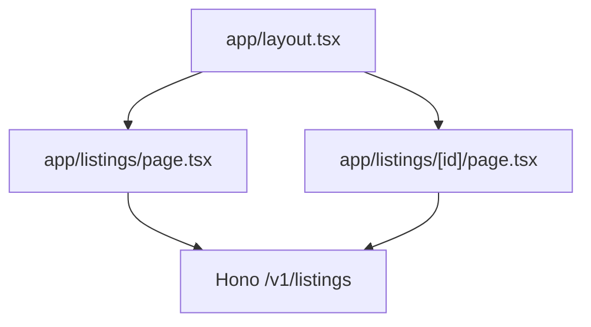

# FE-04 — Next.js App Router fundamentals

| Field | Value |
|-------|--------|
| Category | 03-frontend-react-next |
| Status | `complete` |
| Stack | Next.js App Router · `app/` · layouts · route groups |
| Prereqs | [FE-01](FE-01-react-mental-model.md) · [FE-03](FE-03-data-fetching.md) |
| Related Docs | [`../../walkthrough/08-nextjs-web-app/README.md`](../../walkthrough/08-nextjs-web-app/README.md) · [`../../tech-space/frontend-architecture.md`](../../tech-space/frontend-architecture.md) |

## Learning outcomes

- Navigate the **`app/`** directory: pages, layouts, loading/error UI.
- Map marketplace screens to route segments (`listings`, `listings/[id]`).
- Know what belongs in Next (web edge) vs Hono (API of record).
- Contrast App Router with Pages Router at “architect enough” depth.

---

## 1. Dummy

Next.js App Router is a **file-system router** for the web app. Folders under `app/` become URLs; `layout.tsx` wraps segments; `page.tsx` is the UI for that URL.



**Why it exists:** production web conventions (routing, SSR/RSC, nesting) without hand-rolling a router + bundler story.

---

## 2. When to use / when not

| Use App Router when | Prefer Vite SPA when |
|---------------------|----------------------|
| SEO, SSR, RSC, deploy as web product | Pure React kata / Capacitor-first lesson |
| This blueprint’s `apps/web` target | Tiny demos with no routing |

### App vs Pages Router

| | App Router | Pages Router |
|---|------------|--------------|
| Default today | Yes (new apps) | Legacy |
| Layouts | Nested `layout.tsx` | `_app` + manual |
| Server Components | First-class | Limited |

New blueprint code: **App Router**.

---

## 3. Working

### Folder sketch (marketplace web)

```text
apps/web/app/
  layout.tsx                 # shell, fonts, providers (QueryClient)
  page.tsx                   # home / redirect
  listings/
    page.tsx                 # list
    [id]/
      page.tsx               # detail
    new/
      page.tsx               # create form (client island)
  api/                       # optional Route Handlers — BFF only, not domain home
```

### Layout + page

```tsx
// app/layout.tsx
export default function RootLayout({ children }: { children: React.ReactNode }) {
  return (
    <html lang="en">
      <body>
        <Providers>{children}</Providers>
      </body>
    </html>
  );
}

// app/listings/page.tsx — often a Server Component shell
export default async function ListingsPage() {
  return (
    <main>
      <h1>Listings</h1>
      <ListingList /> {/* client query island or server-fetched child */}
    </main>
  );
}
```

### Special files

| File | Role |
|------|------|
| `loading.tsx` | Instant loading UI for the segment |
| `error.tsx` | Error boundary (Client Component) |
| `not-found.tsx` | 404 UI |
| `template.tsx` | Remounting wrapper (rare) |

### Worst vs best

```text
❌ Business rules / SQL in app/api Route Handlers as the only backend
✅ Hono owns invariants; Next may aggregate for web (FE-10 BFF)
❌ One 2000-line page.tsx
✅ Route segment + feature components / hooks
```

---

## 4. Rich

### Failure modes

| Failure | Fix |
|---------|-----|
| Providers in every page | Single root `Providers` in layout |
| Mixing `pages/` and `app/` without need | Pick App Router; migrate deliberately |
| Secrets in Client Components | Server-only env; never `NEXT_PUBLIC_` for API keys |

### Relationship to current scaffold

Repo may still use Vite `apps/market-place-app` — treat Next `apps/web` as the **teaching target** (walkthrough 08). Map concepts 1:1 when you scaffold.

---

## 5. Professional / CTO

| Stance | Guidance |
|--------|----------|
| Web product | Next App Router |
| API | Separate Hono process (`clouds/` / `apps/api`) |
| Cost | Next complexity vs Vite — pay when SSR/RSC/SEO matter |

**ADR triggers:** adopting Next for marketplace web · forbidding Route Handlers · hybrid pages+app.

**Automate:** `next build` in CI; lint for server-only imports in client graphs.

---

## Exercises

1. **Dummy:** Draw URLs for list, detail, create under `app/listings`.
2. **Working:** List which files you’d add for `loading.tsx` on listings.
3. **CTO memo:** Keep Vite SPA or move to Next for year-1 marketplace web — one sentence each way.

## Related

- [FE-05 RSC vs Client](FE-05-rsc-client.md) · [FE-06 Forms](FE-06-forms-mutations.md)
- [`../../walkthrough/08-nextjs-web-app/README.md`](../../walkthrough/08-nextjs-web-app/README.md)
