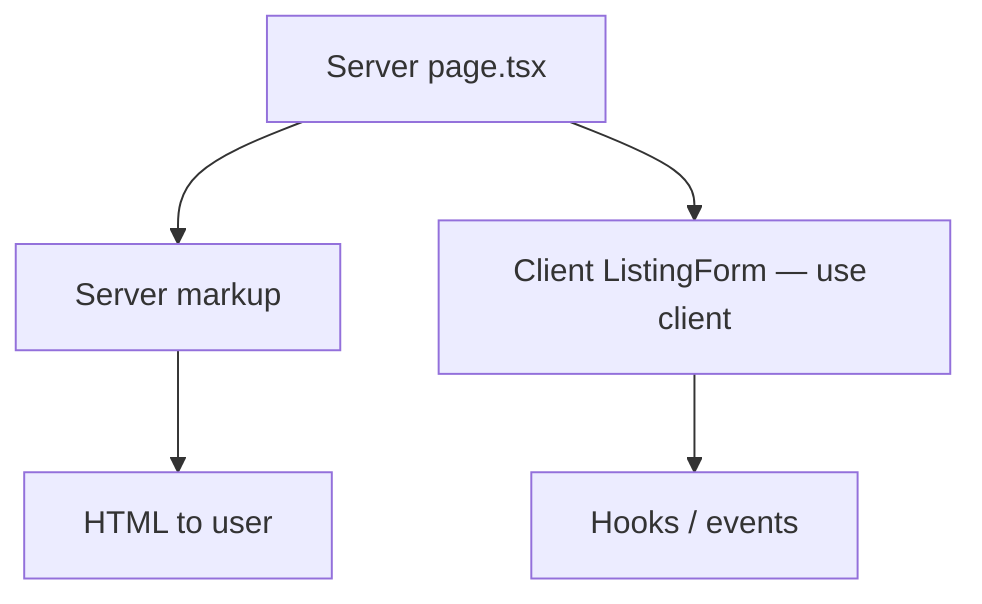

# FE-05 — RSC vs Client Components

| Field | Value |
|-------|--------|
| Category | 03-frontend-react-next |
| Status | `complete` |
| Stack | Next.js `"use client"` · Server Components default · composition |
| Prereqs | [FE-04](FE-04-next-app-router.md) · [FE-01](FE-01-react-mental-model.md) |
| Related Docs | [`../../knowledge/react-rendering/modern-lifecycle.md`](../../knowledge/react-rendering/modern-lifecycle.md) · frontend-architecture boundaries |

## Learning outcomes

- Default in App Router: **Server Components**; opt into **Client** with `"use client"`.
- Know what each can/can’t do (hooks, browser APIs, secrets, bundles).
- Compose: server shell + small client islands (forms, Query, charts).
- Avoid turning the whole tree into Client “just in case.”

---

## 1. Dummy

Server Components render on the server (HTML/payload) with no client JS for that part. Client Components hydrate and run hooks in the browser.



**Why it exists:** ship less JS; keep secrets and heavy data access off the client when possible.

---

## 2. When to use / when not

| Server Component | Client Component |
|------------------|------------------|
| Layouts, static shells, read-only data fetch on server | Forms, Query, onClick, localStorage, browser APIs |
| Access server-only env / internal APIs carefully | Needs `useState` / `useEffect` / TanStack Query |
| Default for `page.tsx` / `layout.tsx` | Leaf interactivity |

### When not

- `"use client"` on root layout → entire app becomes a client bundle.
- Fetching Hono with secret keys from a Client Component.
- Expecting `useState` in a Server Component.

---

## 3. Working

### Marking a client island

```tsx
// components/listing-form.tsx
"use client";

import { useState } from "react";

export function ListingForm({ onSubmit }: { onSubmit: (v: Draft) => void }) {
  const [titleEn, setTitleEn] = useState("");
  // ...
  return <form onSubmit={...}>...</form>;
}
```

```tsx
// app/listings/new/page.tsx — Server Component by default
import { ListingForm } from "@/components/listing-form";

export default function NewListingPage() {
  return (
    <main>
      <h1>New listing</h1>
      <ListingForm onSubmit={/* pass server action or client mutation wrapper */} />
    </main>
  );
}
```

### Pass data down, not hooks up

```tsx
// ✅ Server fetches (sketch), passes serializable props to client child
export default async function ListingDetail({ params }: { params: { id: string } }) {
  const listing = await getListing(params.id); // server-side
  return <ListingDetailView listing={listing} />; // client for interactivity if needed
}
```

Serializable props only (no functions/classes from server to client except Server Actions).

### Worst vs best

```tsx
// ❌ "use client" at app/layout.tsx
// ❌ import server-only db in a client file

// ✅ Server layout + providers split: thin client Providers.tsx imported by layout
```

```tsx
// providers.tsx
"use client";
export function Providers({ children }: { children: React.ReactNode }) {
  return <QueryClientProvider client={queryClient}>{children}</QueryClientProvider>;
}
```

---

## 4. Rich

### Failure modes

| Failure | Fix |
|---------|-----|
| Bundle bloat | Push `"use client"` down the tree |
| Hydration mismatch | Don’t render `Date.now()` / random differently on server vs client |
| Can’t use context | Client provider wrapping children |
| Leaking secrets | Audit client import graph |

### Mental boundary with Hono

| Layer | Owns |
|-------|------|
| RSC / Route Handler | Web delivery, optional aggregation |
| Hono | Domain writes, authz, DB ports |

RSC fetch to Hono is fine; RSC must not become a second domain engine.

---

## 5. Professional / CTO

| Stance | Guidance |
|--------|----------|
| Default | Server-first pages; client islands |
| Team skill | Budget time to learn the split — it’s not optional complexity for Next |
| Mobile | Capacitor won’t use RSC the same way — shared packages/ui + client hooks |

**ADR triggers:** mandating all-client Next · Server Actions as only mutation path vs Hono · shared RSC data layer.

**Automate:** bundle analyzer; eslint restrictions on server-only packages in client.

---

## Exercises

1. **Dummy:** Mark three marketplace UI pieces as Server vs Client.
2. **Working:** Sketch `Providers` client file + server `layout` import.
3. **CTO memo:** Cost of “everything client” vs teaching RSC to a junior hire.

## Related

- [FE-04 App Router](FE-04-next-app-router.md) · [FE-06 Forms](FE-06-forms-mutations.md)
- Knowledge modern-lifecycle Server/Client sections
