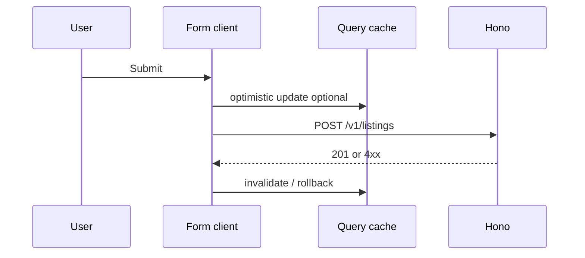

# FE-06 — Forms, mutations & optimistic UI

| Field | Value |
|-------|--------|
| Category | 03-frontend-react-next |
| Status | `complete` |
| Stack | Controlled forms · Zod · TanStack Query mutations · optional Server Actions |
| Prereqs | [FE-03](FE-03-data-fetching.md) · [FE-05](FE-05-rsc-client.md) · [BE-04](../02-backend-hono-bun/BE-04-zod-validation.md) · [BE-05](../02-backend-hono-bun/BE-05-error-model.md) |
| Related Docs | [`../../examples/optimistic-ui-sync/README.md`](../../examples/optimistic-ui-sync/README.md) |

## Learning outcomes

- Build accessible forms that **mirror API contracts** (Zod).
- Mutate via API client + **invalidate/refetch** query cache.
- Apply **optimistic UI** with rollback on failure — domain conflicts stay out of JSX.
- Know when Server Actions are a convenience vs when Hono must remain source of truth.

---

## 1. Dummy

A form collects intent; a **mutation** asks the server to change truth; the UI updates — ideally before the network returns, then reconciles.



**Why it exists:** perceived speed without lying about server authority.

---

## 2. When to use / when not

| Pattern | Use | Avoid |
|---------|-----|-------|
| Controlled inputs | Validation UX, i18n errors | Uncontrolled for complex multi-step without reason |
| `useMutation` | Create/update/delete against Hono | Putting SQL in the form |
| Optimistic update | Low-conflict toggles, rename | Money transfer without careful design |
| Server Actions | Next-only web conveniences | Only mutation path when mobile must call Hono too |

---

## 3. Working

### Form + Zod (client mirror)

```tsx
"use client";
import { useForm } from "react-hook-form"; // or plain useState
import { zodResolver } from "@hookform/resolvers/zod";
import { createListingBody } from "@repo/contracts/listings";

export function CreateListingForm({ onValid }: { onValid: (v: CreateListingBody) => void }) {
  const form = useForm({ resolver: zodResolver(createListingBody) });
  return (
    <form
      onSubmit={form.handleSubmit(onValid)}
      noValidate
    >
      <label htmlFor="titleEn">Title (EN)</label>
      <input id="titleEn" {...form.register("titleEn")} aria-invalid={!!form.formState.errors.titleEn} />
      {form.formState.errors.titleEn && (
        <p role="alert">{form.formState.errors.titleEn.message}</p>
      )}
      {/* titleFa similarly */}
      <button type="submit">Create</button>
    </form>
  );
}
```

Plain `useState` is fine for teaching — a11y labels/`role="alert"` still required.

### Mutation + invalidate

```tsx
const qc = useQueryClient();
const create = useMutation({
  mutationFn: (body: CreateListingBody) => postListing(apiBase, body),
  onSuccess: () => qc.invalidateQueries({ queryKey: ["listings"] }),
  onError: (err) => {
    // map API code VALIDATION / CONFLICT to form or toast
  },
});
```

### Optimistic sketch

```tsx
useMutation({
  mutationFn: renameListing,
  onMutate: async (vars) => {
    await qc.cancelQueries({ queryKey: ["listings"] });
    const prev = qc.getQueryData(["listings"]);
    qc.setQueryData(["listings"], (old) => /* patch title */);
    return { prev };
  },
  onError: (_e, _v, ctx) => {
    qc.setQueryData(["listings"], ctx?.prev);
  },
  onSettled: () => qc.invalidateQueries({ queryKey: ["listings"] }),
});
```

Rollback on failure; conflict (`409`) → clear message ([example](../../examples/optimistic-ui-sync/README.md)).

### Server Actions (optional)

```tsx
// server action may call Hono or shared use case — do not fork domain rules
async function createListingAction(formData: FormData) {
  "use server";
  // parse + call application layer or HTTP to Hono
}
```

If Capacitor must create listings too, **Hono remains the canonical write API**.

### Worst vs best

```tsx
// ❌ Mark success in UI and ignore API errors
// ❌ Duplicate commission rules only in onSubmit
// ✅ Contract Zod + API codes; optimistic with rollback; invalidate
```

---

## 4. Rich

### Failure modes

| Failure | Fix |
|---------|-----|
| Double submit | Disable button while `isPending`; idempotency on API (BE-11) |
| Validation drift | Shared `packages/contracts` |
| Optimistic over money | Don’t; wait for webhook/confirm |
| a11y gaps | Labels, focus on first error, `aria-live` |

### Test seams

- Submit invalid → alert text.
- Mock `postListing` reject → form shows API `code`.
- Optimistic test: onError restores previous cache.

---

## 5. Professional / CTO

| Stance | Guidance |
|--------|----------|
| Writes | Hono as system of record for multi-client |
| UX | Optimistic where conflict rate is low |
| Server Actions | Web sugar — not a second backend |

**ADR triggers:** Server Actions-only architecture · form library standard (RHF vs Formik) · global optimistic middleware.

**Automate:** contract tests for create-listing request/response; Playwright happy-path create.

---

## Exercises

1. **Dummy:** Sequence optimistic rename that gets `409` — what does the user see?
2. **Working:** Wire `CreateListingForm` → `useMutation` → invalidate `["listings"]` on paper.
3. **CTO memo:** Server Actions vs Hono-only writes for web+Capacitor — pick one primary.

## Related

- [FE-03 Data fetching](FE-03-data-fetching.md) · [FE-05 RSC](FE-05-rsc-client.md) · next [FE-07 FSD](FE-07-fsd-feature-folders.md)
- [`../../knowledge/architecture-styles/bff.md`](../../knowledge/architecture-styles/bff.md) (Next must not own domain)
