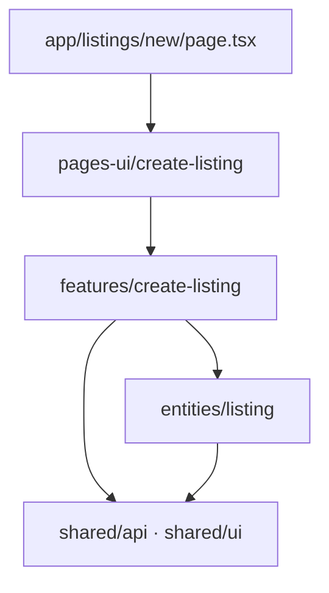

# FE-07 — Feature folders / FSD

| Field | Value |
|-------|--------|
| Category | 03-frontend-react-next |
| Status | `complete` |
| Stack | Next App Router · feature modules · FSD layers (optional depth) |
| Prereqs | [FE-04](FE-04-next-app-router.md) · [FE-05](FE-05-rsc-client.md) · [FE-06](FE-06-forms-mutations.md) |
| Related Docs | [`../../knowledge/architecture-styles/feature-sliced-design.md`](../../knowledge/architecture-styles/feature-sliced-design.md) · [`../../knowledge/architecture-styles/modular-frontend.md`](../../knowledge/architecture-styles/modular-frontend.md) · [`../../tech-space/frontend-architecture.md`](../../tech-space/frontend-architecture.md) |

## Learning outcomes

- Prefer **feature ownership** over `components/` / `hooks/` dumps.
- Apply **import direction**: routes compose features; features do not import each other deeply.
- Map Next `app/` routes to page compositions + feature UI without mixing Pages Router naming.
- Know when **feature folders** are enough vs full **FSD** layers.

---

## 1. Dummy

UI code rots when every screen imports every helper. **Feature folders** put a user scenario (create listing, filter listings) in one place with a public entry. **FSD** adds named layers so dependency direction is enforceable.



**Why it exists:** so adding “host portal” does not require hunting random files under `components/`.

Deep methodology: [Feature-Sliced Design](../../knowledge/architecture-styles/feature-sliced-design.md). Lighter cousin: [Modular frontend](../../knowledge/architecture-styles/modular-frontend.md).

---

## 2. When to use / when not

| Approach | Use when | Avoid when |
|----------|----------|------------|
| Flat `components/` | Tiny demo / one screen | Growing marketplace UI |
| Feature folders | 1–2 FE engineers, clear scenarios | You need strict layer rules across a large team |
| Full FSD | Many entities + screens, import discipline matters | MVP ceremony tax; backend (use slices instead) |

**Backend rule:** FSD is **frontend**. Hono stays modular / vertical-slice / hexagonal — never rename API folders to `widgets/`.

---

## 3. Working

### Minimal feature-folder shape (enough for this course)

```text
apps/web/
  app/
    listings/
      page.tsx              # thin route — compose only
      new/page.tsx
  src/
    features/
      listing-list/
        ui/ListingList.tsx
        api/getListings.ts
        model/useListings.ts
        index.ts            # public API
      create-listing/
        ui/CreateListingForm.tsx
        api/createListing.ts
        model/useCreateListing.ts
        index.ts
    entities/
      listing/
        model/types.ts
        ui/ListingCard.tsx
        index.ts
    shared/
      api/http.ts
      ui/Button.tsx
```

### Public API discipline

```ts
// ✅ features/create-listing/index.ts
export { CreateListingForm } from "./ui/CreateListingForm";
export { useCreateListing } from "./model/useCreateListing";

// ❌ app route imports deep internals
import { useCreateListing } from "@/features/create-listing/model/useCreateListing";
// Prefer:
import { CreateListingForm } from "@/features/create-listing";
```

### Thin route (Next)

```tsx
// app/listings/new/page.tsx
import { CreateListingForm } from "@/features/create-listing";

export default function NewListingPage() {
  return (
    <main>
      <h1>New listing</h1>
      <CreateListingForm />
    </main>
  );
}
```

### Import rules (architect minimum)

```text
app (routes) → features / entities / shared
features → entities / shared   (not other features' internals)
entities → shared
shared → (nothing feature-specific)
```

Compose two features in a **page or widget**, not by cross-importing feature hooks.

### Worst vs best

```text
❌ features/create-listing imports features/listing-list/model/*
❌ Business money rules only in a feature hook (server is source of truth)
✅ Public index exports; Hono owns invariants; UI holds view models
❌ Naming Next App Router folders "pages/" for FSD pages
✅ Use pages-ui/ or views/ under src/ (see FSD knowledge page)
```

---

## 4. Rich

### Failure modes

| Failure | Fix |
|---------|-----|
| Deep imports everywhere | ESLint `no-restricted-imports` / steiger-style FSD lint |
| “Shared” becomes a junk drawer | Shared = ui kit, http, lib — no listing business |
| Feature ↔ feature cycles | Extract entity or compose in page-ui |
| Client bundle pulls server domain | Only `packages/contracts` (+ safe shared); never SQL adapters |

### Test seams

- Import graph: feature A must not resolve feature B internals.
- Route tests mount public feature exports only.
- Entity pure helpers (e.g. display status) unit-tested without React.

### Relationship to backend slices

| Frontend | Backend |
|----------|---------|
| `features/create-listing` | `modules/listing` use case + `/v1/listings` |
| `entities/listing` view model | Domain `Listing` + DB adapter |
| `shared/api` | HTTP client to Hono — not a second API |

---

## 5. Professional / CTO

| Stance | Guidance |
|--------|----------|
| Year-0 marketplace | Feature folders + public `index.ts` — enough |
| Multi-squad UI | Adopt FSD layers + automate import rules |
| Monorepo | FSD **inside** `apps/web`; `packages/ui` ≈ shared presentational; domain stays server-side |

**ADR triggers:** mandating FSD vs feature folders · forbidding deep imports · splitting `packages/ui` from feature UI.

**Automate:** lint boundaries in CI; optional dep-cruiser / FSD linter on `apps/web`.

**Cost:** full FSD slows juniors until the mental model sticks — document the six layers once, link this lesson + knowledge page.

---

## Exercises

1. **Dummy:** Draw arrows for `listings/new` route → create-listing feature → listing entity → shared http.
2. **Working:** Sketch `index.ts` exports for `listing-list` and list three forbidden imports.
3. **CTO memo:** Feature folders now vs FSD in 12 months — one criterion that would force the upgrade.

## Related

- [FE-08 Performance](FE-08-performance.md) · [FE-09 a11y & i18n](FE-09-a11y-i18n.md)
- [FSD knowledge](../../knowledge/architecture-styles/feature-sliced-design.md) · [Modular frontend](../../knowledge/architecture-styles/modular-frontend.md)
