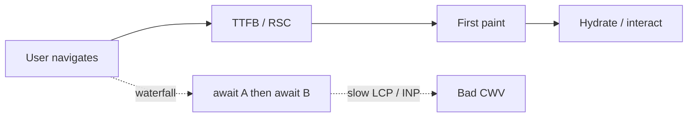
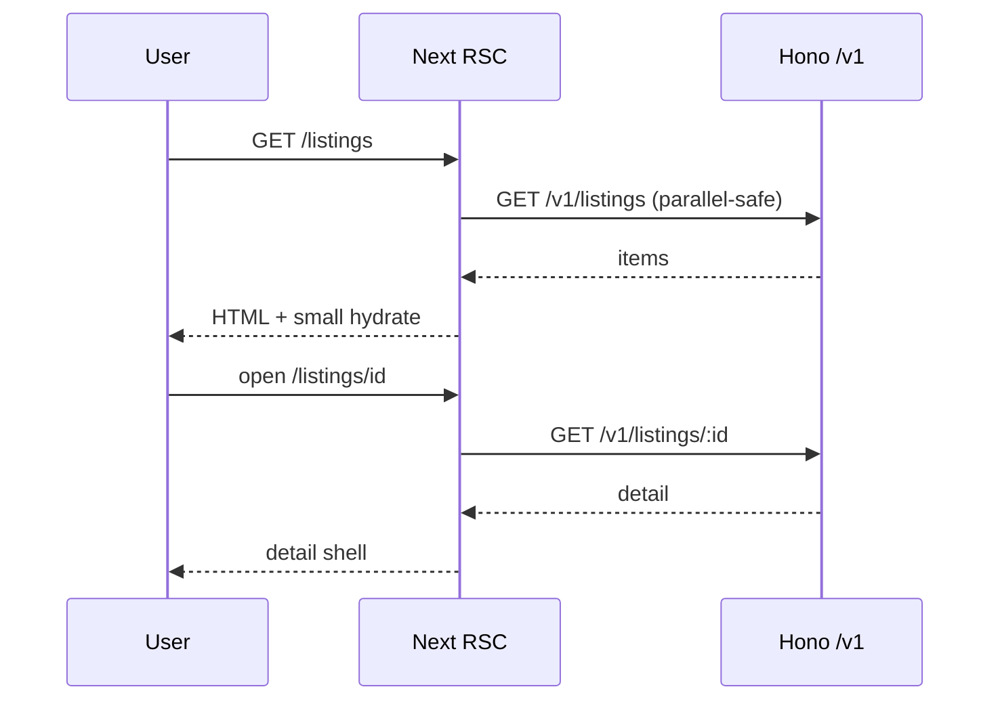

# FE-08 — Performance (bundle, waterfalls, CWV)

| Field | Value |
|-------|--------|
| Category | 03-frontend-react-next |
| Status | `complete` |
| Stack | Next.js · React · TanStack Query · Core Web Vitals |
| Prereqs | [FE-03](FE-03-data-fetching.md) · [FE-04](FE-04-next-app-router.md) · [FE-05](FE-05-rsc-client.md) · [FE-07](FE-07-fsd-feature-folders.md) |
| Related Docs | [`../../tech-space/frontend-architecture.md`](../../tech-space/frontend-architecture.md) · [`../../knowledge/react-rendering/modern-lifecycle.md`](../../knowledge/react-rendering/modern-lifecycle.md) |

## Learning outcomes

- Name the **Core Web Vitals** that matter for marketplace web and what usually breaks them.
- Spot **request waterfalls** (RSC + client) and fix with parallel fetch / correct boundaries.
- Shrink **JS cost**: Server Components default, dynamic import for heavy client islands, feature-level code split.
- Tie FE performance to **API latency** without pretending UI micro-opts fix a slow `/v1`.

---

## 1. Dummy

Fast UI is mostly: **less JavaScript on the critical path**, **fewer sequential waits**, **stable layout**.



**Why it exists:** marketplace listing pages compete on feel; architects own budgets, not only “make it pretty.”

---

## 2. When to use / when not

| Optimize when | Defer when |
|---------------|------------|
| LCP/INP fail on listing list/detail | Premature memoization with no measurement |
| Bundle includes admin-only charts on guest home | Micro-optimizing pure renders before cutting waterfalls |
| Client Component tree fetches in series | Ignoring API p95 — fix Hono/DB first |

**Rule:** measure (Lighthouse / Web Vitals / Next analyzer) → fix architecture → then micro-opts.

---

## 3. Working

### Core Web Vitals (architect glossary)

| Metric | Rough meaning | Typical FE causes |
|--------|---------------|-------------------|
| **LCP** | Largest contentful paint | Huge hero image, blocked CSS/JS, slow TTFB |
| **INP** | Interaction to next paint | Heavy main-thread JS, sync work on click |
| **CLS** | Layout shift | Images without size, late ads/fonts, skeleton mismatch |

### Waterfall anti-pattern

```tsx
// ❌ Client: wait for listings, then for each id fetch detail (N+1 UI)
const { data: list } = useQuery({ queryKey: ["listings"], queryFn: getListings });
const firstId = list?.[0]?.id;
const { data: detail } = useQuery({
  queryKey: ["listing", firstId],
  queryFn: () => getListing(firstId!),
  enabled: !!firstId,
});
```

**Better:** one list endpoint with fields needed for the screen; or `Promise.all` / RSC parallel fetches for independent data; detail on navigation ([FE-03](FE-03-data-fetching.md)).

### RSC vs client cost

| Choice | Perf effect |
|--------|-------------|
| Server Component shell | Less client JS; data can start on server |
| Fat `'use client'` page | Larger hydrate cost → worse INP |
| `next/dynamic` for chart/editor | Defer rare islands |

```tsx
import dynamic from "next/dynamic";

const ListingMap = dynamic(() => import("@/features/listing-map").then((m) => m.ListingMap), {
  ssr: false,
  loading: () => <p>Loading map…</p>,
});
```

### Bundle hygiene

```text
✅ Feature folders → natural split boundaries (import only what the route needs)
✅ packages/ui presentational — tree-shakeable exports
❌ Import entire icon/lib suites from barrel that re-exports everything
❌ Put QueryClient + every feature provider in a leaf layout needlessly
```

### Images & layout

```tsx
import Image from "next/image";

<Image src={listing.coverUrl} alt="" width={640} height={400} priority={isLcpCandidate} />
```

Always reserve space (width/height or aspect-ratio) → protect **CLS**.

### Worst vs best

```text
❌ useMemo everywhere “for performance” with no profiler evidence
✅ Cut client boundary; parallelize fetches; compress LCP image
❌ Serialize huge props from RSC into client islands
✅ Pass ids + small view models; let the island fetch or receive minimal props
```

---

## 4. Rich

### Failure modes

| Failure | Fix |
|---------|-----|
| Suspense waterfall (parent await then child await) | Fetch in parallel; or compose promises without sequential `await` chains |
| Cache stampedes after mutation | Targeted `invalidateQueries` ([FE-06](FE-06-forms-mutations.md)) |
| “Fast locally” / slow prod | Measure RUM + API p95; CDN for static; region for Hono |
| Mobile Capacitor ≠ Next CWV | Separate budgets; still avoid fat shared client bundles |

### Test / budget seams

- CI: `next build` bundle analyzer on PR for `apps/web`.
- Playwright: assert list paints key heading within budget (smoke).
- Contract: list payload size — overfetching is a FE+API joint bug.

### Sequence: good listing navigation



---

## 5. Professional / CTO

| Stance | Guidance |
|--------|----------|
| Budgets | Publish LCP/INP targets for listing list + detail |
| Ownership | FE owns JS/CWV; platform owns TTFB/CDN; API owns query cost |
| Trade-off | RSC complexity vs SPA simplicity — pay when SEO + CWV matter ([FE-11](README.md)) |

**ADR triggers:** mandatory bundle budgets · edge caching for public listings · forbidding client-only listing SEO pages.

**Automate:** Web Vitals reporting; Lighthouse CI on staging; fail PR if main chunk grows >N%.

**Cost:** perf work without product metrics wastes sprints — instrument first.

---

## Exercises

1. **Dummy:** Name which CWV a missing image `width`/`height` hurts most.
2. **Working:** Rewrite a sequential double-`useQuery` listing→detail into a single-screen data plan.
3. **CTO memo:** One performance budget for guest listing list (metric + threshold + owner).

## Related

- [FE-07 FSD](FE-07-fsd-feature-folders.md) · [FE-09 a11y & i18n](FE-09-a11y-i18n.md) · [FE-05 RSC](FE-05-rsc-client.md)
- [BE-13 Observability](../02-backend-hono-bun/BE-13-observability.md) (latency is not only a FE problem)
