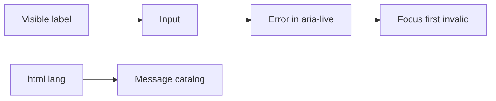

# FE-09 — Accessibility & i18n basics

| Field | Value |
|-------|--------|
| Category | 03-frontend-react-next |
| Status | `complete` |
| Stack | React · Next.js · forms · semantic HTML |
| Prereqs | [FE-02](FE-02-hooks-state.md) · [FE-06](FE-06-forms-mutations.md) · [FE-07](FE-07-fsd-feature-folders.md) |
| Related Docs | [`../../tech-space/frontend-architecture.md`](../../tech-space/frontend-architecture.md) |

## Learning outcomes

- Ship forms and listing UI with **labels, focus, errors, and keyboard** paths by default.
- Place a11y ownership in **`packages/ui` + feature forms**, not as a late QA patch.
- Know **i18n** basics: `lang`, message catalogs, RTL-aware layout — without boiling the ocean.
- Treat accessibility as an **NFR** (see [SA-02](../01-system-architecture/SA-02-nfrs.md)), not a polish pass.

---

## 1. Dummy

If a user cannot complete “create listing” with keyboard + screen reader, the feature is unfinished — same as a 500 from Hono.



**Why it exists:** legal risk, market reach, and design-system quality — architects set the bar early.

---

## 2. When to use / when not

| Invest now | Defer / simplify |
|------------|------------------|
| All forms, dialogs, nav, listing cards | Fancy custom widgets before native HTML works |
| `lang` + one locale pipeline in Next | Full CMS translation workflow on day one |
| Focus traps in modals you already ship | Rebuilding Design System solely for WCAG AAA |

**Target for this blueprint:** WCAG **2.2 AA** mindset on interactive paths (listings CRUD, auth later in FE-10).

---

## 3. Working

### Semantic baseline

```tsx
// ✅
<label htmlFor="title">Title</label>
<input id="title" name="title" aria-invalid={!!errors.title} aria-describedby={errors.title ? "title-err" : undefined} />
{errors.title ? <p id="title-err" role="alert">{errors.title}</p> : null}

// ❌ placeholder-only “labels”; div-as-button without keyboard
```

### Keyboard & focus

| Pattern | Rule |
|---------|------|
| Buttons / links | Real `<button>` / `<a href>` — not `div onClick` |
| Modal / disclosure | Focus move in; restore on close; Escape closes ([FE-02](FE-02-hooks-state.md)) |
| After submit error | Focus first invalid field |
| Skip link | Optional but valuable on dense shells |

### Live regions

```tsx
<div aria-live="polite" aria-atomic="true">
  {statusMessage}
</div>
```

Use for save success / non-blocking status; `role="alert"` for errors that must interrupt.

### Color & motion

- Do not convey state by color alone (icon + text).
- Respect `prefers-reduced-motion` for non-essential animation (hero motion still allowed if optional).

### i18n basics

```tsx
// app/layout.tsx
<html lang={locale}>  {/* e.g. "en" | "fa" — never hardcode if you ship multi-locale */}
```

| Concern | Approach |
|---------|----------|
| UI strings | Message catalog (`next-intl`, etc.) — keys not English prose in components |
| API errors | Map `code` from Hono ([BE-05](../02-backend-hono-bun/BE-05-error-model.md)) → localized string |
| Dates / money | `Intl.DateTimeFormat` / `Intl.NumberFormat` with locale |
| RTL | Logical CSS (`margin-inline-start`) when locale needs it |
| Content | CMS/listing body may stay user-authored; UI chrome is what you translate first |

```ts
// shared/i18n sketch
const messages = {
  en: { "listing.create.title": "New listing" },
  fa: { "listing.create.title": "آگهی جدید" },
} as const;

function t(locale: keyof typeof messages, key: keyof (typeof messages)["en"]) {
  return messages[locale][key];
}
```

Keep catalogs in **shared or feature `model/`**, not copy-pasted across routes.

### Where it lives (boundaries)

| Layer | a11y / i18n duty |
|-------|------------------|
| `packages/ui` | Primitives: focus rings, labeled inputs, dialog a11y |
| Feature forms | Wire errors, ids, submit announcements |
| Next `app/` | `lang`, locale segment/layout, document title |
| Hono | Stable error `code`s — not localized English-only messages as contract |

### Worst vs best

```text
❌ Icon-only controls with no accessible name
✅ aria-label or visible text
❌ English strings baked into 40 components
✅ t(key) + catalog; API codes for errors
❌ “We’ll do a11y after launch”
✅ Checklist on every form PR
```

---

## 4. Rich

### Failure modes

| Failure | Fix |
|---------|-----|
| Client island steals focus oddly | Audit after mutation/dialog; restore focus |
| RSC + client duplicate labels | One label ownership; don’t hide visually without `sr-only` care |
| Locale in URL vs cookie drift | Single source (middleware / segment); document in ADR |
| Screen reader misses optimistic UI | Announce commit/rollback ([FE-06](FE-06-forms-mutations.md)) |

### Test seams

- axe / eslint-plugin-jsx-a11y in CI on `apps/web`.
- Playwright keyboard path: tab to submit create-listing.
- Unit: error `code` → message catalog key exists for each locale you ship.

### Checklist (ship bar for FE forms)

- [ ] Label associated with control  
- [ ] Error text linked (`aria-describedby`) + announced  
- [ ] Keyboard operable  
- [ ] `lang` correct on document  
- [ ] No color-only status  

---

## 5. Professional / CTO

| Stance | Guidance |
|--------|----------|
| Risk | a11y is compliance + brand; budget it as NFR |
| Design system | `packages/ui` is the leverage point — audit once, reuse |
| i18n | Pick one library early if second locale is on the roadmap |
| Mobile | Capacitor WebViews inherit the same DOM rules — don’t fork a11y ethics |

**ADR triggers:** i18n library choice · locale routing strategy · AA vs AAA target · third-party widget exceptions.

**Automate:** jsx-a11y + axe CI; optional locale missing-key CI check.

**Cost:** late a11y rewrites of custom widgets cost more than native HTML from day one.

---

## Exercises

1. **Dummy:** List three defects on a placeholder-only title field for a screen-reader user.
2. **Working:** Sketch `CreateListingForm` ids/`aria-*` for title + price with one shared error region.
3. **CTO memo:** Second locale in Q3 — pick URL prefix vs cookie and one sentence why.

## Related

- [FE-07 FSD](FE-07-fsd-feature-folders.md) · [FE-08 Performance](FE-08-performance.md) · next [FE-10 Auth UX & BFF](FE-10-auth-ux-bff.md)
- [FE-06 Forms](FE-06-forms-mutations.md) · [SA-02 NFRs](../01-system-architecture/SA-02-nfrs.md)
