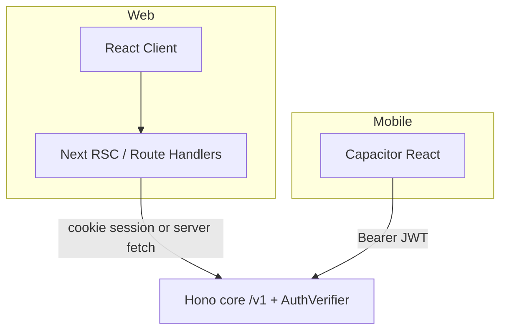
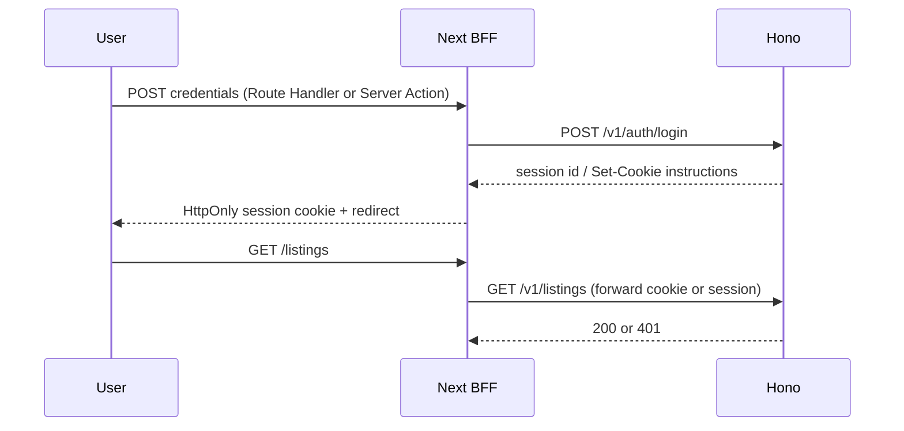

# FE-10 — Auth UX & BFF role of Next

| Field | Value |
|-------|--------|
| Category | 03-frontend-react-next |
| Status | `complete` |
| Stack | Next.js App Router · cookies / sessions · Route Handlers · Hono `/v1` |
| Prereqs | [FE-04](FE-04-next-app-router.md) · [FE-05](FE-05-rsc-client.md) · [FE-06](FE-06-forms-mutations.md) · [BE-06](../02-backend-hono-bun/BE-06-auth-session-jwt.md) |
| Related Docs | [`../../knowledge/architecture-styles/bff.md`](../../knowledge/architecture-styles/bff.md) · [`../../examples/auth-session/README.md`](../../examples/auth-session/README.md) · [`../../walkthrough/14-auth-session/README.md`](../../walkthrough/14-auth-session/README.md) · [`../../tech-space/frontend-architecture.md`](../../tech-space/frontend-architecture.md) |

## Learning outcomes

- Separate **auth UX** (login, redirects, loading, errors) from **auth authority** (Hono verifies every protected write).
- Place Next as an optional **web BFF**: aggregate, shape, hold web session cookies — never a second domain.
- Design web (cookie) vs mobile (bearer) paths that share one API principal model ([BE-06](../02-backend-hono-bun/BE-06-auth-session-jwt.md)).
- Know CSRF / cookie / redirect failure modes for marketplace flows.

---

## 1. Dummy

The browser shows “logged in.” The **API** decides if `POST /v1/listings` is allowed. Next may help the **web** client with cookies and page gates; Capacitor still talks to Hono with a token strategy.



**Why it exists:** multi-client marketplace without leaking secrets or duplicating pricing/permission rules in UI.

Deep BFF methodology: [BFF knowledge](../../knowledge/architecture-styles/bff.md).

---

## 2. When to use / when not

| Pattern | Use when | Avoid when |
|---------|----------|------------|
| Next as web BFF | Need HttpOnly cookies, RSC data for SEO shells, hide internal URLs | BFF starts owning commission / listing invariants |
| Browser → Hono only | Simple SPA / early slice; CORS + CSRF planned | You need server-only secrets on the web path |
| Separate mobile BFF | Mobile payloads diverge heavily | One well-shaped `/v1` already fits both clients |

### Auth UX vs security

| Layer | Owns |
|-------|------|
| Login form / “session expired” toast | UX ([FE-09](FE-09-a11y-i18n.md) labels/errors) |
| `middleware.ts` redirect to `/login` | Web DX — **not** the only check |
| Hono `AuthVerifier` | Source of truth for protected routes |

---

## 3. Working

### Recommended web shape (this blueprint)

```text
apps/web/
  app/
    login/page.tsx              # client form island
    (app)/listings/...          # gated layouts
    api/auth/login/route.ts     # optional BFF: set cookie after Hono login
    api/auth/logout/route.ts
  middleware.ts                 # soft gate: redirect unauthenticated pages
apps/api/                       # Hono: POST /v1/auth/login, session verify
```

### Login sequence (cookie web)



If the client calls Hono **directly** with cookies: same-site / CORS + CSRF plan required ([BE-06](../02-backend-hono-bun/BE-06-auth-session-jwt.md)).

### Soft gate (Next) — not enough alone

```ts
// middleware.ts — UX redirect only
import { NextResponse } from "next/server";
import type { NextRequest } from "next/server";

export function middleware(req: NextRequest) {
  const session = req.cookies.get("session");
  if (!session && req.nextUrl.pathname.startsWith("/listings/new")) {
    return NextResponse.redirect(new URL("/login", req.url));
  }
  return NextResponse.next();
}
```

Hono must still reject unauthenticated `POST` with `401` + stable `code`.

### Auth UX checklist

| Moment | UX |
|--------|-----|
| Submit login | Disable button; announce errors ([FE-06](FE-06-forms-mutations.md) / [FE-09](FE-09-a11y-i18n.md)) |
| Success | Redirect to intended URL (`?next=`) safely (open-redirect allowlist) |
| 401 mid-session | Clear client cache; send to login; preserve return path |
| Logout | Call API + clear cookie; invalidate Query keys |

### What BFF may / must not do

| May | Must not |
|-----|----------|
| Aggregate listings + user profile for one page | Re-implement domain validation as the only check |
| Map DTOs for web | Hold Stripe secrets in Client Components |
| Set HttpOnly cookies | Trust `localStorage` as the session for web |

### Worst vs best

```text
❌ “isLoggedIn” only in React context; API open
✅ Cookie/JWT verified on Hono every protected write
❌ Server Action embeds pricing rules “because it’s server”
✅ Server Action / Route Handler calls Hono or shared use case port
❌ JWT in NEXT_PUBLIC_
✅ HttpOnly cookie (web) or secure storage + bearer (mobile)
```

---

## 4. Rich

### Failure modes

| Failure | Fix |
|---------|-----|
| CSRF on cookie mutations | SameSite + CSRF token / BFF same-origin POSTs |
| Open redirect after login | Allowlist relative paths only |
| Session in RSC vs client desync | Single session source; invalidate Query on auth change |
| Mobile breaks on cookie auth | Bearer path + shared `AuthUser` ([BE-06](../02-backend-hono-bun/BE-06-auth-session-jwt.md)) |
| BFF becomes second backend | Review: invariants only in core modules / domain |

### Test seams

- Playwright: login → create listing → logout → create fails.
- Hono `app.request`: protected route without cookie → 401.
- Middleware redirect does **not** replace API tests.

### Packages

| Package | Role |
|---------|------|
| `packages/contracts` | Login request/response Zod |
| Hono auth port | Verify principal |
| `packages/ui` | Presentational login fields — no fetch secrets |

---

## 5. Professional / CTO

| Stance | Guidance |
|--------|----------|
| Authority | One core API auth story; channels adapt |
| Next BFF | Pay the hop when cookies/RSC aggregation help web |
| Cost | Dual cookie+JWT adapters > one brittle “JWT everywhere in localStorage” |
| Compliance | Session fixation, CSRF, logout completeness — security track owns depth |

**ADR triggers:** Next Route Handlers as mandatory web BFF · cookie-only vs dual auth · IdP (Auth.js / OIDC) vs custom session.

**Automate:** contract tests for `/v1/auth/*`; E2E login; ban `NEXT_PUBLIC_` secrets in CI grep.

**Evolution:** start Hono-direct for the first slice; introduce Next BFF when cookie/CSRF or aggregation pain appears — document the switch.

---

## Exercises

1. **Dummy:** Draw where a forged “logged in” React flag still fails to create a listing.
2. **Working:** Sketch login Route Handler → Hono → Set-Cookie → middleware gate for `/listings/new`.
3. **CTO memo:** Cookie web + Bearer mobile vs JWT-only both clients — pick one primary for year-1 and one risk.

## Related

- [FE-11 CTO SPA vs Next vs mobile](FE-11-cto-spa-next-mobile.md) · [FE-09 a11y](FE-09-a11y-i18n.md)
- [BE-06 Auth](../02-backend-hono-bun/BE-06-auth-session-jwt.md) · [BFF](../../knowledge/architecture-styles/bff.md)
