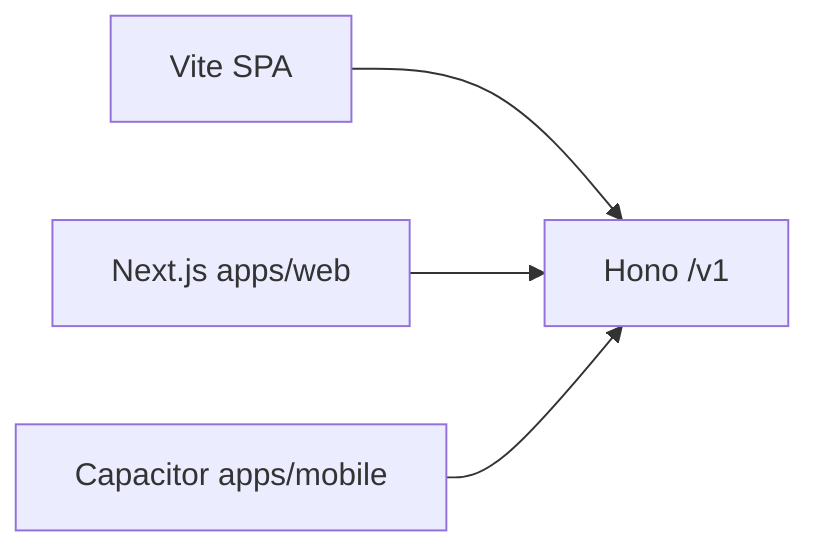
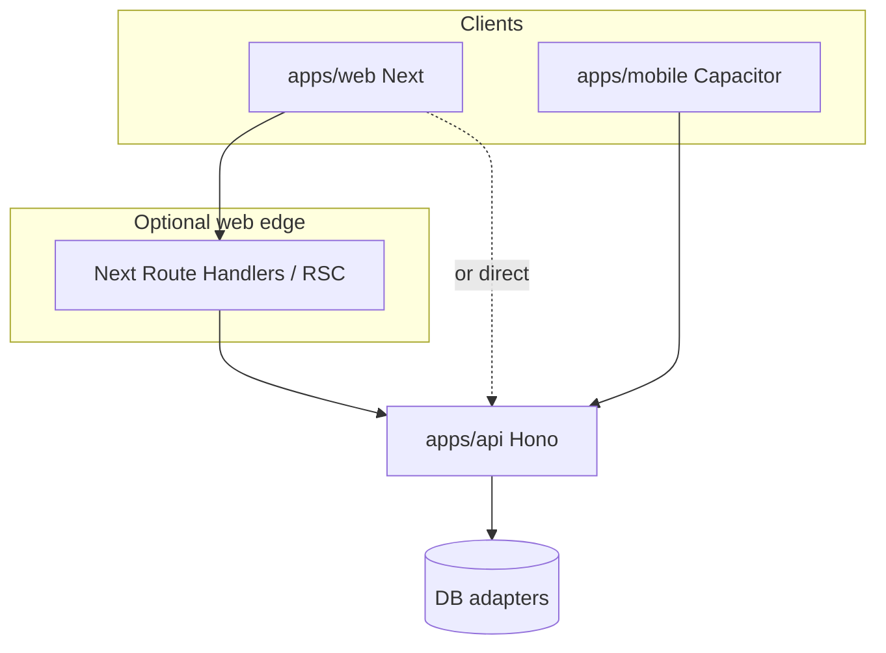

# FE-11 — CTO: SPA vs Next vs mobile shell

| Field | Value |
|-------|--------|
| Category | 03-frontend-react-next |
| Status | `complete` |
| Stack | Vite SPA · Next.js App Router · Capacitor + React · Hono |
| Prereqs | [FE-04](FE-04-next-app-router.md) · [FE-05](FE-05-rsc-client.md) · [FE-08](FE-08-performance.md) · [FE-10](FE-10-auth-ux-bff.md) |
| Related Docs | [`../../tech-space/project-blueprint.md`](../../tech-space/project-blueprint.md) · [`../../tech-space/frontend-architecture.md`](../../tech-space/frontend-architecture.md) · [`../../tech-space/mobile-architecture.md`](../../tech-space/mobile-architecture.md) · [`../../knowledge/architecture-styles/bff.md`](../../knowledge/architecture-styles/bff.md) |

## Learning outcomes

- Choose **delivery shells** (Vite SPA, Next web, Capacitor) without forking domain rules.
- State this blueprint’s **default**: Next `apps/web` + Hono API + Capacitor `apps/mobile` later.
- Write a short **ADR-ready** recommendation with cost, SEO, auth, and team skills.
- Know what belongs in shared packages vs what must stay shell-specific.

---

## 1. Dummy

Three ways to ship UI to humans — **one** Hono API of record:



**Why the choice matters:** SEO, auth cookie story, CWV, native plugins, and hiring — not “which React tutorial is trendiest.”

---

## 2. When to use / when not

| Shell | Prefer when | Prefer not when |
|-------|-------------|-----------------|
| **Vite SPA** | Internal tools, Capacitor-first lesson, zero SEO | Public marketplace listing SEO / RSC teaching target |
| **Next App Router** | Public web, SSR/RSC, web BFF cookies | Tiny kata; team cannot afford Next complexity yet |
| **Capacitor** | Store presence, camera/push, shared React | Need pixel-perfect native UI kits day one |

### Blueprint default (do not silently replace)

From [`project-blueprint.md`](../../tech-space/project-blueprint.md):

| App | Role |
|-----|------|
| `apps/web` | Next.js — primary web UI |
| `apps/mobile` | Capacitor + React — native shell |
| `apps/api` (or clouds server) | Hono — invariants |

Existing Vite `apps/market-place-app` may remain a **learning/scaffold** peer — map concepts to Next when promoting the product web surface.

---

## 3. Working

### Decision matrix (marketplace)

| Concern | Vite SPA | Next | Capacitor |
|---------|----------|------|-----------|
| Public SEO / LCP for listings | Weak without extra work | Strong (RSC/SSR) | N/A (store app) |
| HttpOnly session cookies | Possible with care | Natural + optional BFF | Prefer bearer ([FE-10](FE-10-auth-ux-bff.md)) |
| Shared `packages/ui` | Client components | Client + RSC shells | Client only — no RSC in shared UI |
| Ops surface | Static host + API | Node/edge for Next + API | Stores + API + native CI |
| Interview / CTO signal | Fine for API-first demos | Matches production web | Multi-client story |

### C4-ish containers



### Shared vs shell-specific

| Shared (`packages/*`) | Shell-specific |
|-----------------------|----------------|
| `contracts` Zod | Next `app/` routes, `middleware.ts` |
| Domain rules (server-side) | Capacitor plugins / secure storage |
| Presentational `ui` (client-safe) | Store icons, splash, deep links |
| API client helpers | Cookie jar vs bearer attach |

### Migration paths

```text
1. API + Vite SPA slice          → prove /v1
2. Add Next apps/web             → SEO + RSC teaching target
3. Add Capacitor                 → same API, token auth
```

Or Capacitor-from-Vite if mobile is the product bet — still keep Hono canonical ([mobile-architecture.md](../../tech-space/mobile-architecture.md)).

### Worst vs best

```text
❌ Copy listing commission logic into SPA, Next Server Action, and mobile
✅ One Hono/domain path; shells only adapt transport + UX
❌ RSC-only components inside packages/ui shared with Capacitor
✅ Client-safe UI package; Next composes RSC shells locally
❌ “We’ll decide SPA vs Next later” with no ADR after first public URL
✅ ADR when the public web shell is chosen
```

---

## 4. Rich

### Failure modes

| Failure | Fix |
|---------|-----|
| Two competing web apps forever | Pick primary public shell; demote the other to demo |
| Auth strategy per shell with no port | Shared `AuthUser` + dual adapters ([BE-06](../02-backend-hono-bun/BE-06-auth-session-jwt.md)) |
| Bundle ships Next APIs into mobile | Boundary lint; separate entrypoints |
| Overbuilding BFF for one SPA | Skip BFF until second client or cookie pain ([bff.md](../../knowledge/architecture-styles/bff.md)) |

### Cost sketch (order-of-magnitude thinking)

| Choice | Main cost drivers |
|--------|-------------------|
| SPA-only | Fast ship; SEO/CWV work later or never |
| Next | Framework expertise, hosting, RSC discipline |
| + Capacitor | Store review, native CI, plugin matrix |
| + Web BFF | Extra hop & ownership — buy when aggregation/cookies need it |

### Test seams

- Contract tests against Hono independent of shell.
- Playwright on Next critical paths; Detox/native later for Capacitor.
- Visual/a11y on shared `packages/ui` once, reuse.

---

## 5. Professional / CTO

| Stance | Guidance |
|--------|----------|
| Default here | **Next web + Hono + Capacitor later** |
| Product bet | If SEO-null internal tool → SPA may win — write the ADR |
| Org | One API team boundary; FE owns shells; don’t split domain by client |
| Evolution | Feature folders → FSD as team grows ([FE-07](FE-07-fsd-feature-folders.md)); perf budgets on the public shell ([FE-08](FE-08-performance.md)) |

**ADR triggers:** primary web shell · Capacitor yes/no year-1 · mandatory Next BFF · deprecating Vite marketplace app.

**Automate:** monorepo pipelines per app; shared contract package in CI for all clients.

**Executive one-liner:** “Clients are disposable skins; the modular API and contracts are the company.”

---

## Exercises

1. **Dummy:** For a SEO-critical listing detail URL, which shell is the default here and why (one sentence)?
2. **Working:** Fill the decision matrix for “host admin console, no SEO” — pick SPA or Next.
3. **CTO memo (½ page):** Recommend year-1 shells for this marketplace blueprint: web + mobile + auth approach + one rejected alternative.

## Related

- [FE-10 Auth UX & BFF](FE-10-auth-ux-bff.md) · [FE-08 Performance](FE-08-performance.md) · Phase 4 [data stores](../04-data-stores/README.md)
- [Project blueprint](../../tech-space/project-blueprint.md) · [Mobile architecture](../../tech-space/mobile-architecture.md)

---

## Phase 3 exit

After FE-01–FE-11 you can: build React/Next UI against Hono `/v1`, structure features, mind CWV/a11y, design auth UX without lying about security, and defend SPA vs Next vs Capacitor as a CTO.

**Next course phase:** [Phase 4 — Data stores](../PLAN.md) (`implement Phase 4 wave 4.1`).
