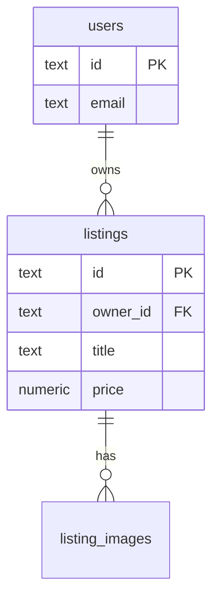

# DB-01 — Relational model & SQL core

| Field | Value |
|-------|--------|
| Category | 04-data-stores |
| Status | `complete` |
| Stack | SQL · tables · keys · joins · marketplace listings mental model |
| Prereqs | [FD-02 HTTP](../00-foundations/FD-02-http.md) · [FD-03 TypeScript](../00-foundations/FD-03-typescript.md) helpful |
| Related Docs | [`../../tech-space/database-abstraction.md`](../../tech-space/database-abstraction.md) · [`../../tech-space/decisions/0002-database-adapters.md`](../../tech-space/decisions/0002-database-adapters.md) · [`../../examples/multi-db-notes/README.md`](../../examples/multi-db-notes/README.md) |

## Learning outcomes

- Model marketplace data as **tables, keys, and relationships** — not as JSON blobs by default.
- Write **CRUD SQL** with parameters (never string-concatenated user input).
- Choose **normalization vs denormalization** with an explicit reason.
- Know what stays **engine-agnostic** vs what adapters must specialize later ([DB-02](DB-02-postgres-essentials.md), [DB-03](DB-03-mariadb-differences.md)).

---

## 1. Dummy

SQL stores rows in tables. A **listing** is a row; a **user** is a row; “who owns this listing?” is a **foreign key**.



**Why it exists:** Hono use cases persist through a repository port — the mental model underneath every adapter is still relational SQL ([database-abstraction.md](../../tech-space/database-abstraction.md)).

---

## 2. When to use / when not

| Prefer relational SQL when | Prefer something else when |
|----------------------------|----------------------------|
| Invariants, joins, reporting, multi-user writes | Ephemeral cache (Redis) for hot keys |
| Marketplace listings/orders with clear entities | Full-text-only search engine as **system of record** |
| Teaching ports/adapters across engines | Document DB as sole store without a reason |

### Normalization vs denormalize

| Normalize (3NF mindset) | Denormalize |
|-------------------------|-------------|
| Owner email lives on `users`, not copied on every listing | Cache `owner_display_name` on listing for a read-heavy feed |
| One source of truth for price rules | Precomputed search document — refresh on write |

**Rule:** denormalize for a measured read path; document how it stays consistent.

---

## 3. Working

### Keys

| Kind | Role |
|------|------|
| **Primary key (PK)** | Stable identity of a row |
| **Foreign key (FK)** | Relationship + optional referential integrity |
| **Unique** | Natural keys (email) when required |
| **Surrogate** | `id` generated by app/DB — usual for APIs |

```sql
-- Engine-agnostic sketch (types differ per vendor — see DB-02 / DB-03)
CREATE TABLE users (
  id          TEXT PRIMARY KEY,
  email       TEXT NOT NULL UNIQUE,
  created_at  TIMESTAMP NOT NULL
);

CREATE TABLE listings (
  id          TEXT PRIMARY KEY,
  owner_id    TEXT NOT NULL REFERENCES users (id),
  title       TEXT NOT NULL,
  price_cents INTEGER NOT NULL CHECK (price_cents >= 0),
  status      TEXT NOT NULL,
  created_at  TIMESTAMP NOT NULL
);
```

### CRUD (parameterized)

```sql
-- Create
INSERT INTO listings (id, owner_id, title, price_cents, status, created_at)
VALUES ($1, $2, $3, $4, $5, $6);

-- Read
SELECT id, owner_id, title, price_cents, status, created_at
FROM listings
WHERE id = $1;

-- List by owner
SELECT id, title, price_cents, status
FROM listings
WHERE owner_id = $1
ORDER BY created_at DESC
LIMIT $2;

-- Update
UPDATE listings
SET title = $2, price_cents = $3
WHERE id = $1 AND owner_id = $4;

-- Delete (soft-delete often better for marketplace)
UPDATE listings SET status = 'deleted' WHERE id = $1;
```

Placeholder style (`$1` vs `?`) is **adapter-specific** — domain never embeds driver SQL APIs.

### Joins (read model)

```sql
SELECT l.id, l.title, u.email AS owner_email
FROM listings l
JOIN users u ON u.id = l.owner_id
WHERE l.status = 'published'
LIMIT 50;
```

### Where SQL lives in this monorepo

| Layer | Allowed |
|-------|---------|
| `packages/domain` / use cases | Entities, rules — **no** SQL strings |
| Persistence **port** | `createListing`, `listListings` method shapes |
| **Adapter** (`packages/db`) | Vendor SQL + mapping to domain types |
| Hono routes | Call use cases — not raw SQL |

### Worst vs best

```text
❌ sql = `SELECT * FROM listings WHERE id = '${id}'`  -- injection
✅ parameterized queries in the adapter
❌ SELECT * in production paths
✅ explicit columns matching the repository contract
❌ Business “can publish?” only as a CHECK you never evolve
✅ Domain rule + DB constraints for hard invariants (price >= 0)
```

---

## 4. Rich

### Failure modes

| Failure | Fix |
|---------|-----|
| Orphan listings | FK + transaction on create ([DB-07](README.md) later) |
| Money as `FLOAT` | Integer cents or `NUMERIC` — never binary float for currency |
| God table `data JSON` | Extract columns you query/filter on |
| Leaking SQL into React | API DTO only |

### Test seams

- Insert + select round-trip in adapter contract tests.
- Reject negative `price_cents` at DB **and** domain.
- Join query returns expected owner email for a fixture.

### Meaningful differences (preview)

Same repository port; adapters diverge on `RETURNING`, boolean storage, upsert syntax — that is intentional ([ADR 0002](../../tech-space/decisions/0002-database-adapters.md)). Do not hide them inside use cases with `if (driver === ...)`.

---

## 5. Professional / CTO

| Stance | Guidance |
|--------|----------|
| Schema | Design for invariants and query paths you own |
| ORM | Optional later; this course starts SQL-visible ([ADR 0002](../../tech-space/decisions/0002-database-adapters.md)) |
| Cost | Bad keys/types cost more than “pick Postgres vs MariaDB” debates |

**ADR triggers:** UUID vs text ids · soft-delete policy · money representation.

**Automate:** migration CI; contract tests per adapter; ban string-built SQL in lint where feasible.

---

## Exercises

1. **Dummy:** Draw PK/FK for `users` → `listings` → `listing_images`.
2. **Working:** Write parameterized SQL for “list published listings for owner X, limit 20.”
3. **CTO memo:** One denormalized column you’d add to `listings` for a home feed — and how you’d keep it fresh.

## Related

- [DB-02 PostgreSQL essentials](DB-02-postgres-essentials.md) · [DB-03 MariaDB differences](DB-03-mariadb-differences.md)
- [Database abstraction](../../tech-space/database-abstraction.md) · [ADR 0002](../../tech-space/decisions/0002-database-adapters.md)
