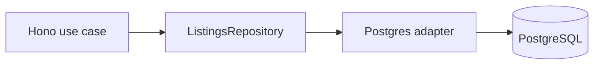

# DB-02 — PostgreSQL essentials

| Field | Value |
|-------|--------|
| Category | 04-data-stores |
| Status | `complete` |
| Stack | PostgreSQL · `pg` / Drizzle-friendly SQL · Docker Compose |
| Prereqs | [DB-01](DB-01-sql-core.md) |
| Related Docs | [`../../tech-space/database-abstraction.md`](../../tech-space/database-abstraction.md) · [`../../walkthrough/11-postgres-adapter/README.md`](../../walkthrough/11-postgres-adapter/README.md) · [`../../clouds/market-place-server/03-drizzle-setup.md`](../../clouds/market-place-server/03-drizzle-setup.md) · ADR 0002 |

## Learning outcomes

- Use Postgres as the **primary server engine** for production-shaped marketplace data.
- Pick **types** that match money, time, and identity (`timestamptz`, `numeric`/`bigint` cents, `boolean`, `jsonb`).
- Use **`RETURNING`**, constraints, and schemas that adapters can rely on.
- Place Postgres behind the **same repository port** as libSQL/MariaDB — dialect lives in the adapter.

---

## 1. Dummy

PostgreSQL is a full-featured SQL engine: strong types, JSON, transactions, extensions. In this blueprint it is the **cloud/server** default; libSQL stays the light local option ([ADR 0002](../../tech-space/decisions/0002-database-adapters.md)).



**Why it exists:** production durability, tooling, and “meaningful” SQL features without pretending every engine is identical.

---

## 2. When to use / when not

| Prefer Postgres when | Prefer another driver when |
|----------------------|----------------------------|
| Production API, complex queries, `jsonb`, strong constraints | Zero-Docker local kata → libSQL first |
| Team already runs Compose/`pg` | Hard MariaDB lock-in at customer site ([DB-03](DB-03-mariadb-differences.md)) |
| Teaching EXPLAIN / indexes later (wave 4.2) | Embedded single-file DB for offline-only demos |

---

## 3. Working

### Types that matter (marketplace)

| Need | Prefer in Postgres | Avoid |
|------|--------------------|-------|
| Money | `bigint` cents **or** `numeric(12,2)` | `float` / `double` |
| Time | `timestamptz` | `timestamp` without time zone |
| Flags | `boolean` | `'true'` text |
| Flexible attrs | `jsonb` for sparse metadata | Replacing all columns with one JSON document |
| IDs | `text`/`uuid`/`bigint generated … as identity` — pick one in ADR | Mixing strategies per table without reason |
| Strings | `text` | Pointless `varchar(255)` unless length is a real constraint |

```sql
CREATE TABLE listings (
  id           TEXT PRIMARY KEY,
  owner_id     TEXT NOT NULL REFERENCES users (id),
  title        TEXT NOT NULL,
  price_cents  BIGINT NOT NULL CHECK (price_cents >= 0),
  status       TEXT NOT NULL CHECK (status IN ('draft', 'published', 'deleted')),
  attrs        JSONB NOT NULL DEFAULT '{}'::jsonb,
  created_at   TIMESTAMPTZ NOT NULL DEFAULT now(),
  updated_at   TIMESTAMPTZ NOT NULL DEFAULT now()
);

CREATE INDEX listings_owner_created_idx
  ON listings (owner_id, created_at DESC);
```

### `RETURNING` (adapter-friendly)

```sql
INSERT INTO listings (id, owner_id, title, price_cents, status)
VALUES ($1, $2, $3, $4, $5)
RETURNING id, owner_id, title, price_cents, status, created_at;
```

Capability flag in abstraction docs: `returning: true` for Postgres.

### Upsert sketch

```sql
INSERT INTO listings (id, owner_id, title, price_cents, status)
VALUES ($1, $2, $3, $4, $5)
ON CONFLICT (id) DO UPDATE
SET title = EXCLUDED.title,
    price_cents = EXCLUDED.price_cents,
    updated_at = now()
RETURNING *;
```

Syntax differs on MariaDB — keep this **in the Postgres adapter only**.

### JSONB query (when justified)

```sql
SELECT id, title
FROM listings
WHERE attrs @> '{"featured": true}'::jsonb
  AND status = 'published';
```

Index with GIN when this path is hot (detail in wave 4.2 indexing).

### Local / Compose

Repo `infra/docker-compose.yml` typically exposes Postgres (`POSTGRES_USER` / `POSTGRES_DB`). Walkthrough: [11-postgres-adapter](../../walkthrough/11-postgres-adapter/README.md). Clouds reference may use Drizzle — still keep **port boundaries** ([03-drizzle-setup](../../clouds/market-place-server/03-drizzle-setup.md)).

### Worst vs best

```text
❌ timestamp without time zone for “created_at”
✅ timestamptz; store UTC, format in the client locale ([FE-09](../03-frontend-react-next/FE-09-a11y-i18n.md))
❌ if (driver === 'postgres') inside createListing use case
✅ Postgres-only SQL inside packages/db postgres adapter
❌ SELECT * + parse loosely in TypeScript
✅ RETURNING explicit columns → mapped domain type
```

---

## 4. Rich

### Failure modes

| Failure | Fix |
|---------|-----|
| Connection exhaustion | Pool limits + timeouts (DB-11 later); don’t open a client per request unbound |
| Migration drift | Vendor migration folder + CI apply ([DB-05](DB-05-migrations.md)) |
| RLS assumptions | This blueprint’s API auth is Hono — don’t assume Supabase RLS unless you adopt it |
| `jsonb` as escape hatch for everything | Promote filtered fields to columns |

### Test seams

- Contract test: create listing → `RETURNING` maps to domain `Listing`.
- Check constraint rejects negative cents.
- Compose healthcheck before integration suite.

### Capability row (Postgres)

| Flag | Postgres |
|------|----------|
| `returning` | Yes |
| `json` | `jsonb` |
| `upsert` | `ON CONFLICT` |
| `boolean` | Native |

---

## 5. Professional / CTO

| Stance | Guidance |
|--------|----------|
| Default server DB | PostgreSQL for this blueprint’s production shape |
| Managed offering | RDS / Cloud SQL / Neon / Supabase — same SQL literacy |
| ORM | Drizzle/Kysely OK if adapters stay honest about dialect ([ADR 0002](../../tech-space/decisions/0002-database-adapters.md)) |

**ADR triggers:** identity strategy · cents vs numeric · mandatory `jsonb` columns · managed Postgres vendor.

**Automate:** `pg_dump` backup drill later (wave 4.4); EXPLAIN budgets on hot listing queries (wave 4.2).

**Cost:** Postgres ops (disk, connections, replicas) dominate long-term — schema discipline beats premature sharding.

---

## Exercises

1. **Dummy:** Rewrite a `float price` column into a safer Postgres type for listings.
2. **Working:** Write `INSERT … RETURNING` for create-listing matching your repository DTO.
3. **CTO memo:** Managed Postgres vs self-hosted Compose-in-prod — one risk each.

## Related

- [DB-01 SQL core](DB-01-sql-core.md) · [DB-03 MariaDB differences](DB-03-mariadb-differences.md)
- [Walkthrough 11](../../walkthrough/11-postgres-adapter/README.md) · [Database abstraction](../../tech-space/database-abstraction.md)
