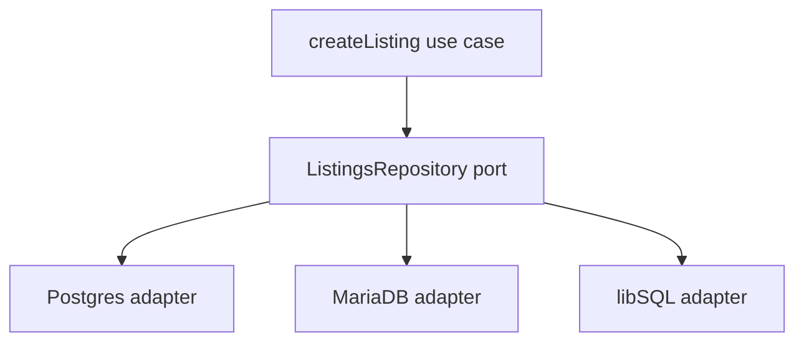

# DB-03 — MariaDB / MySQL differences

| Field | Value |
|-------|--------|
| Category | 04-data-stores |
| Status | `complete` |
| Stack | MariaDB · MySQL-compatible SQL · adapter capability flags |
| Prereqs | [DB-01](DB-01-sql-core.md) · [DB-02](DB-02-postgres-essentials.md) |
| Related Docs | [`../../tech-space/database-abstraction.md`](../../tech-space/database-abstraction.md) · [`../../tech-space/decisions/0002-database-adapters.md`](../../tech-space/decisions/0002-database-adapters.md) · [`../../examples/multi-db-notes/README.md`](../../examples/multi-db-notes/README.md) |

## Learning outcomes

- Treat MariaDB as a **first-class adapter target**, not “Postgres with different Docker image.”
- List **meaningful differences** that break naïve shared SQL (booleans, upsert, returning, JSON, quoting).
- Encode differences as **adapter code + capability flags + contract tests** — never `if (driver)` in use cases.
- Know when a customer/ops constraint forces MariaDB and what you give up vs Postgres.

---

## 1. Dummy

MariaDB speaks SQL too — but dialects diverge. The repository port stays identical; the **MariaDB adapter** owns the dialect pain.



**Why it exists:** real orgs standardize on MariaDB/MySQL; this blueprint teaches honest multi-engine design ([ADR 0002](../../tech-space/decisions/0002-database-adapters.md)).

---

## 2. When to use / when not

| Prefer MariaDB when | Prefer Postgres when |
|---------------------|----------------------|
| Org/hosting standard is MariaDB/MySQL | Greenfield API with Postgres ops skill |
| Existing replica/backup toolchain is MySQL-family | Need Postgres-first features (`jsonb` ops, richer EXPLAIN culture here) |
| Teaching “don’t fake portability” | Single-engine product with no multi-adapter goal |

**When not:** inventing a fourth dialect “for completeness” with zero tests.

---

## 3. Working

### Meaningful differences (adapter checklist)

| Topic | PostgreSQL | MariaDB / MySQL-family | Adapter action |
|-------|------------|------------------------|----------------|
| Boolean | Native `boolean` | Often `TINYINT(1)` / `BOOLEAN` alias — verify driver mapping | Map to domain `boolean` explicitly |
| Return inserted row | `RETURNING *` | Limited / version-dependent; often `INSERT` then `SELECT` by id | Branch **inside adapter**; capability `returning` |
| Upsert | `ON CONFLICT … DO UPDATE` | `ON DUPLICATE KEY UPDATE` | Separate SQL strings |
| JSON | `jsonb` + operators | `JSON` type; different functions | Capability `json`; avoid shared JSON SQL |
| Placeholders | `$1, $2` (`pg`) | `?` (mysql2) | Driver client API |
| Identifier quoting | `"camelCase"` | `` `camelCase` `` | Prefer `snake_case` unquoted |
| `ILIKE` | Yes | Use `LIKE` + collation / `LOWER()` | Don’t share ILIKE strings |
| Sequences / identity | `GENERATED … AS IDENTITY` / sequences | `AUTO_INCREMENT` | Id strategy per migration folder |
| Strict mode / SQL modes | Different knobs | `sql_mode` can change “invalid date” behavior | Pin modes in Compose |

### Same port, two SQL shapes

```ts
// packages/application — engine-agnostic
export interface ListingsRepository {
  create(input: CreateListing): Promise<Listing>;
}
```

```sql
-- postgres adapter
INSERT INTO listings (id, owner_id, title, price_cents, status)
VALUES ($1, $2, $3, $4, $5)
RETURNING id, owner_id, title, price_cents, status, created_at;
```

```sql
-- mariadb adapter (illustrative)
INSERT INTO listings (id, owner_id, title, price_cents, status, created_at)
VALUES (?, ?, ?, ?, ?, ?);
-- then:
SELECT id, owner_id, title, price_cents, status, created_at
FROM listings WHERE id = ?;
```

```sql
-- mariadb upsert sketch
INSERT INTO listings (id, owner_id, title, price_cents, status)
VALUES (?, ?, ?, ?, ?)
ON DUPLICATE KEY UPDATE
  title = VALUES(title),
  price_cents = VALUES(price_cents);
```

### Schema sketch (MariaDB-oriented)

```sql
CREATE TABLE listings (
  id           VARCHAR(64) PRIMARY KEY,
  owner_id     VARCHAR(64) NOT NULL,
  title        VARCHAR(500) NOT NULL,
  price_cents  BIGINT NOT NULL,
  status       VARCHAR(32) NOT NULL,
  is_featured  TINYINT(1) NOT NULL DEFAULT 0,
  attrs        JSON NULL,
  created_at   DATETIME(3) NOT NULL,
  CONSTRAINT fk_listings_owner FOREIGN KEY (owner_id) REFERENCES users (id),
  CONSTRAINT chk_price CHECK (price_cents >= 0)
) ENGINE=InnoDB DEFAULT CHARSET=utf8mb4;
```

Use **InnoDB** for FK + transactions. Prefer `utf8mb4`.

### Capability row (MariaDB)

| Flag | Typical MariaDB adapter |
|------|-------------------------|
| `returning` | Often false → follow-up SELECT |
| `json` | Yes, dialect-specific |
| `upsert` | `ON DUPLICATE KEY UPDATE` |
| `boolean` | Tinyint mapping |

Document measured truth in `database-abstraction.md` as you implement — don’t invent runtime support.

### Worst vs best

```text
❌ Copy-paste Postgres SQL into MariaDB adapter and “fix later”
✅ Vendor SQL + contract tests on both engines
❌ Domain parses 0/1 sometimes and boolean sometimes
✅ Adapter normalizes to domain boolean
❌ Shared migrations that only apply cleanly on Postgres
✅ migrations/postgres and migrations/mariadb (until unified tooling verified)
```

---

## 4. Rich

### Failure modes

| Failure | Fix |
|---------|-----|
| Silent truncation of `title` | Sized columns + app validation via Zod contracts |
| FK ignored (MyISAM / wrong engine) | Force InnoDB in migrations |
| Timezone-naive `DATETIME` surprises | Store UTC; document; consider `TIMESTAMP` carefully |
| “Works on my Postgres” CI only | Matrix: libSQL + Postgres + MariaDB contract jobs |

### Test seams

- Same `ListingsRepository` suite with `DATABASE_DRIVER=mariadb`.
- Assert create returns equivalent domain object without requiring `RETURNING`.
- Boolean/`TINYINT` round-trip test.

### Where it lives

```text
packages/db/
  listings/
    postgres-listings-repository.ts
    mariadb-listings-repository.ts
    libsql-listings-repository.ts
  create-listings-repository.ts   # switch on driver at composition root
```

Composition root (`createApp(deps)`) picks the adapter — use cases never switch.

---

## 5. Professional / CTO

| Stance | Guidance |
|--------|----------|
| Multi-adapter | Teaching + real portability tax — budget contract tests |
| Single engine prod | One adapter is enough; keep the **port** for future escape |
| MariaDB vs MySQL | Close family; still verify version + `sql_mode` per deploy |

**ADR triggers:** supporting MariaDB in prod · dropping an engine · adopting Prisma multi-provider (usually rejected here for hiding differences).

**Automate:** CI matrix per driver; capability table in docs updated when flags change.

**Cost:** three dialects ≈ nearly three persistence codepaths — worth it for teaching and customer lock-in escape; expensive if nobody runs the matrix.

---

## Exercises

1. **Dummy:** Name three SQL features you must not share verbatim between Postgres and MariaDB adapters.
2. **Working:** Sketch MariaDB `create` without `RETURNING` that still satisfies `Promise<Listing>`.
3. **CTO memo:** Customer mandates MariaDB — what do you keep identical (port/tests) and what do you fork (migrations/SQL)?

## Related

- [DB-01 SQL core](DB-01-sql-core.md) · [DB-02 Postgres](DB-02-postgres-essentials.md) · next [DB-04 SQLite/libSQL](DB-04-sqlite-libsql.md)
- [ADR 0002](../../tech-space/decisions/0002-database-adapters.md) · [multi-db-notes example](../../examples/multi-db-notes/README.md)
