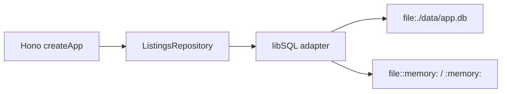

# DB-04 — SQLite & libSQL (local / edge)

| Field | Value |
|-------|--------|
| Category | 04-data-stores |
| Status | `complete` |
| Stack | SQLite · libSQL (`@libsql/client`) · file / memory URLs |
| Prereqs | [DB-01](DB-01-sql-core.md) · [DB-02](DB-02-postgres-essentials.md) · [DB-03](DB-03-mariadb-differences.md) |
| Related Docs | [`../../walkthrough/07-database-port-and-libsql/README.md`](../../walkthrough/07-database-port-and-libsql/README.md) · [`../../tech-space/database-abstraction.md`](../../tech-space/database-abstraction.md) · [ADR 0002](../../tech-space/decisions/0002-database-adapters.md) |

## Learning outcomes

- Use **libSQL/SQLite** as the **first local driver** for DX — not as silent production Postgres.
- Know SQLite’s **limits** (concurrency, types affinity, missing server features) vs Postgres/MariaDB.
- Implement a **libSQL adapter** behind the same repository port.
- Choose file vs memory vs remote libSQL with eyes open.

---

## 1. Dummy

SQLite is an **embedded** SQL engine (one process, often one file). **libSQL** is an open evolution / client ecosystem compatible with SQLite workflows — this blueprint’s preferred **zero-Docker** path ([ADR 0002](../../tech-space/decisions/0002-database-adapters.md)).



**Why it exists:** ship a vertical slice on a laptop without Compose; same port later swaps to Postgres.

---

## 2. When to use / when not

| Prefer libSQL/SQLite when | Prefer Postgres/MariaDB when |
|---------------------------|------------------------------|
| Local DX, CI unit/integration without Docker | Multi-writer production API |
| Edge / single-node / demo | Need `jsonb` ops, rich roles, replicas as designed |
| First adapter in walkthrough 07 | Customer already standardized on server SQL |

### When not

- Treating a shared network SQLite file as a multi-instance production DB.
- Claiming “SQLite = Postgres” in interviews without naming concurrency/type differences.

---

## 3. Working

### Env shape (illustrative)

```bash
DATABASE_DRIVER=libsql
DATABASE_URL=file:./data/listings.db
# tests:
# DATABASE_URL=file::memory:
```

Confirm URL scheme against current `@libsql/client` docs when implementing.

### Schema sketch (SQLite affinity)

```sql
CREATE TABLE IF NOT EXISTS listings (
  id          TEXT PRIMARY KEY NOT NULL,
  owner_id    TEXT NOT NULL,
  title       TEXT NOT NULL,
  price_cents INTEGER NOT NULL CHECK (price_cents >= 0),
  status      TEXT NOT NULL,
  created_at  TEXT NOT NULL  -- ISO-8601 UTC string is a common teaching choice
);

CREATE INDEX IF NOT EXISTS listings_owner_created_idx
  ON listings (owner_id, created_at);
```

SQLite uses **type affinity**, not rigid Postgres types — adapters must still map to domain `boolean` / numbers honestly.

### Adapter sketch

```ts
// packages/db/.../libsql-listings-repository.ts
import { createClient } from "@libsql/client";
import type { ListingsRepository } from "@fsab/application";

export function createLibsqlListingsRepository(url: string): ListingsRepository {
  const client = createClient({ url });
  return {
    async create(input) {
      await client.execute({
        sql: `INSERT INTO listings (id, owner_id, title, price_cents, status, created_at)
              VALUES (?, ?, ?, ?, ?, ?)`,
        args: [input.id, input.ownerId, input.title, input.priceCents, input.status, input.createdAt],
      });
      const row = await client.execute({
        sql: `SELECT id, owner_id, title, price_cents, status, created_at
              FROM listings WHERE id = ?`,
        args: [input.id],
      });
      return mapListing(row.rows[0]); // capability: returning often via follow-up SELECT
    },
    // list / get / update …
  };
}
```

### Capability row (libSQL/SQLite)

| Flag | Typical |
|------|---------|
| `returning` | Partial / version-dependent — often SELECT after write |
| `json` | Text or JSON1 functions — not `jsonb` |
| `upsert` | `INSERT … ON CONFLICT` (SQLite upsert) |
| `boolean` | Integer 0/1 — map in adapter |

### Factory (composition root)

```ts
switch (config.databaseDriver) {
  case "libsql":
    return createLibsqlListingsRepository(config.databaseUrl);
  case "postgres":
    return createPostgresListingsRepository(/* … */);
  case "mariadb":
    return createMariadbListingsRepository(/* … */);
  default:
    throw new Error(`Unknown driver: ${config.databaseDriver}`);
}
```

Use cases never `switch` on driver.

### Worst vs best

```text
❌ Share one SQLite file across multiple API replicas on a network volume
✅ One writer process locally; Postgres for multi-instance prod
❌ INTEGER “bool” leaked into Zod contracts as 0|1 inconsistently
✅ Adapter → domain boolean
❌ Skip contract tests “because it’s just SQLite”
✅ Same repository suite as memory/Postgres later
```

---

## 4. Rich

### Failure modes

| Failure | Fix |
|---------|-----|
| `database is locked` | Short transactions; avoid long writers; don’t multi-process write the same file |
| Path/permissions on Windows | Stable `data/` path; document verify step in walkthrough 07 |
| Schema drift vs Postgres | Vendor migrations ([DB-05](DB-05-migrations.md)); capability docs |
| Floating “REAL” money | Store integer cents |

### Test seams

- In-memory libSQL for fast CI.
- File DB for “survives process restart” smoke.
- Contract: create + list matches in-memory fake behavior.

### Where it lives

| Path | Role |
|------|------|
| `packages/db` adapters/libsql | Vendor SDK + SQL |
| `packages/application` | Port only |
| Walkthrough 07 | Implementation checklist |

---

## 5. Professional / CTO

| Stance | Guidance |
|--------|----------|
| Default local | libSQL first |
| Default prod | Postgres (this blueprint) unless ADR says otherwise |
| Edge/remote libSQL | Possible — treat as another adapter config, not magic |

**ADR triggers:** libSQL in production · Turso/remote vs file · forbidding SQLite in CI matrix.

**Automate:** `DATABASE_DRIVER=libsql` job in CI; wipe ephemeral test DBs.

**Cost:** cheap DX; expensive if you discover concurrency limits in prod too late — gate production driver in config review.

---

## Exercises

1. **Dummy:** One sentence — why libSQL is first locally but not the silent prod default.
2. **Working:** Sketch `create` without `RETURNING` that still returns a domain `Listing`.
3. **CTO memo:** Allow Turso/remote libSQL for a preview env? One benefit, one risk.

## Related

- [DB-05 Migrations](DB-05-migrations.md) · [DB-06 Indexes & EXPLAIN](DB-06-indexes-explain.md)
- [Walkthrough 07](../../walkthrough/07-database-port-and-libsql/README.md) · [ADR 0002](../../tech-space/decisions/0002-database-adapters.md)
