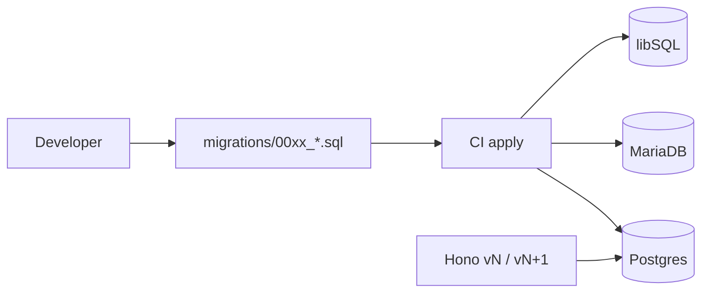
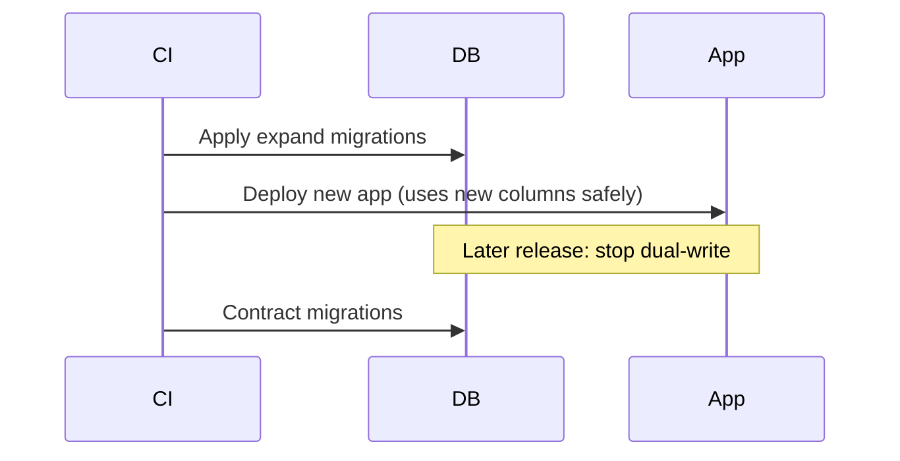

# DB-05 — Migrations (expand / contract)

| Field | Value |
|-------|--------|
| Category | 04-data-stores |
| Status | `complete` |
| Stack | Versioned SQL migrations · per-vendor folders · CI apply |
| Prereqs | [DB-01](DB-01-sql-core.md) · [DB-02](DB-02-postgres-essentials.md) · [DB-04](DB-04-sqlite-libsql.md) |
| Related Docs | [`../../tech-space/database-abstraction.md`](../../tech-space/database-abstraction.md) · [ADR 0002](../../tech-space/decisions/0002-database-adapters.md) · [`../06-cicd/README.md`](../06-cicd/README.md) (CI-08 later) |

## Learning outcomes

- Treat schema change as **versioned, repeatable migrations** — not manual prod clicks.
- Apply **expand/contract** so deploys stay online with multiple app versions.
- Keep **vendor-specific migration trees** until a unified tool is verified.
- Wire migrations into **dev + CI** without coupling them to domain packages.

---

## 1. Dummy

A migration is a **numbered change** to the database schema (and sometimes data). Apps expect a known schema version; CI applies pending migrations before tests/deploy.



**Why it exists:** “works on my machine” schema kills every multi-env system.

---

## 2. When to use / when not

| Use migrations when | Avoid / defer when |
|---------------------|--------------------|
| Any shared or persisted DB | Throwaway memory fake in a unit test |
| More than one environment | Editing prod by hand “just this once” |
| Multi-adapter engines | One giant undocumented `SCHEMA.sql` only forever |

### Expand / contract (zero-downtime mindset)

| Phase | Do | App versions |
|-------|----|--------------|
| **Expand** | Add column/table nullable or with default; dual-write if needed | Old + new both work |
| **Migrate data** | Backfill in batches | Still compatible |
| **Contract** | Remove old column/code after all instances switched | New only |

Never expand+contract in one deploy if old instances still run.

---

## 3. Working

### Folder shape (this monorepo)

```text
packages/db/migrations/
  postgres/
    0001_init.sql
    0002_listings_attrs.sql
  mariadb/
    0001_init.sql
    0002_listings_attrs.sql
  libsql/
    0001_init.sql
    0002_listings_attrs.sql
```

Same **version numbers** across vendors; SQL **content** may differ ([DB-03](DB-03-mariadb-differences.md)).

### Example — expand: add `subtitle`

```sql
-- 0003_listings_subtitle.sql (Postgres)
ALTER TABLE listings
  ADD COLUMN subtitle TEXT NULL;
```

```ts
// App expand: read/write subtitle if present; old app ignores unknown column if SELECT lists columns explicitly
```

Contract later (only after old app gone):

```sql
-- 0004_listings_drop_legacy_note.sql
ALTER TABLE listings DROP COLUMN legacy_note;
```

### Bookkeeping table

```sql
CREATE TABLE IF NOT EXISTS schema_migrations (
  version TEXT PRIMARY KEY,
  applied_at TIMESTAMPTZ NOT NULL DEFAULT now()
);
```

(libSQL: `TEXT` timestamps — same idea.)

Runner: apply files not in `schema_migrations`, in order; record version; fail closed on error.

### Tooling options

| Approach | Fit here |
|----------|----------|
| Hand-written SQL + small runner | Matches ADR “honest SQL” teaching |
| Drizzle-kit / another migrator | OK if per-dialect outputs stay reviewable |
| Prisma migrate multi-provider | Usually hides differences we teach — not default |

### Deploy order



### Worst vs best

```text
❌ ALTER + DROP old column + require new code in one Friday deploy
✅ Expand → roll app → backfill → contract
❌ Migrations in apps/web
✅ packages/db (or infra) owned by persistence
❌ Editing applied migration files in place
✅ New forward migration (fix-forward); reserve true down migrations for dev only
```

---

## 4. Rich

### Failure modes

| Failure | Fix |
|---------|-----|
| Drift (manual prod change) | Reconcile with a new migration; lock prod DDL to pipeline |
| Long lock on big `ALTER` | Expand patterns; batched backfill; schedule ([DB-06](DB-06-indexes-explain.md) for index creates) |
| Partial multi-engine apply | CI matrix per driver; don’t ship if one vendor folder lags |
| Data migration in app boot | Prefer explicit job/step — boot should not surprise-lock tables |

### Test seams

- Fresh DB: apply all migrations → contract tests pass.
- Expand compatibility: old SELECT list still works after additive migration.
- Idempotent runner: second apply no-ops.

### Link to API versioning

Schema expand pairs with API expand ([BE-09](../02-backend-hono-bun/BE-09-api-versioning.md)): don’t remove response fields the same day you drop columns.

---

## 5. Professional / CTO

| Stance | Guidance |
|--------|----------|
| Ownership | Platform/API team owns migration CI; feature teams open PRs with SQL review |
| Downtime | Expand/contract is the default for marketplace uptime |
| Cost | Bad migrations (table rewrites) cost more than ORM debates |

**ADR triggers:** migration tool choice · forbidding down-migrations in prod · single vs per-vendor trees.

**Automate:** migrate job before API deploy; block merge if `migrations/**` fails on matrix; CI-08 in Phase 6.

**Evolution:** unify tooling only after all three dialects proven.

---

## Exercises

1. **Dummy:** Why is “add NOT NULL column without default” dangerous on a live table with rows?
2. **Working:** Write expand + later contract steps for renaming `title` → `headline` without downtime.
3. **CTO memo:** Who can run DDL in prod — humans, CI only, or break-glass role?

## Related

- [DB-04 libSQL](DB-04-sqlite-libsql.md) · [DB-06 Indexes & EXPLAIN](DB-06-indexes-explain.md) · [DB-08 Port+adapters](README.md) (wave 4.3)
- [ADR 0002](../../tech-space/decisions/0002-database-adapters.md)
