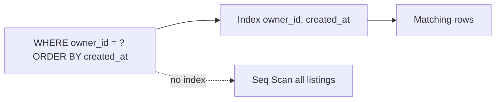
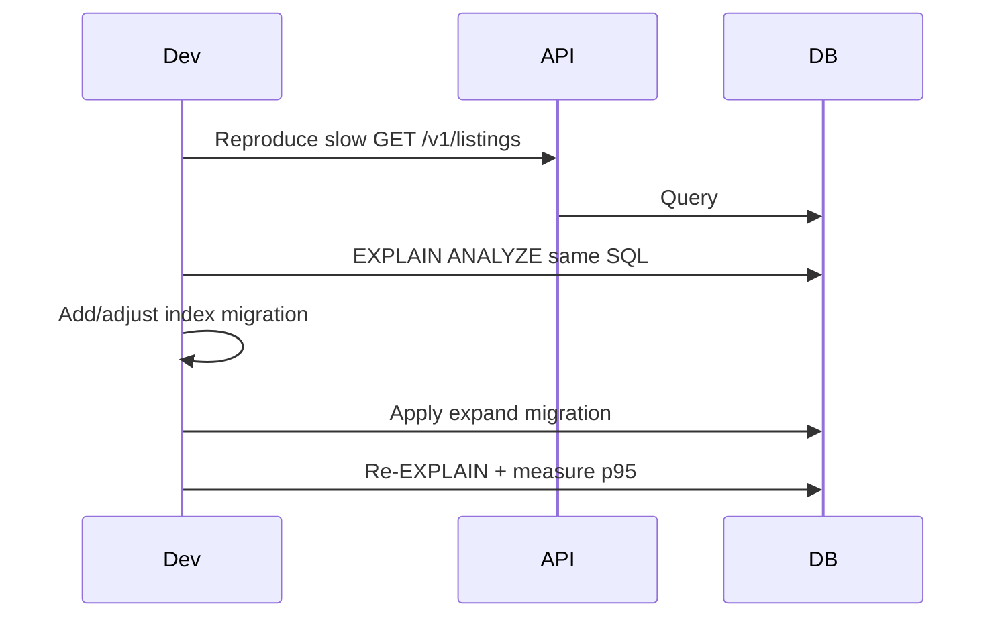

# DB-06 — Indexes & reading EXPLAIN

| Field | Value |
|-------|--------|
| Category | 04-data-stores |
| Status | `complete` |
| Stack | B-tree indexes · composite/partial · `EXPLAIN` / `EXPLAIN ANALYZE` (Postgres-first) |
| Prereqs | [DB-01](DB-01-sql-core.md) · [DB-02](DB-02-postgres-essentials.md) · [DB-05](DB-05-migrations.md) |
| Related Docs | [`../../tech-space/database-abstraction.md`](../../tech-space/database-abstraction.md) · [`../01-system-architecture/SA-10-capacity.md`](../01-system-architecture/SA-10-capacity.md) |

## Learning outcomes

- Add indexes for **real filter/join paths** (listings by owner, status, created_at).
- Design **composite** indexes with correct column order (equality then range).
- Read a basic **EXPLAIN** plan: seq scan vs index scan, and when that matters.
- Ship indexes via **migrations** and verify with production-like data shapes.

---

## 1. Dummy

An index is a **lookup structure** so the engine need not scan every row. `EXPLAIN` shows **how** the planner intends to run your query.



**Why it exists:** marketplace list/detail traffic dies on seq scans long before your Hono code is the bottleneck.

---

## 2. When to use / when not

| Index when | Skip / defer when |
|------------|-------------------|
| Hot `WHERE` / `JOIN` / `ORDER BY` paths | Write-only columns never filtered |
| FK columns used in joins | Premature indexes on every column “just in case” |
| Partial index for common `status = 'published'` | Low-cardinality columns alone (`boolean`) without combining |

**Rule:** measure with EXPLAIN on realistic row counts — toy DBs lie.

---

## 3. Working

### Marketplace indexes (Postgres sketches)

```sql
-- FK / owner lists
CREATE INDEX listings_owner_id_idx ON listings (owner_id);

-- Feed: equality + recency (equality first)
CREATE INDEX listings_status_created_idx
  ON listings (status, created_at DESC);

-- Partial: published only (smaller, matches public feed)
CREATE INDEX listings_published_created_idx
  ON listings (created_at DESC)
  WHERE status = 'published';
```

### Composite order

```text
WHERE status = 'published' AND created_at > $1
→ (status, created_at)  ✅
→ (created_at, status)  ❌ weak for status equality-first patterns
```

Leftmost prefix: `(status, created_at)` also helps `WHERE status = ?`.

### EXPLAIN (Postgres)

```sql
EXPLAIN
SELECT id, title, price_cents
FROM listings
WHERE status = 'published'
ORDER BY created_at DESC
LIMIT 50;
```

```sql
EXPLAIN (ANALYZE, BUFFERS)
SELECT …;  -- runs the query; use on staging, not carelessly on prod hot paths
```

| Plan clue | Meaning |
|-----------|---------|
| **Seq Scan** on large `listings` | Likely missing/useless index for this filter |
| **Index Scan** / **Index Only Scan** | Using an index (covering = better) |
| **Sort** after scan | Order not satisfied by index — consider matching `ORDER BY` |
| **Rows** estimate vs actual (ANALYZE) | Bad stats → `ANALYZE` table; check predicates |

MariaDB: `EXPLAIN` exists but output differs — learn Postgres deeply here; verify MariaDB/libSQL separately in adapters’ hot paths.

### libSQL/SQLite

```sql
EXPLAIN QUERY PLAN
SELECT id FROM listings WHERE owner_id = ? ORDER BY created_at DESC;
```

Still index FKs and list filters; don’t expect identical planner behavior to Postgres.

### Migration hygiene for indexes

```sql
-- 0005_listings_status_created_idx.sql
CREATE INDEX CONCURRENTLY IF NOT EXISTS listings_status_created_idx
  ON listings (status, created_at DESC);
```

`CONCURRENTLY` (Postgres) avoids long write locks — **cannot run inside a transaction block**; document in runner. Prefer expand-style: add index, observe, drop unused later ([DB-05](DB-05-migrations.md)).

### Worst vs best

```text
❌ Index every column; slow writes; unused indexes
✅ Indexes tied to named query paths (owner list, public feed)
❌ EXPLAIN on 10 seed rows → conclude “seq scan is fine”
✅ Staging with production-like cardinality ([SA-10](../01-system-architecture/SA-10-capacity.md))
❌ SELECT * preventing index-only scans
✅ Select needed columns; consider covering indexes when justified
```

---

## 4. Rich

### Failure modes

| Failure | Fix |
|---------|-----|
| Write amplification | Drop unused indexes; partial indexes for hot subset |
| Index bloat / churn | Monitor; `REINDEX` carefully in ops track |
| Wrong partial predicate | Match query `WHERE` exactly |
| Adapter SQL differs | Re-EXPLAIN per engine for the same repository method |

### Test / budget seams

- CI can run `EXPLAIN` and assert no Seq Scan on golden hot queries (advanced).
- Contract tests don’t replace plan review.
- App p95 + DB time in traces ([BE-13](../02-backend-hono-bun/BE-13-observability.md)).

### Sequence: diagnose slow list



---

## 5. Professional / CTO

| Stance | Guidance |
|--------|----------|
| Ownership | Feature author proposes index with EXPLAIN evidence; review like code |
| Budgets | Tie to NFR/capacity ([SA-10](../01-system-architecture/SA-10-capacity.md)) |
| Cost | Extra indexes = disk + slower writes — intentional trade |

**ADR triggers:** mandatory EXPLAIN for new list endpoints · `CREATE INDEX CONCURRENTLY` policy · shared read-replica for ANALYZE.

**Automate:** slow-query log; periodic unused-index report; migration CI.

**Evolution:** caching/CQRS ([DB-09](README.md) later) only after indexes and query shape are honest.

---

## Exercises

1. **Dummy:** For `WHERE owner_id = ? ORDER BY created_at DESC`, which composite order do you pick?
2. **Working:** Draft a partial index for published listings and the `EXPLAIN` you’d expect to improve.
3. **CTO memo:** Require EXPLAIN attachment on PRs that add marketplace list filters — yes/no and why.

## Related

- [DB-05 Migrations](DB-05-migrations.md) · [DB-04 libSQL](DB-04-sqlite-libsql.md) · next [DB-07 Transactions](DB-07-transactions-isolation.md)
- [DB-02 Postgres](DB-02-postgres-essentials.md) · [SA-10 Capacity](../01-system-architecture/SA-10-capacity.md)
