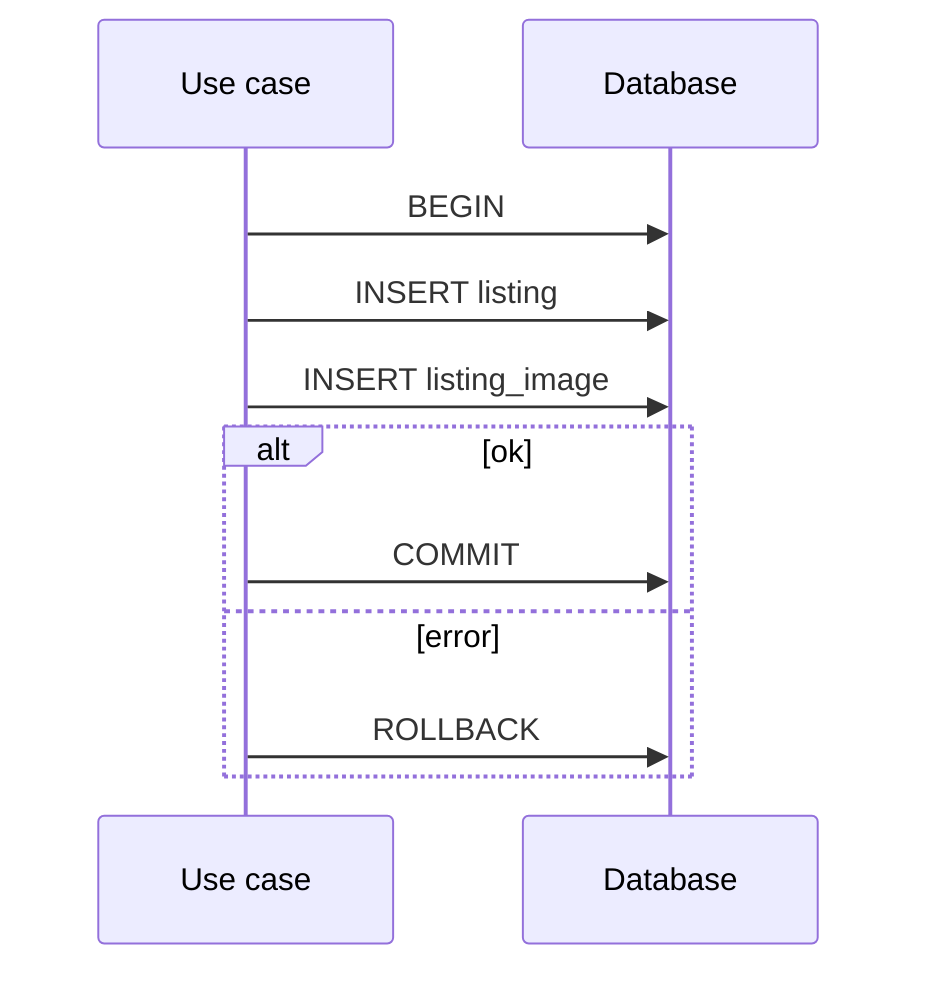

# DB-07 — Transactions & isolation

| Field | Value |
|-------|--------|
| Category | 04-data-stores |
| Status | `complete` |
| Stack | BEGIN/COMMIT/ROLLBACK · isolation levels · unit of work · Postgres-first |
| Prereqs | [DB-01](DB-01-sql-core.md) · [DB-02](DB-02-postgres-essentials.md) · [DB-05](DB-05-migrations.md) · [DB-06](DB-06-indexes-explain.md) |
| Related Docs | [`../../tech-space/database-abstraction.md`](../../tech-space/database-abstraction.md) · [`../02-backend-hono-bun/BE-11-rate-limits-idempotency.md`](../02-backend-hono-bun/BE-11-rate-limits-idempotency.md) · [`../../knowledge/design-patterns/repository.md`](../../knowledge/design-patterns/repository.md) |

## Learning outcomes

- Wrap multi-step writes in a **transaction** so they commit or roll back together.
- Keep transactions **short** — no HTTP/payment calls while holding locks.
- Name isolation basics (**READ COMMITTED** default vs stricter levels) at architect depth.
- Place transaction boundaries at the **use case / unit-of-work**, not scattered in random SQL helpers.

---

## 1. Dummy

A transaction is an **all-or-nothing** unit of work. Create listing + initial image row either both persist or neither does.



**Why it exists:** marketplace invariants (“published listing always has owner”) must not half-apply under concurrent requests.

---

## 2. When to use / when not

| Use a transaction when | Skip / keep auto-commit when |
|------------------------|------------------------------|
| Multiple statements must succeed together | Single idempotent read |
| Read-modify-write that must not race (stock, status) | Independent fire-and-forget audit (maybe outbox later) |
| Transfer-style invariants | Holding a row lock while awaiting Stripe HTTP |

### Isolation (architect glossary)

| Level | Rough idea | Typical use |
|-------|------------|-------------|
| **READ COMMITTED** | See only committed data; default on Postgres | Most API requests |
| **REPEATABLE READ** | Stable snapshot for the tx | Some reporting / multi-read consistency |
| **SERIALIZABLE** | Strongest; more aborts under contention | Rare critical paths — measure |

Don’t raise isolation “for safety” without knowing abort/retry cost.

---

## 3. Working

### SQL sketch

```sql
BEGIN;

INSERT INTO listings (id, owner_id, title, price_cents, status, created_at)
VALUES ($1, $2, $3, $4, 'draft', now());

INSERT INTO listing_images (id, listing_id, url, sort_order)
VALUES ($5, $1, $6, 0);

COMMIT;
-- on error: ROLLBACK;
```

### Use-case boundary (TypeScript shape)

```ts
// packages/application — port may expose a unit of work
export interface UnitOfWork {
  listings: ListingsRepository;
  images: ListingImagesRepository;
  commit(): Promise<void>;
  rollback(): Promise<void>;
}

export async function createListingWithCover(
  uow: UnitOfWork,
  input: CreateListingInput,
): Promise<Listing> {
  try {
    const listing = await uow.listings.create(input);
    await uow.images.add({ listingId: listing.id, url: input.coverUrl, sortOrder: 0 });
    await uow.commit();
    return listing;
  } catch (e) {
    await uow.rollback();
    throw e;
  }
}
```

Adapters implement `UnitOfWork` with vendor clients (`pg` client query `BEGIN`, libSQL batch/tx API, etc.). **Domain does not import `pg`.**

### Short transactions (hard rule)

```text
❌ BEGIN → SELECT … FOR UPDATE → await fetch(payment) → UPDATE → COMMIT
✅ await fetch(payment) → BEGIN → UPDATE status WHERE pending → COMMIT
```

Pair with idempotency keys on the payment/order path ([BE-11](../02-backend-hono-bun/BE-11-rate-limits-idempotency.md)).

### Optimistic vs pessimistic

| Style | Pattern | Fit |
|-------|---------|-----|
| **Optimistic** | `UPDATE … WHERE id = $1 AND version = $2` | Concurrent edits; retry on 0 rows |
| **Pessimistic** | `SELECT … FOR UPDATE` | Short critical sections only |

```sql
UPDATE listings
SET title = $2, version = version + 1
WHERE id = $1 AND version = $3;
-- rowCount === 0 → conflict (409) to the API
```

### Engine notes

| Engine | Watch |
|--------|-------|
| **Postgres** | Clear tx + isolation; `FOR UPDATE`; deadlocks possible under contention |
| **MariaDB InnoDB** | Transactions yes; verify isolation defaults |
| **libSQL/SQLite** | Tx supported; long writers → `database is locked` ([DB-04](DB-04-sqlite-libsql.md)) |

### Worst vs best

```text
❌ Open transaction in middleware for entire HTTP request lifetime
✅ Begin at use-case start of multi-write; commit before response shaping
❌ Swallow rollback errors and return 200
✅ Fail closed; map to 409/500 with stable codes ([BE-05](../02-backend-hono-bun/BE-05-error-model.md))
```

---

## 4. Rich

### Failure modes

| Failure | Fix |
|---------|-----|
| Deadlock | Consistent lock order; short tx; retry once with backoff |
| Serialization failure | Retry use case; don’t hide as generic 500 forever |
| Partial commit across two DBs | Avoid dual-DB tx; use outbox / saga later |
| Connection returned to pool mid-tx | Bind tx to one connection until commit/rollback |

### Test seams

- Force failure after first insert → assert no orphan listing/image.
- Concurrent optimistic updates → one wins, one gets conflict.
- Contract tests per adapter: same UoW behavior ([DB-08](DB-08-port-adapters.md)).

### Observability

Log tx duration; alert on long transactions; tie to API latency ([BE-13](../02-backend-hono-bun/BE-13-observability.md)).

---

## 5. Professional / CTO

| Stance | Guidance |
|--------|----------|
| Default | READ COMMITTED + short UoW around multi-writes |
| Money / inventory | Explicit invariants + idempotency + conflict mapping |
| Cost | Long locks destroy throughput more than “missing microservices” |

**ADR triggers:** mandatory UoW port · SERIALIZABLE for a specific aggregate · distributed transactions (usually reject).

**Automate:** statement/idle_in_tx timeouts in Postgres; tests that abort mid-flow.

**Evolution:** outbox pattern when side effects must align with commits — still one DB tx for the write + outbox row.

---

## Exercises

1. **Dummy:** Why is “call Stripe inside BEGIN/COMMIT” dangerous?
2. **Working:** Sketch create-listing + cover image with commit/rollback and where Hono maps a conflict.
3. **CTO memo:** Optimistic versioning vs `FOR UPDATE` for “publish listing” — pick one default.

## Related

- [DB-08 Port + adapters](DB-08-port-adapters.md) · [DB-06 Indexes](DB-06-indexes-explain.md) · [BE-11 Idempotency](../02-backend-hono-bun/BE-11-rate-limits-idempotency.md)
- [Repository pattern](../../knowledge/design-patterns/repository.md)
