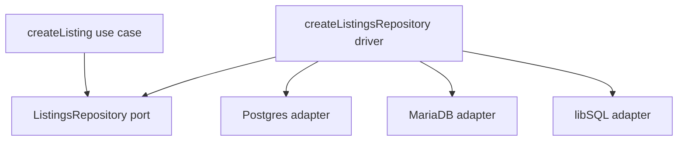

# DB-08 — Port + adapters (ADR 0002)

| Field | Value |
|-------|--------|
| Category | 04-data-stores |
| Status | `complete` |
| Stack | Repository port · libSQL / Postgres / MariaDB adapters · factory · contract tests |
| Prereqs | [DB-03](DB-03-mariadb-differences.md) · [DB-04](DB-04-sqlite-libsql.md) · [DB-07](DB-07-transactions-isolation.md) · [BE-07](../02-backend-hono-bun/BE-07-composition-root-di.md) |
| Related Docs | [`../../tech-space/database-abstraction.md`](../../tech-space/database-abstraction.md) · [ADR 0002](../../tech-space/decisions/0002-database-adapters.md) · [`../../examples/multi-db-notes/README.md`](../../examples/multi-db-notes/README.md) · [`../../knowledge/design-patterns/adapter.md`](../../knowledge/design-patterns/adapter.md) · [`../../knowledge/design-patterns/repository.md`](../../knowledge/design-patterns/repository.md) |

## Learning outcomes

- Apply **ADR 0002**: ports in application, one adapter per vendor in `packages/db`.
- Wire drivers at the **composition root** (`DATABASE_DRIVER`) — never inside use cases.
- Encode dialect gaps as **capability flags + contract tests**, not fake universal SQL.
- Decide when **multi-adapter** is worth the cost vs a single production engine.

---

## 1. Dummy

The use case depends on a **port** (interface). Postgres, MariaDB, and libSQL each provide an **adapter**. Swap the adapter; keep the rules.



**Why it exists:** teach DIP + honest multi-engine support without Prisma-hiding differences ([ADR 0002](../../tech-space/decisions/0002-database-adapters.md)).

Deep pattern pages: [Repository](../../knowledge/design-patterns/repository.md) · [Adapter](../../knowledge/design-patterns/adapter.md). Design summary: [database-abstraction.md](../../tech-space/database-abstraction.md).

---

## 2. When to use / when not

| Multi-adapter when | Single adapter when |
|--------------------|---------------------|
| Teaching / interview signal for this blueprint | Product locked to one engine, no teaching goal |
| Real customer need for MariaDB **or** Postgres | Premature “enterprise” layer for a toy feature |
| Local libSQL + prod Postgres | Fake portability with untested second driver |

### ADR 0002 decision (recap)

1. Ports in `packages/application`
2. One adapter per vendor in `packages/db`
3. Hand-written SQL (or thin helper); Kysely only if boilerplate hurts
4. Contract tests per adapter
5. Driver order: **libSQL → Postgres → MariaDB**

**Rejected default:** Prisma multi-provider as the teaching path (hides meaningful differences).

---

## 3. Working

### Package boundaries

```text
packages/application/   # ListingsRepository port, use cases, UnitOfWork shape
packages/domain/        # Listing entity / pure rules — no SQL
packages/db/            # adapters + factory + migrations ([DB-05](DB-05-migrations.md))
packages/contracts/     # Zod DTOs for HTTP — not a substitute for the port
apps/api/               # createApp(deps) wires driver from config ([BE-07](../02-backend-hono-bun/BE-07-composition-root-di.md))
```

### Port

```ts
// packages/application/src/ports/listings-repository.ts
export type Listing = {
  id: string;
  ownerId: string;
  title: string;
  priceCents: number;
  status: "draft" | "published" | "deleted";
  createdAt: string;
};

export interface ListingsRepository {
  create(input: Omit<Listing, "createdAt"> & { createdAt?: string }): Promise<Listing>;
  get(id: string): Promise<Listing | null>;
  listByOwner(ownerId: string, limit: number): Promise<Listing[]>;
}
```

### Factory

```ts
// packages/db/src/create-listings-repository.ts
export function createListingsRepository(config: {
  driver: "libsql" | "postgres" | "mariadb" | "memory";
  url: string;
}): ListingsRepository {
  switch (config.driver) {
    case "memory":
      return createMemoryListingsRepository();
    case "libsql":
      return createLibsqlListingsRepository(config.url);
    case "postgres":
      return createPostgresListingsRepository(config.url);
    case "mariadb":
      return createMariadbListingsRepository(config.url);
    default:
      throw new Error(`Unsupported driver: ${config.driver satisfies never}`);
  }
}
```

### Composition root

```ts
const listings = createListingsRepository({
  driver: env.DATABASE_DRIVER,
  url: env.DATABASE_URL,
});

const app = createApp({ listings, /* authVerifier, clock, … */ });
```

### Capability flags

```ts
export type DbCapabilities = {
  returning: boolean;
  json: boolean;
  upsert: "on_conflict" | "duplicate_key" | false;
  boolean: "native" | "tinyint";
};

// Measure per driver — do not invent support
```

Adapters use flags or simply different SQL; use cases **never** read `capabilities` to branch business rules.

### Contract tests

```text
shared suite:
  create → get round-trip
  listByOwner ordering
  reject negative price (DB check and/or domain)
  boolean/status mapping identical at domain boundary
run with: memory | libsql | postgres | mariadb
```

Example track: [`multi-db-notes`](../../examples/multi-db-notes/README.md). Walkthrough: [07 libSQL](../../walkthrough/07-database-port-and-libsql/README.md) → [11 Postgres](../../walkthrough/11-postgres-adapter/README.md) → [12 MariaDB](../../walkthrough/12-mariadb-adapter/README.md).

### Transactions + ports

Expose `UnitOfWork` or `withTransaction(fn)` on the db factory so [DB-07](DB-07-transactions-isolation.md) stays vendor-agnostic at the use-case layer.

### Worst vs best

```text
❌ if (driver === 'postgres') inside createListing use case
✅ dialect only inside packages/db adapters
❌ port method runSql(sql: string)
✅ domain-named methods on the repository
❌ “All three engines work” with only memory tests
✅ CI matrix per driver
```

---

## 4. Rich

### Failure modes

| Failure | Fix |
|---------|-----|
| LSP break (adapters disagree on null vs throw) | Contract tests + shared error mapping |
| Leaking `Pool` / client on the port | Keep client inside adapter / UoW |
| Silent bool ↔ 0/1 | Explicit map in MariaDB/libSQL adapters ([DB-03](DB-03-mariadb-differences.md)) |
| God factory with feature flags soup | One factory per aggregate family; config validated at boot |

### Test seams

- Memory adapter for pure use-case tests.
- Integration: Testcontainers/Compose for Postgres/MariaDB; file/memory libSQL.
- Capability table asserted in docs when flags change.

### Hexagonal edges

Persistence is an **driven adapter**. Hono is a **driving adapter**. Domain/application sit inside — Dependency Rule ([architecture-rules](../../knowledge/architecture-styles/architecture-rules.md) / Clean/Hex knowledge).

---

## 5. Professional / CTO

| Stance | Guidance |
|--------|----------|
| This blueprint | Multi-adapter for teaching + escape hatch |
| Many products | One prod engine + port + memory fake is enough |
| ORM | Allowed later if dialect honesty + migrations stay reviewable |

**ADR triggers:** adopting Kysely/Drizzle · dropping MariaDB support · Prisma multi-provider · requiring three engines in every CI PR (cost).

**Automate:** driver matrix; boot fail on unknown `DATABASE_DRIVER`; ban vendor imports outside `packages/db` (lint).

**Cost:** three dialects ≈ three persistence codepaths — pay for pedagogy or real portability; don’t pretend it’s free.

**Alternatives considered (from ADR):** Prisma multi-provider (DX vs honesty); single ORM façade (false portability); Postgres-only (valid product choice — keep the port anyway).

---

## Exercises

1. **Dummy:** Draw arrows from `createListing` → port → three adapters; mark where `pg` may be imported.
2. **Working:** List five contract assertions every listings adapter must pass.
3. **CTO memo:** Ship year-1 with Postgres-only adapter + libSQL local — when do you invest in MariaDB?

## Related

- [DB-07 Transactions](DB-07-transactions-isolation.md) · [DB-09 Backups/HA](README.md) (wave 4.4) · [DB-10 CTO engine pick](README.md)
- [ADR 0002](../../tech-space/decisions/0002-database-adapters.md) · [Database abstraction](../../tech-space/database-abstraction.md) · [BE-07 Composition root](../02-backend-hono-bun/BE-07-composition-root-di.md)
