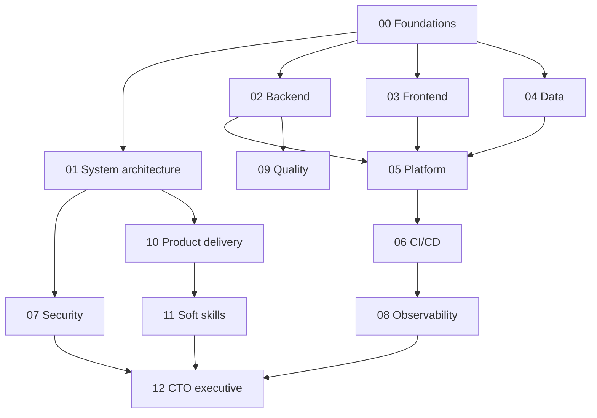

# Course — Senior Engineer → Architect → CTO

Curriculum hub for becoming a **senior software engineer / architect** who can also **operate at CTO level**: stack depth, system design, delivery, leadership, and judgment.

**This folder = plans + topic maps + (later) lessons.**  
Full concept depth for architecture/patterns already lives in [`../knowledge/`](../knowledge/README.md). Hands-on build steps live in [`../walkthrough/`](../walkthrough/README.md). Project application lives in [`../tech-space/`](../tech-space/README.md).

| Doc | Purpose |
|-----|---------|
| [`PLAN.md`](PLAN.md) | Phased implementation of lessons (what we write next) |
| [`TRACKS.md`](TRACKS.md) | Study order from foundations → CTO |
| [`LADDER.md`](LADDER.md) | Dummy → Working → Rich → CTO lesson shape |
| [`_TOPIC-TEMPLATE.md`](_TOPIC-TEMPLATE.md) | Copy when implementing a lesson |

## Categories

| # | Category | Folder | Focus |
|---|----------|--------|--------|
| 00 | Foundations | [00-foundations](00-foundations/README.md) | CS basics, TypeScript, HTTP, git, debugging |
| 01 | System architecture | [01-system-architecture](01-system-architecture/README.md) | Styles, DDD, trade-offs — links to knowledge |
| 02 | Backend — Hono / Bun | [02-backend-hono-bun](02-backend-hono-bun/README.md) | API design, runtime, workers |
| 03 | Frontend — React / Next.js | [03-frontend-react-next](03-frontend-react-next/README.md) | UI architecture, RSC, performance |
| 04 | Data — Postgres / MariaDB / SQLite | [04-data-stores](04-data-stores/README.md) | SQL, adapters, migrations, ops |
| 05 | Platform — Docker / Compose / K8s / Terraform | [05-platform-infra](05-platform-infra/README.md) | Containers, orchestration, IaC |
| 06 | CI/CD | [06-cicd](06-cicd/README.md) | Pipelines, environments, releases |
| 07 | Security & privacy | [07-security](07-security/README.md) | Authn/z, threats, compliance basics |
| 08 | Observability & reliability | [08-observability](08-observability/README.md) | Logs, metrics, traces, SLOs |
| 09 | Quality & testing | [09-quality-testing](09-quality-testing/README.md) | Unit → e2e, contracts, load |
| 10 | Product & delivery | [10-product-delivery](10-product-delivery/README.md) | Specs, ADRs, estimation, incidents |
| 11 | Soft skills & leadership | [11-soft-skills-leadership](11-soft-skills-leadership/README.md) | Communication, mentoring, conflict |
| 12 | CTO & executive | [12-cto-executive](12-cto-executive/README.md) | Strategy, org design, cost, board |

## Status legend

| Status | Meaning |
|--------|---------|
| `planned` | Topic listed; lesson not written yet |
| `outline` | Learning outcomes + stubs only |
| `draft` | Dummy–Working filled |
| `complete` | Full Dummy → CTO lesson |
| `link` | Taught primarily via existing Docs (knowledge/tech-space/walkthrough) |

## How we implement (steps)

1. Lock topic maps (this PR / this folder) — **you are here**.
2. Follow [`PLAN.md`](PLAN.md) phases; implement one category (or wave) at a time.
3. Each lesson uses [`LADDER.md`](LADDER.md) + [`_TOPIC-TEMPLATE.md`](_TOPIC-TEMPLATE.md).
4. Prefer **linking** to `knowledge/` over duplicating architecture essays.
5. Update [`.brain`](../.brain/INDEX.md) when a durable course concept lands.

**Default stack for examples:** Hono + Bun · React + Next.js · Postgres / MariaDB / SQLite (libSQL) · Docker Compose → Kubernetes · Terraform · GitHub Actions CI/CD.
