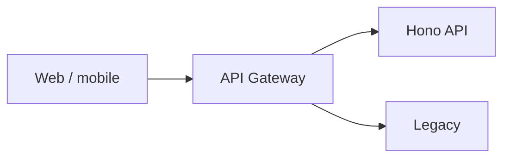
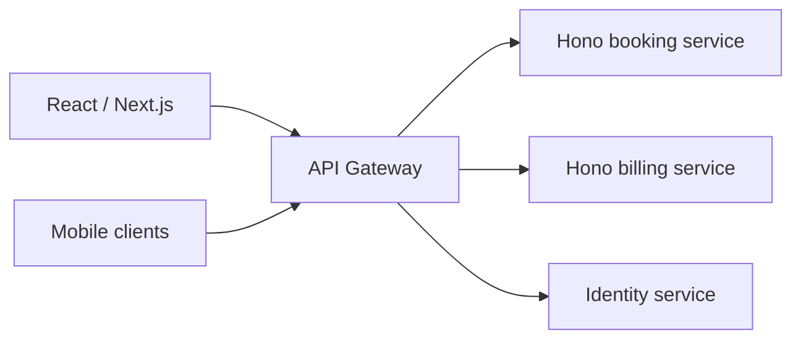

# API Gateway Architecture

## One-line definition

An API Gateway is a **single entry point** in front of backend services that handles routing, authentication, rate limiting, TLS termination, and cross-cutting policies — without owning core business domain logic.

## Problem it solves

Clients should not know the internal topology of microservices or SCS backends. A gateway centralizes edge concerns (auth, routing, quotas, request IDs) so each service stays focused on its capability.

---

## 1. Dummy — 30-second picture

Single front door: auth, rate limit, route to services or monolith modules.



**Why it exists:** cross-cutting edge policy without duplicating it in every route file.

---

## 2. When to use / when not

### When to use

- Multiple backend services reachable by external clients
- Need centralized authN/authZ, rate limits, IP allowlists, or WAF policies
- Public vs internal API exposure differences
- Multi-team backend with a shared edge platform
- Mobile/web clients need a stable external hostname

### When not

- Single Hono modular monolith — the app itself is the entry point
- Gateway becomes a second BFF full of business orchestration
- Tiny MVP where Cloudflare/nginx basics already suffice without “architecture”
- Using a gateway to hide a distributed monolith’s chatty internals forever

### Fit by application type

| Application type | Fit | Why |
|---|---:|---|
| Small React SPA | Poor | One API origin is enough |
| Large React dashboard | Medium | Useful once multiple services exist |
| Next.js App Router app | Medium | Next may sit behind or act partially as edge |
| Hono API | Medium | Hono can be *behind* a gateway or implement lightweight gateway routes |
| Background worker | Poor | Workers are not public entry |
| Mobile app API | Good | Stable public edge for mobile |
| Marketplace / booking system | Good | At multi-service scale |
| Internal admin panel | Medium | Often VPN + one API; gateway optional |

### Frontend, backend, or both?

**Integration / edge topology**. Not a frontend folder design and not a domain model.

In React + Next.js + Hono:

- Browser → Gateway → Hono services (or → Next.js → Gateway → services)
- Prefer Next.js BFF for **UI-specific shaping**; gateway for **routing and policy**
- Do not put booking invariants in gateway config plugins
- Stripe webhooks often bypass generic client gateway paths with dedicated routes

## 3. Working — folders and a thin example

### Core rules

- Gateway handles cross-cutting edge policies, not domain workflows
- Route by path/host to services; keep path contracts versioned
- Auth tokens validated at edge when appropriate; services still enforce authorization
- Timeouts, retries, and circuit breaking configured deliberately
- No shared DB access from the gateway
- Distinguish gateway (edge) from BFF (client-specific aggregation)
- Observability: correlation IDs injected at the gateway

### Dependency diagram (this monorepo)




### Folder structure


### 1. React frontend

```text
apps/web/src/shared/api/http.ts      # baseURL = https://api.example.com
```

### 2. Next.js App Router frontend

```text
apps/web/
  src/shared/api/server-http.ts      # server-side calls to gateway or internal URLs
```

### 3. Hono backend (services behind gateway)

```text
apps/booking-api/src/main.ts
apps/billing-api/src/main.ts
```

### 4. Gateway config in monorepo

```text
infra/gateway/
  routes.yaml                        # /bookings/* → booking-api
  policies/
    rate-limit.yaml
    jwt-auth.yaml
apps/
  booking-api/
  billing-api/
  web/
```

Example route config sketch:

```yaml
# infra/gateway/routes.yaml
routes:
  - name: booking
    match: /v1/bookings
    upstream: http://booking-api:3001
    auth: jwt
  - name: billing
    match: /v1/billing
    upstream: http://billing-api:3002
    auth: jwt
  - name: stripe-webhook
    match: /v1/webhooks/stripe
    upstream: http://billing-api:3002
    auth: stripe-signature
```

### TypeScript


Lightweight gateway-ish edge with Hono (for small multi-service setups):

```ts
// apps/edge-gateway/src/main.ts
import { Hono } from "hono";
import { verifyJwt } from "./auth";

const app = new Hono();

app.use("/v1/*", async (c, next) => {
  if (c.req.path.startsWith("/v1/webhooks/")) return next();
  const user = await verifyJwt(c.req.header("authorization"));
  c.set("userId", user.sub);
  c.header("x-request-id", crypto.randomUUID());
  await next();
});

app.all("/v1/bookings/*", (c) => proxy(c, process.env.BOOKING_URL!));
app.all("/v1/billing/*", (c) => proxy(c, process.env.BILLING_URL!));

export default app;
```

Prefer managed gateways (Kong, AWS API Gateway, Cloudflare) as you scale; keep this pattern for clarity of responsibilities.

## 4. Rich — seams, failures, tests

### Seams worth testing


- **Unit:** auth middleware and routing rules
- **Integration:** gateway → stub upstreams
- **Contract:** public external paths vs service paths
- **E2E:** client through gateway to real services in staging
- **Mocking:** stub upstreams for gateway policy tests; do not “mock away” auth

### Failure modes

| Failure | Who owns it |
|---------|-------------|
| Auth only in one service | Gateway JWT validation |
| Wrong route weight in strangler | Config review + metrics |
| Rate limit bypass via direct internal URL | Network policy |

### Anti-patterns


- Business orchestration in the gateway (checkout saga in Lua/plugins)
- Double auth confusion — gateway checks JWT but services trust all internal calls blindly without service auth
- Using gateway as a replacement for fixing service boundaries
- Exposing every internal path 1:1 forever without an external contract
- Collapsing BFF and gateway into one unmaintainable layer


---

## 5. Professional / CTO

### Cost

| Dimension | Gateway cost |
|-----------|--------------|
| Team | Edge policy centralization |
| Delivery | Faster security rollout; risk if gateway becomes god-router |
| Ops | Another tier to monitor; TLS, WAF, rate limits |
| Evolution | Start with Hono middleware + reverse proxy; managed gateway at scale |

### ADR triggers

Managed gateway vendor · JWT validation at edge · routing to strangler paths.

### Automate

- Infrastructure-as-code for routes
- Smoke tests through gateway on every deploy

## Migration


1. Single Hono API with path prefixes per module
2. Extract services; keep one hostname via reverse proxy
3. Add JWT and rate limits at the proxy/gateway
4. Document external `/v1` contracts separately from internal URLs
5. Introduce BFF only when client aggregation demands it

## Related concepts

[BFF](bff.md) · [Strangler fig](strangler-fig.md) · [Microservices](microservices.md)

## Where in this repo

Edge routing for [strangler-fig.md](strangler-fig.md) and future multi-service deploys.
