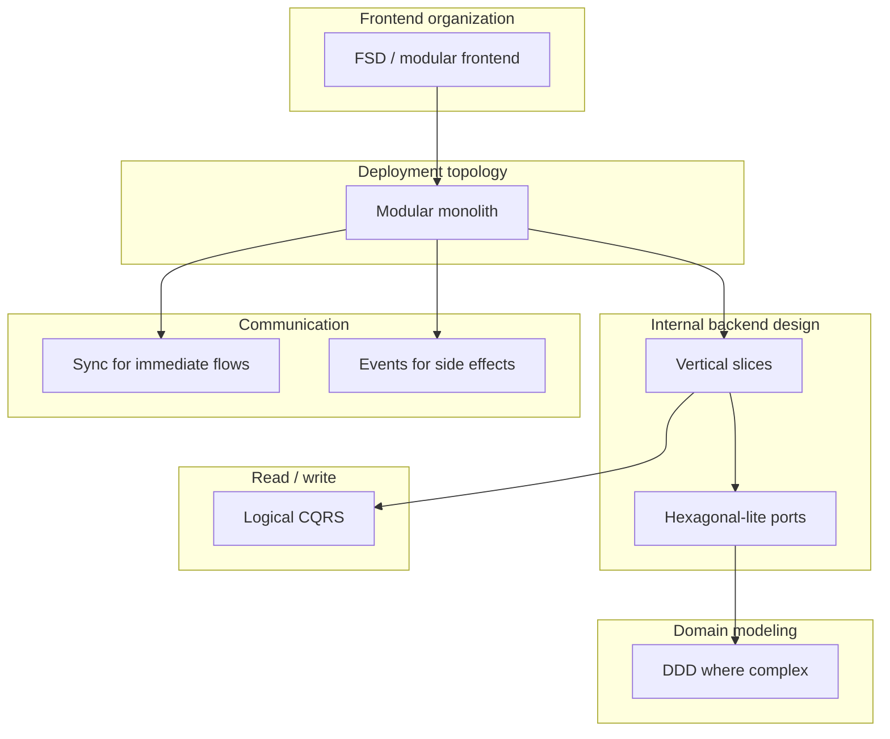

# Architecture Combination Guide

Architectures fail in practice when teams treat them as mutually exclusive brands. Most successful React + Next.js + Hono systems **combine architectures from different categories** and pick **one primary choice per category per boundary**.

## Separate Concerns First

| Category | Examples | Question it answers |
|---|---|---|
| Deployment topology | Modular monolith, microservices, serverless, SOA, SCS | How is the system packaged and deployed? |
| Internal backend design | Layered, Hexagonal, Clean, Vertical Slice | How is code inside a deployable organized? |
| Frontend organization | Feature-Sliced Design, modular frontend, vertical slices | How is UI code organized? |
| Domain modeling | DDD | How are business rules modeled? |
| Communication style | Event-driven, synchronous HTTP, messaging | How do parts talk? |
| Read/write design | CQRS, Event Sourcing | How are reads and writes shaped/stored? |
| Integration boundary | BFF, API Gateway, Adapter | How do clients and services meet? |
| Extensibility | Plugin / Microkernel | How are optional capabilities added? |
| Repository organization | Monorepo | How is code stored and versioned? |
| Migration strategy | Strangler Fig | How do we evolve from legacy? |

**Rule of thumb:** architectures from **different categories** often combine cleanly. Architectures from the **same category** are usually alternatives at the same boundary (for example: modular monolith *or* microservices for one capability — not both at once).



## Compatibility Matrix

| Architecture A | Architecture B | Compatibility | Recommended combination | Risks / Rules |
|---|---|---|---|---|
| Modular monolith | DDD | Natural combination | Modules = bounded contexts; rich domain only where needed | Do not apply full tactical DDD to every CRUD module |
| Modular monolith | Vertical Slice | Natural combination | Modules by capability; slices inside each module | Do not let slices cross module internals |
| Modular monolith | Hexagonal | Natural combination | Ports at module edges for DB/Stripe/email | Avoid adapter-to-adapter calls |
| Modular monolith | Clean Architecture | Natural combination | Dependency rule inside modules | Clean rings across the whole monolith become ceremony |
| Next.js | Feature-Sliced Design | Natural combination | `app/` routing + FSD layers under `src/` | Don’t fight App Router with a second pages router taxonomy |
| React SPA | Feature-Sliced Design | Natural combination | Full FSD layers in `src/` | Overkill for tiny SPAs |
| Hono | Hexagonal Architecture | Natural combination | Routes as driving adapters; repos/Stripe as driven | Keep Hono types out of domain |
| Hono | Vertical Slice Architecture | Natural combination | One folder per command/query route | Extract shared kernel when duplication hurts |
| DDD | Event-Driven Architecture | Natural combination | Domain/integration events between contexts | Don’t use events as sync RPC |
| DDD | CQRS | Natural combination | Aggregates on write; read models for UI | Start logical CQRS before split DBs |
| CQRS | Event Sourcing | Possible but requires discipline | ES only when history/replay justifies it | ES implies CQRS-ish reads; CQRS does not imply ES |
| CQRS without Event Sourcing | — | Recommended default | Separate command/query handlers; same Postgres | Don’t invent event store for dashboards alone |
| Microservices | DDD | Natural combination | One service ≈ one bounded context | Nano-services per entity class |
| Microservices | Event-Driven Architecture | Natural combination | Primary cross-service integration | Dual writes without outbox |
| Microservices | API Gateway | Natural combination | Edge policy + routing | Business logic in gateway plugins |
| Microservices | BFF | Natural combination | Per-client aggregation over services | BFF becoming the domain layer |
| BFF | Next.js | Natural combination | RSC/route handlers as web BFF | SQL + invariants living only in Next while API also owns them |
| Plugin architecture | Modular Monolith | Natural combination | Core modules + plugin packages | Plugins writing to core tables directly |
| Monorepo | Modular Monolith | Natural combination | `apps/api` + `apps/web` + packages | Boundary-free `@repo/common` |
| Monorepo | Microservices | Natural combination | Multiple apps in one repo | Repo ≠ one deployable; keep pipelines clear |
| Layered | Vertical Slice | Possible but requires discipline | Migrate feature-by-feature from layers to slices | Running both taxonomies forever in the same module |
| Clean | Hexagonal | Natural combination | Same dependency inversion idea; different vocabulary | Duplicate folders for both “rings” and “hex” |
| Clean | DDD | Natural combination | Entities/use cases host domain model | Anemic entities in “entity” folders |
| Serverless | Event-Driven Architecture | Natural combination | Queue/bus triggered functions | Chatty sync function chains |
| Serverless | CQRS | Natural combination | Command functions + query functions/projections | Per-function DB connection exhaustion |

---

## Combination Deep Dives

### Modular monolith + DDD

- **Recommended:** yes, default for complex SaaS domains
- **Boundaries:** deploy = one API; modules = bounded contexts; domain model inside complex modules
- **Dependencies:** `api → application → domain`; infrastructure implements ports
- **Communication:** in-process public module APIs; events for cross-context side effects
- **Traps:** naming every folder “aggregate”; shared DB tables across contexts
- **Folders:**

```text
apps/api/src/modules/booking/{domain,application,infrastructure,api}/
apps/api/src/modules/billing/...
```

### Modular monolith + Vertical Slice

- **Recommended:** yes, especially for delivery speed
- **Boundaries:** module ownership first; slices per use case inside
- **Dependencies:** slice internals private; `shared/` inside module for cross-slice rules
- **Communication:** HTTP → slice handler; cross-module via `public.ts`
- **Traps:** recreating a global `BookingService`; cross-slice SQL imports
- **Folders:** `modules/booking/create-booking/`, `modules/booking/cancel-booking/`

### Modular monolith + Hexagonal

- **Recommended:** yes at persistence and payment edges
- **Boundaries:** ports owned by application/domain; adapters in infrastructure
- **Dependencies:** domain has zero Drizzle/Stripe/Hono imports
- **Communication:** composition root wires adapters once
- **Traps:** ports that leak SQL types; every function gets an interface blindly

### Modular monolith + Clean Architecture

- **Recommended:** Clean-lite inside modules
- **Boundaries:** use cases depend on entities; frameworks at outer ring
- **Dependencies:** inward-only
- **Traps:** four rings copied into every tiny CRUD module

### Next.js + Feature-Sliced Design

- **Recommended:** for large App Router products
- **Boundaries:** Next `app/` = routing entry; FSD layers in `src/`
- **Dependencies:** `app → pages/widgets → features → entities → shared`
- **Traps:** naming a folder `pages` that collides with Pages Router mentally; putting server DB code in `entities`

### React SPA + Feature-Sliced Design

- **Recommended:** when SPA is large and long-lived
- **Boundaries:** same FSD layers without Next `app/`
- **Traps:** applying full FSD to a 5-screen MVP

### Hono + Hexagonal

- **Recommended:** for APIs with real domain + multiple adapters
- **Boundaries:** route modules drive use cases; DB/Stripe are driven adapters
- **Dependencies:** handlers → use cases → ports ← adapters
- **Traps:** using `Context` inside domain functions

### Hono + Vertical Slice

- **Recommended:** default internal backend design for many products
- **Boundaries:** one slice per route/command
- **Dependencies:** slice-local schema/SQL/handler
- **Traps:** slice folders that only forward to a layered service god-object

### DDD + Event-Driven

- **Recommended:** for cross-context integration
- **Boundaries:** domain events vs integration events clarified
- **Communication:** outbox → bus → other context public API
- **Traps:** eventual consistency ignored in UI expectations

### DDD + CQRS

- **Recommended:** when read models diverge from aggregates
- **Boundaries:** write = aggregates; read = projections/SQL
- **Traps:** forcing CQRS on every entity

### CQRS + Event Sourcing

- **Compatibility:** powerful, expensive
- **Use when:** audit/replay/rebuild are real requirements
- **Rules:** event store is source of truth; projections disposable
- **Traps:** ES everywhere because CQRS was introduced

### CQRS without Event Sourcing

- **Recommended default**
- **Boundaries:** command/query handlers; same Postgres; optional projection tables
- **Traps:** introducing Kafka “because CQRS”

### Microservices + DDD / Event-Driven / API Gateway / BFF

- **Recommended only when deploy/scale/team autonomy requires services**
- **Boundaries:** service = context; gateway = edge; BFF = client shape; events = integration
- **Traps:** distributed monolith; domain logic in gateway/BFF; shared DB

### BFF + Next.js

- **Recommended:** web client aggregation and secret keeping
- **Boundaries:** Next server layer shapes DTOs; Hono owns invariants
- **Traps:** two sources of truth for booking rules

### Plugin architecture + Modular monolith

- **Recommended:** for integrations/automations
- **Boundaries:** `packages/plugin-api` contract; plugins register in composition root
- **Traps:** core importing plugin internals; plugins bypassing module APIs

### Monorepo + Modular monolith / Microservices

- **Recommended:** both fine
- **Boundaries:** apps are deployables; packages are libraries
- **Traps:** assuming one repo means one service; or many services with no ownership

### Layered + Vertical Slice

- **Compatibility:** migration path, not a stable dual taxonomy
- **Rule:** pick a module and convert it fully to slices when touched

### Clean + Hexagonal

- **Natural combination:** same idea — dependency inversion
- **Rule:** choose vocabulary per codebase; don’t double-nest both ceremonies

### Clean + DDD

- **Natural combination:** Clean structure hosts DDD tactical patterns
- **Rule:** entities must have behavior, not only types

### Serverless + Event-Driven / CQRS

- **Natural combination:** functions as command handlers, projectors, consumers
- **Rules:** pooler for Postgres; idempotent consumers; avoid sync function fan-out

---

## What Not to Combine at the Same Boundary

| Conflict | Why |
|---|---|
| Modular monolith + microservices for the *same* module | One deploy story per capability |
| Layered folders + FSD layers + vertical slices all as peer roots | Team cannot find code |
| Event Sourcing + active mutable row as dual sources of truth forever | Divergence |
| BFF + API Gateway both doing domain orchestration | Unclear ownership |
| SOA shared services + SCS autonomy for the same capability | Opposing goals |
| Polyrepo + monorepo for the same apps | Repo strategy conflict |

## Practical Default Stack (Combination)

For most serious React + Next.js + Hono products:

1. **Monorepo** repository organization  
2. **Modular monolith** deployment  
3. **Vertical slices** (backend) + **FSD or modular frontend** (UI)  
4. **Hexagonal-lite** at DB/payment edges  
5. **DDD** only in complex modules  
6. **Sync HTTP** for immediate user flows  
7. **Events/queues** for side effects  
8. **Logical CQRS** when reads hurt  
9. **BFF** via Next.js when the web client needs aggregation  
10. **Strangler Fig** if migrating legacy  

Defer microservices, physical CQRS, Event Sourcing, SOA, and full SCS until a concrete boundary forces them.
