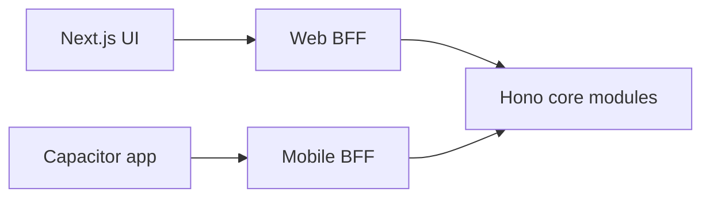
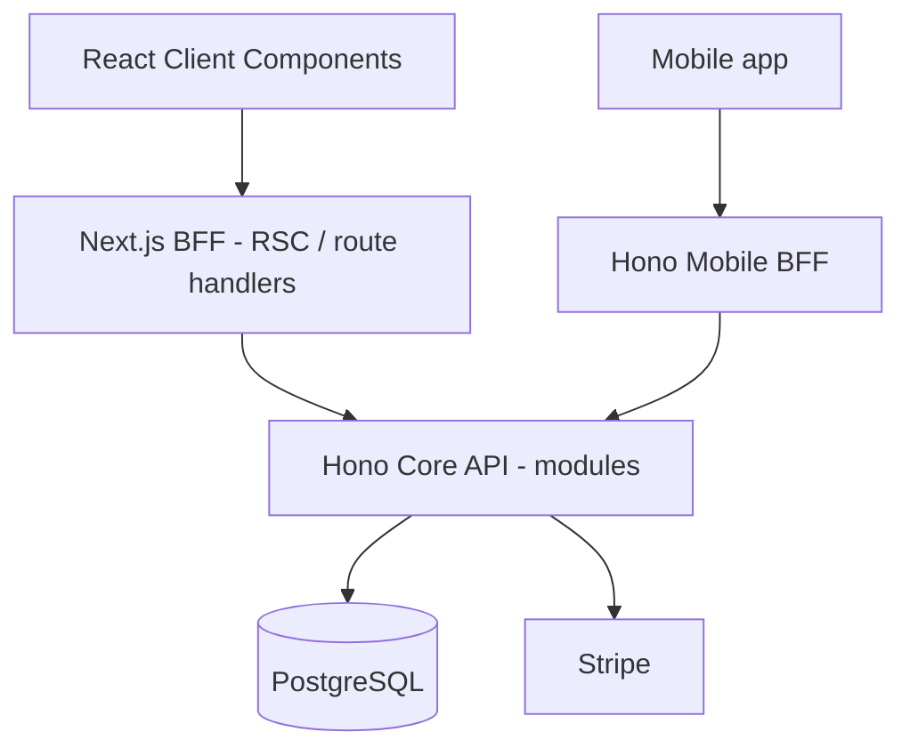

# Backend for Frontend (BFF)

## One-line definition

A Backend for Frontend is an **API layer tailored to a specific client experience** (web, mobile, admin) that aggregates, shapes, and secures backend data so the UI is not forced to speak to multiple internal services in their raw form.

## Problem it solves

When a React/Next.js app calls many microservices or modules directly, the client accumulates orchestration, over-fetching, and auth complexity. A BFF gives each client a purpose-built façade.

---

## 1. Dummy — 30-second picture

Each client gets its own API tailor. Web BFF aggregates; core API keeps invariants.



**Why it exists:** mobile and web need different payloads — not different domain rules.

---

## 2. When to use / when not

### When to use

- Multiple clients with different data needs (web vs mobile vs admin)
- Microservices or many internal APIs that would otherwise couple to the UI
- Need to hide internal APIs, aggregate calls, or adapt DTOs per channel
- Next.js already acts as a server layer for the web client
- Team can own BFF as part of the frontend or edge platform team

### When not

- Single client + modular monolith with a well-shaped public API — extra hop
- BFF becomes a second domain layer duplicating business rules
- Every micro-page gets its own BFF service (ops explosion)
- Using BFF only to avoid fixing a bad public API

### Fit by application type

| Application type | Fit | Why |
|---|---:|---|
| Small React SPA | Poor | One API is enough |
| Large React dashboard | Medium | Useful aggregation for dense screens |
| Next.js App Router app | Good | RSC/route handlers are a natural web BFF |
| Hono API | Medium | Hono can *be* the BFF or the downstream API |
| Background worker | Poor | Not a client façade |
| Mobile app API | Good | Classic BFF case — mobile-specific API |
| Marketplace / booking system | Good | Web and mobile booking flows diverge |
| Internal admin panel | Medium | Admin BFF if admin shapes differ strongly |

### Frontend, backend, or both?

**Integration boundary** between clients and backend(s). Often implemented with Next.js (web BFF) or a dedicated Hono service (mobile BFF).

In React + Next.js + Hono:

- **Web:** Next.js Server Components, Route Handlers, and server actions aggregate Hono APIs
- **Mobile:** separate Hono BFF (`apps/mobile-bff`) shaping payloads for Capacitor/React Native
- Core domain stays in the main Hono API / modules — BFF should not own invariants
- Stripe secrets and service credentials stay server-side in BFF or core API, never in the browser

## 3. Working — folders and a thin example

### Core rules

- BFF may aggregate and translate; it must not become the system of record for business invariants
- One BFF per client type (or carefully shared), not one per screen by default
- Browser talks to BFF; BFF talks to internal APIs with service auth
- Do not expose internal service URLs to the client when a BFF exists
- DTO mapping lives in the BFF; domain rules live downstream
- Caching and auth-session concerns for that client belong in the BFF
- Avoid infinite BFF-to-BFF chains

### Dependency diagram (this monorepo)




### Folder structure


### 1. React frontend (SPA calling BFF)

```text
apps/web/src/
  shared/api/bff-client.ts           # only talks to /bff/*
  features/checkout/...
```

### 2. Next.js App Router frontend (BFF-in-Next)

```text
apps/web/
  app/
    bookings/[id]/page.tsx           # RSC aggregates
    api/bff/
      checkout-summary/route.ts      # shapes multi-module data
  src/
    bff/
      checkout-summary.ts            # orchestration + DTO map
      clients/core-api.ts            # server-only Hono client
    features/...
```

### 3. Hono backend

Core API (not BFF):

```text
apps/api/src/modules/{booking,billing,identity}/...
```

Optional mobile BFF:

```text
apps/mobile-bff/src/
  routes/checkout-summary.ts
  mappers/checkout-summary.mapper.ts
  clients/core-api.ts
  main.ts
```

### 4. Monorepo

```text
apps/web/                 # Next.js web BFF + UI
apps/mobile-bff/          # Hono BFF for mobile
apps/api/                 # core domain API
packages/contracts/       # shared zod where safe
```

### TypeScript


```ts
// apps/web/src/bff/checkout-summary.ts
import { coreApi } from "./clients/core-api";

export async function getCheckoutSummary(bookingId: string, userId: string) {
  const [booking, listing, wallet] = await Promise.all([
    coreApi.getBooking(bookingId),
    coreApi.getListingForBooking(bookingId),
    coreApi.getWallet(userId),
  ]);

  // shape for web UI — not domain persistence
  return {
    bookingId: booking.id,
    title: listing.title,
    nights: booking.nights,
    total: { cents: booking.totalCents, currency: "USD" },
    canPayWithBalance: wallet.balanceCents >= booking.totalCents,
    steps: ["review", "pay", "confirmation"],
  };
}
```

```ts
// app/api/bff/checkout-summary/route.ts
import { getCheckoutSummary } from "@/bff/checkout-summary";
import { requireSession } from "@/bff/auth";

export async function GET(req: Request) {
  const session = await requireSession(req);
  const bookingId = new URL(req.url).searchParams.get("bookingId");
  if (!bookingId) return Response.json({ error: "missing bookingId" }, { status: 400 });
  const dto = await getCheckoutSummary(bookingId, session.userId);
  return Response.json(dto);
}
```

## 4. Rich — seams, failures, tests

### Seams worth testing


- **Unit:** mappers and aggregation helpers
- **Integration:** BFF route with mocked core API clients
- **Contract:** BFF DTO schema vs UI; core API contracts separately
- **E2E:** UI → BFF → core in staging
- **Mocking:** mock downstream Hono modules at HTTP client boundary

### Failure modes

| Failure | Who owns it |
|---------|-------------|
| Validation drift from core | Commands only on core API |
| BFF N+1 to microservices | Aggregate endpoint in BFF |
| Secret leaked to client bundle | Server-only client module |

### Anti-patterns


- Reimplementing domain validation in the BFF and drifting from core
- God-BFF that serves web, mobile, and admin with tangled conditionals
- Client still calling core services “just for this one endpoint”
- Putting SQL in the Next.js BFF while core API also owns the same tables
- Treating server actions as free license to skip authorization


---

## 5. Professional / CTO

### Cost

| Dimension | BFF cost |
|-----------|----------|
| Team | Extra layer to own; must not duplicate domain |
| Delivery | Faster UI iteration when aggregation is real |
| Ops | More deployables if mobile BFF splits |
| Evolution | Next.js as web BFF first; dedicated `apps/mobile-bff` when Capacitor diverges |

### ADR triggers

New BFF per client channel · business rules creeping into BFF · BFF calling BFF.

### Automate

- Server-only imports for core API clients in Next
- Contract tests: BFF DTO ↔ UI components

## Migration


1. Stop importing multiple module clients into Client Components
2. Add one aggregated Route Handler / server function for the worst screen
3. Move secrets and multi-calls server-side
4. If mobile diverges, create `apps/mobile-bff`
5. Keep core Hono as the system of record

## Related concepts

[Next.js recommendations](react-next-hono-recommendations.md) · [API gateway](api-gateway.md) · [Microservices](microservices.md) · [Hexagonal](hexagonal.md)

## Where in this repo

Next.js web BFF pattern in [react-next-hono-recommendations.md](react-next-hono-recommendations.md); optional `apps/mobile-bff`.
