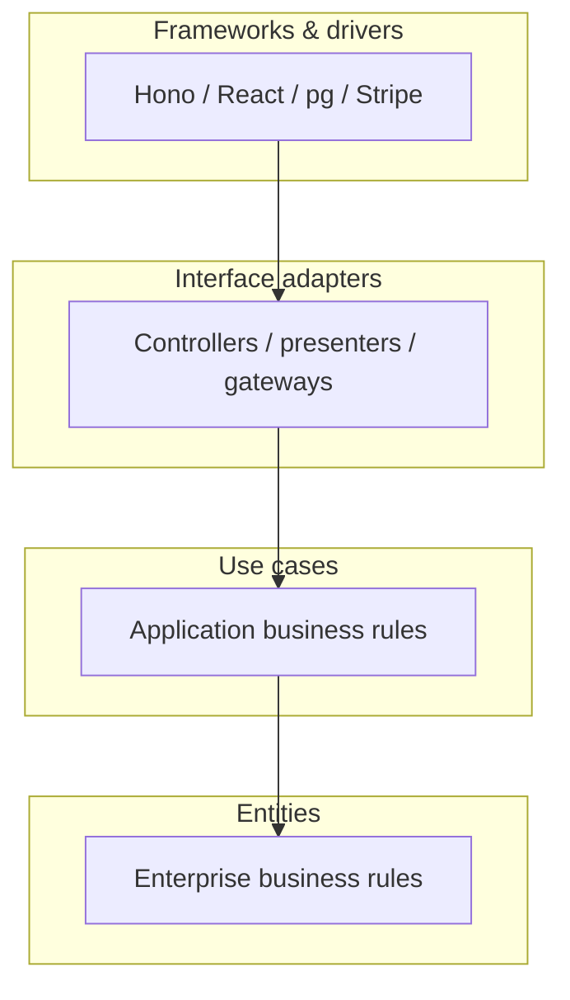

# Clean architecture

## One-line definition

A **dependency rule**: source code dependencies point **inward** toward entities and use cases. Frameworks, UI, and databases are outer details. Closely related to [hexagonal](hexagonal.md); different vocabulary (rings) and ceremony.

## Problem it solves

Framework churn (Hono ↔ another server, React ↔ native, Postgres ↔ something else) must not rewrite business rules. Clean Architecture makes that rule visible as concentric rings and import direction.

---

## 1. Dummy — 30-second picture

Four rings. The center is entities. Outside that, use cases. Outside that, controllers/presenters/gateways. The outermost ring is Hono, React, `pg`, Stripe.



**Why it exists:** so the center compiles with **zero** framework imports.

---

## 2. When to use / when not

### When to use

- Long-lived domain with changing delivery mechanisms
- Teams that want **strict, reviewable** import rules
- Aligning language with “Clean Architecture” interviews / books

### When not to use

- Over-layering a simple feature into entities / use-cases / gateways / presenters when a function would do
- Cargo-cult folder names without enforcing the dependency rule

### Fit by application type

| Application type | Fit | Why |
|------------------|-----|-----|
| Hono API with real domain | Excellent | Controllers stay thin |
| Next.js BFF | Good | Keep RSC/route handlers in outer ring |
| Thin CRUD admin | Weak | Prefer vertical slice / layered |
| Marketplace checkout | Excellent | Entities + use cases pay off |

### Frontend, backend, or both?

**Both**, but this repo usually keeps **fewer names** on the frontend: pure domain helpers + hooks + UI, without a full “presenter” ring unless view-models are genuinely complex.

---

## 3. Working — folders and a thin example

### Core rules

1. Entities know only entities.
2. Use cases know entities and **ports** they declare.
3. Interface adapters map DTOs ↔ use case models; they may know use cases.
4. Frameworks know adapters; **nothing inward knows frameworks**.
5. Enforce with ESLint/TS path constraints — folders alone do nothing.

### Ring → this monorepo mapping

| Clean ring | This repo |
|------------|-----------|
| Entities | `packages/domain` |
| Use cases + ports | `packages/application` |
| Interface adapters | Hono controllers, React hooks mapping, gateway classes |
| Frameworks & drivers | `apps/*`, Drizzle/`pg`, Stripe SDK |

### Folder structure — strict teaching layout (Hono chat)

```text
apps/api/src/
  entities/
    message.ts                 # parseMentions, length limits
  use-cases/
    post-message.ts
    ports/message-repository.ts
  interface-adapters/
    http/post-message.controller.ts
    http/message.presenter.ts  # row → JSON view model
    persistence/pg-message.repository.ts
  frameworks/
    hono/app.ts                # only place that imports hono
    pg/pool.ts
  main.ts
```

### TypeScript — dependency rule

```ts
// ✅ entities/message.ts — no imports from outer rings
export function assertBody(raw: string): string {
  const body = raw.trim();
  if (!body) throw new DomainError("EMPTY");
  if (body.length > 4000) throw new DomainError("TOO_LONG");
  return body;
}

// ❌ entities importing drizzle
import { messages } from "../frameworks/pg/schema"; // violation
```

### Worst vs best

```ts
// ❌ “Clean” folder names, Prisma inside entity
export class Message {
  async save() { await prisma.message.create({ data: this }); }
}

// ✅ Entity pure; repository adapter in outer ring
await messages.save(Message.create(userId, assertBody(raw)));
```

---

## 4. Rich — seams, failures, tests

### Presenter optional rule

Add a presenter/view-model **only** when the API shape diverges hard from the entity (chat rows with display names, permissions flags, localization). Do not invent presenters that `return entity`.

### Failure modes

| Failure | Ring |
|---------|------|
| Invariant broken | Entity / use case → domain error |
| Auth missing | Interface adapter / framework middleware |
| DB constraint | Adapter maps to application error; entities stay pure |

### Testing

- Entity tests: pure
- Use case tests: fake repository port
- Controller tests: mock use case; assert status codes
- Avoid “all rings in one Playwright test” as the only safety net

### Anti-patterns

- Entities that are ORM models
- Use cases that take `Hono.Context`
- Presenter ceremony with no UI/API complexity

---

## 5. Professional / CTO

### Cost vs hexagonal

| | Clean | Hexagonal |
|---|--------|-----------|
| Vocabulary | Rings, presenters | Ports, adapters |
| Emphasis | Import direction + enterprise rules | Pluggable edges |
| This repo | Same dependency rule; often fewer folder names | Prefer “ports & adapters” language at DB/payment edges |

Pick **one vocabulary per team** and map it in an ADR so reviews do not argue synonyms.

### ADR triggers

Enforcing boundary lint · introducing presenters · splitting `packages/domain` by bounded context ([DDD](domain-driven-design.md)).

### Automate

- `eslint-plugin-boundaries` or TS project references: domain → no apps
- CI grep/arch-unit: forbid ORM imports under `packages/domain`

---

## Common mistakes

1. Four rings of folders, zero import lint.
2. DTO types used as entities.
3. Use case returning raw SQL rows.

## Migration

- **From layered:** move pure rules to entities; introduce use-case functions; push frameworks out.
- **Align with hexagonal:** rename “gateway” ↔ “driven adapter”; keep the same dependency rule.

## Related concepts

[Hexagonal](hexagonal.md) · [Layered](layered.md) · [DIP](../solid/05-D.md) · [DDD](domain-driven-design.md)

## Where in this repo

Same rule as hexagonal with ring vocabulary. Prefer `packages/domain` + `packages/application` over a fourth “presenter” package until view-models hurt.
