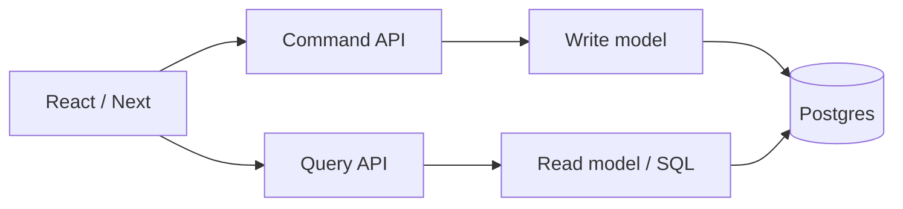
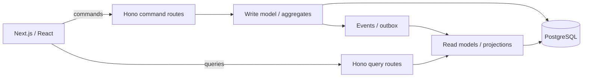

# CQRS (Command Query Responsibility Segregation)

## One-line definition

CQRS separates **write operations (commands)** that change state from **read operations (queries)** that return data, allowing different models, optimizations, and scaling strategies for each side.

## Problem it solves

A single domain model often becomes awkward for both enforcing invariants and serving rich UI dashboards. Writes need strict validation; reads need joins, denormalization, and speed. CQRS splits those responsibilities.

---

## 1. Dummy — 30-second picture

Two doors on the same product: **commands** change state; **queries** return shaped reads. They may share one DB at first.



**Why it exists:** dashboards need joins; writes need invariants — one model struggles at both.

---

## 2. When to use / when not

### When to use

- Read shapes differ sharply from write models (dashboards, search, calendars)
- High read/write asymmetry or independent scaling needs
- Complex domains where the write model must stay pure
- Team can accept eventual consistency for some views
- Logical CQRS (separate handlers/models, same DB) is enough for most SaaS

### When not

- Simple CRUD with the same DTO for read and write
- Small teams where dual models double maintenance without payoff
- Immediate strong consistency required on every screen with no lag tolerance
- Jumping straight to separate read databases without measuring pain

### Fit by application type

| Application type | Fit | Why |
|---|---:|---|
| Small React SPA | Poor | Extra models without need |
| Large React dashboard | Good | Heavy read models / projections |
| Next.js App Router app | Good | RSC queries vs server-action commands |
| Hono API | Good | Clear command vs query routes |
| Background worker | Good | Workers update read models from events |
| Mobile app API | Medium | Useful for tailored read DTOs |
| Marketplace / booking system | Good | Availability calendars ≠ booking aggregate |
| Internal admin panel | Medium | Reporting queries often benefit |

### Frontend, backend, or both?

Primarily **read/write design** on the backend; frontend should call distinct command vs query APIs and avoid treating query DTOs as write models.

In React + Next.js + Hono:

- Commands: `POST/PATCH` Hono routes or Next.js server actions
- Queries: `GET` endpoints, RSC loaders, or TanStack Query against read APIs
- TanStack Query caches **queries only**; mutations invalidate or update selectively
- Physical separation (read replica / projection DB) is optional and later

## 3. Working — folders and a thin example

### Core rules

- Commands change state and return limited acknowledgements (ids, status) — not large graphs by default
- Queries never mutate state
- Write model enforces invariants; read model may be denormalized and disposable
- Do not reuse write aggregates as the only query API for complex screens
- Prefer **logical CQRS** first (separate handlers/SQL), same PostgreSQL
- If projections are async, UI must handle stale reads (refresh, polling, realtime)
- Frontend forms map to command schemas (Zod), not to query dashboard types

### Dependency diagram (this monorepo)




### Folder structure


### 1. React frontend

```text
apps/web/src/
  features/confirm-booking/
    useConfirmBooking.ts             # mutation → command API
  features/booking-calendar/
    useBookingCalendar.ts            # query → read API
    calendar.types.ts                # read DTO only
```

### 2. Next.js App Router frontend

```text
apps/web/
  app/listings/[id]/calendar/page.tsx   # RSC query
  app/bookings/new/actions.ts           # command
  src/features/...
```

### 3. Hono backend

```text
apps/api/src/modules/booking/
  commands/
    confirm-booking/
      handler.ts
      schema.ts
      route.ts
  queries/
    booking-calendar/
      handler.ts
      sql.ts                         # denormalized query
      route.ts
  domain/booking.ts                  # write model only
  infrastructure/
    drizzle-booking.repository.ts
    booking-calendar.projection.ts
```

### 4. Monorepo

```text
apps/api/           # commands + queries
apps/worker/        # projection updaters
packages/contracts/ # command + query zod schemas for web
```

### TypeScript


```ts
// commands/confirm-booking/handler.ts
export async function confirmBookingCommand(
  input: { bookingId: string },
  deps: { bookings: BookingRepository; payments: PaymentGateway },
) {
  const booking = await deps.bookings.getById(input.bookingId);
  if (!booking) throw new NotFoundError("booking");
  // write-model rules...
  booking.confirm();
  await deps.bookings.save(booking);
  return { bookingId: booking.id, status: booking.status };
}
```

```ts
// queries/booking-calendar/handler.ts
export async function bookingCalendarQuery(
  input: { listingId: string; from: string; to: string },
  deps: { db: Db },
) {
  // purpose-built read SQL — not the aggregate
  return deps.db
    .selectFrom("booking_calendar_days")
    .select(["day", "available", "priceCents", "bookingId"])
    .where("listingId", "=", input.listingId)
    .where("day", ">=", input.from)
    .where("day", "<=", input.to)
    .execute();
}
```

```ts
// React — keep command and query hooks separate
export function useConfirmBooking() {
  return useMutation({ mutationFn: (bookingId: string) =>
    http.post(`/bookings/${bookingId}/confirm`, {}) });
}

export function useBookingCalendar(listingId: string, range: DateRange) {
  return useQuery({
    queryKey: ["booking-calendar", listingId, range],
    queryFn: () => http.get(`/listings/${listingId}/calendar`, range),
  });
}
```

## 4. Rich — seams, failures, tests

### Seams worth testing


- **Unit:** command handlers + domain invariants
- **Integration:** command commits; query SQL returns expected shape
- **Contract:** command/query Zod schemas shared with frontend
- **E2E:** mutate then eventually observe read model (if async)
- **Mocking:** mock payment ports on commands; queries tested with real SQL fixtures

### Failure modes

| Failure | Who owns it |
|---------|-------------|
| Query mutates state | Ban in query handler review |
| Stale calendar after confirm | Invalidate TanStack Query / projection lag UX |
| Same SQL for read and write | Extract purpose-built query SQL |

### Anti-patterns


- Dual models for every trivial entity — maintenance explosion
- Returning full write aggregates from every query “for reuse”
- Physical CQRS (two databases) before logical separation is needed
- Forgetting invalidation — UI shows stale data with no strategy
- Treating CQRS as requiring Event Sourcing (it does not)


---

## 5. Professional / CTO

### Cost

| Dimension | CQRS cost |
|-----------|-----------|
| Team | Two mental models per feature when over-applied |
| Delivery | Heavy screens ship faster with purpose SQL |
| Ops | Projection lag if async read models |
| Evolution | Logical CQRS first; physical split only with evidence |

### Evolution

1. `commands/` vs `queries/` folders in one Hono module.
2. TanStack Query for reads; mutations for commands on web.
3. Worker projections only when read SQL contends with writes.

### ADR triggers

Separate read database · event-driven projections · shared write model for queries.

### Automate

- Lint or convention: query handlers must not call command repositories
- Schema tests: command vs query Zod in `packages/contracts`

## Migration


1. Split route folders into `commands/` and `queries/` for one module
2. Write purpose-built SQL for the heaviest screen
3. Keep the same database
4. Add projection table + worker only when read SQL becomes too expensive or contentious
5. Introduce separate read store only with clear scaling evidence

## Related concepts

[Event-driven](event-driven.md) · [Event sourcing](event-sourcing.md) · [DDD](domain-driven-design.md) · [Vertical slice](vertical-slice.md)

## Where in this repo

Command/query split inside Hono modules; TanStack Query on the client. See vertical-slice todo example.
