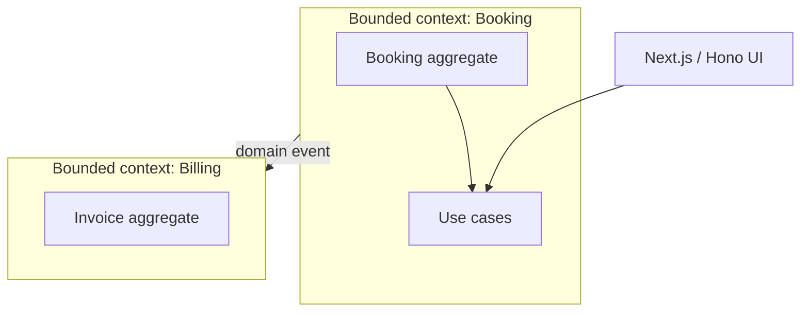
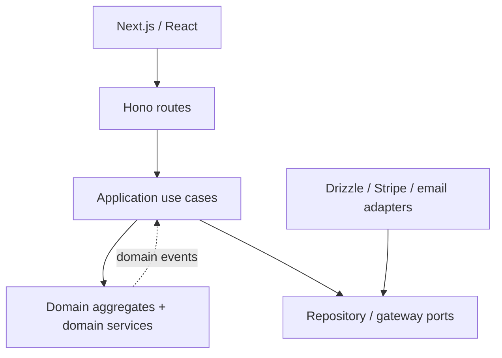

# Domain-Driven Design (DDD)

## One-line definition

Domain-Driven Design is a **modeling approach** that aligns software structure with the business domain using bounded contexts, ubiquitous language, aggregates, domain events, and explicit domain rules — not a deployment topology by itself.

## Problem it solves

When business rules are scattered across React components, Hono routes, and SQL, the product language disappears and changes become risky. DDD keeps complex rules in a domain model that the team and code share.

---

## 1. Dummy — 30-second picture

Bounded contexts as bubbles. Inside each bubble: aggregates enforce rules. Outside: only public APIs and events — no reaching into another context's tables.



**Why it exists:** so "confirm booking" and "capture payment" stay separate languages with explicit handoffs.

---

## 2. When to use / when not

### When to use

- Genuine domain complexity (pricing, bookings, entitlements, compliance, multi-party workflows)
- Multiple specialists collaborating on the same problem space
- Product expected to live years with evolving rules
- Team can invest in language workshops and context maps
- Scale of *rules*, not just traffic — complexity of meaning

### When not

- Simple CRUD / content sites / thin admin panels
- Early MVP still discovering the problem — premature bounded contexts
- Team uses DDD vocabulary (`AggregateRoot`) without modeling discipline
- Every module gets full tactical DDD ceremony for anemic data

### Fit by application type

| Application type | Fit | Why |
|---|---:|---|
| Small React SPA | Poor | Rarely enough domain depth |
| Large React dashboard | Medium | UI benefits from entity language; heavy DDD stays server-side |
| Next.js App Router app | Medium | Server actions/use cases can host domain; avoid fat client domains |
| Hono API | Good | Natural home for aggregates and domain services |
| Background worker | Good | Domain reacts to commands/events consistently |
| Mobile app API | Good | Shared domain on API protects multiple clients |
| Marketplace / booking system | Good | Classic DDD fit: listings, bookings, payments, disputes |
| Internal admin panel | Medium | Only where policy/workflow complexity exists |

### Frontend, backend, or both?

Primarily **domain / business modeling**, applied most strongly on the **backend**, with a thinner language mirror on the frontend.

In React + Next.js + Hono:

- **Hono modules** ≈ bounded contexts (`booking`, `billing`, `identity`)
- **Aggregates** live in domain packages; routes are drivers
- **Next.js/React** consume DTOs and may share Zod + display rules, not full aggregates
- **Workers** apply the same domain when processing outbox/queue messages

## 3. Working — folders and a thin example

### Core rules

- Code and conversation use the same ubiquitous language per bounded context
- A bounded context has an explicit public API; other contexts do not reach into its tables or internals
- Aggregates enforce invariants; external code cannot bypass them to patch rows
- Domain code **must not** import Hono, React, Next.js, Drizzle, Prisma, Stripe SDK, or SQL
- Application/use-case layer orchestrates repositories and ports; domain stays pure
- Cross-context collaboration via public functions, domain events, or anti-corruption layers — not shared DB tables
- Prefer one aggregate transaction boundary; update other contexts asynchronously when consistency allows

### Dependency diagram (this monorepo)




### Folder structure


### 1. React frontend

Keep domain light — types and labels, not aggregates:

```text
apps/web/src/
  entities/booking/
    model/types.ts                   # DTO-aligned types
    model/labels.ts                  # ubiquitous language for UI copy
  features/confirm-booking/
```

### 2. Next.js App Router frontend

```text
apps/web/
  app/bookings/[id]/page.tsx         # loads DTO via server component
  src/features/confirm-booking/
  src/entities/booking/
```

### 3. Hono backend (tactical DDD inside a module)

```text
apps/api/src/modules/booking/
  domain/
    booking.ts                       # aggregate
    booking-errors.ts
    pricing-policy.ts
    events.ts                        # BookingConfirmed
  application/
    confirm-booking.ts
    cancel-booking.ts
    ports.ts                         # BookingRepository, PaymentGateway
  infrastructure/
    drizzle-booking.repository.ts
    stripe-payment.adapter.ts
  api/
    booking.routes.ts
  public.ts                          # other modules import only this
```

### 4. Monorepo

```text
apps/api/src/modules/
  booking/                           # bounded context
  billing/
  identity/
packages/shared/                     # IDs, money — not full domain models
```

### TypeScript


```ts
// modules/booking/domain/booking.ts
export type BookingStatus = "pending" | "confirmed" | "cancelled";

export class Booking {
  private constructor(
    readonly id: string,
    readonly listingId: string,
    private _status: BookingStatus,
    private _nights: number,
    private _totalCents: number,
  ) {}

  static create(input: {
    id: string;
    listingId: string;
    nights: number;
    nightlyRateCents: number;
  }): Booking {
    if (input.nights < 1) throw new Error("Booking must include at least one night");
    return new Booking(
      input.id,
      input.listingId,
      "pending",
      input.nights,
      input.nights * input.nightlyRateCents,
    );
  }

  get status() {
    return this._status;
  }

  get totalCents() {
    return this._totalCents;
  }

  confirm(paymentCaptured: boolean): { type: "BookingConfirmed"; bookingId: string } {
    if (this._status !== "pending") throw new Error("Only pending bookings can be confirmed");
    if (!paymentCaptured) throw new Error("Payment must be captured before confirm");
    this._status = "confirmed";
    return { type: "BookingConfirmed", bookingId: this.id };
  }

  cancel(): void {
    if (this._status === "cancelled") return;
    if (this._status === "confirmed") {
      // policy: confirmed cancellations allowed; refund handled in application
    }
    this._status = "cancelled";
  }
}
```

```ts
// modules/booking/application/confirm-booking.ts
import { Booking } from "../domain/booking";
import type { BookingRepository, PaymentGateway } from "./ports";

export async function confirmBooking(
  bookingId: string,
  deps: { bookings: BookingRepository; payments: PaymentGateway; publish: (e: unknown) => Promise<void> },
) {
  const booking = await deps.bookings.getById(bookingId);
  if (!booking) throw new Error("Booking not found");

  const payment = await deps.payments.captureForBooking(bookingId, booking.totalCents);
  const event = booking.confirm(payment.status === "captured");
  await deps.bookings.save(booking);
  await deps.publish(event);
}
```

## 4. Rich — seams, failures, tests

### Seams worth testing


- **Unit:** aggregates and domain services with no DB/framework
- **Integration:** repository adapters + use cases against Postgres
- **Contract:** anti-corruption adapters for Stripe/webhooks; context public APIs
- **E2E:** critical journeys spanning contexts (book → pay → confirm)
- **Mocking:** mock ports at application boundary; never mock aggregate internals

### Failure modes

| Failure | Who owns it |
|---------|-------------|
| Invariant violated (confirm twice) | Domain aggregate → mapped in application |
| Missing booking | Repository / use case → 404 at route |
| Cross-context direct SQL | Module boundary / ADR |
| Payment gateway timeout | Infrastructure adapter → retry policy in application |

### Anti-patterns


- Anemic “entities” that are only TypeScript interfaces with all logic in services
- One global domain model across the whole company — unbounded context
- Importing Drizzle models into `domain/` — persistence model ≠ domain model
- Using DDD names as folder decoration without invariants
- Synchronously coupling every context in one request transaction forever


---

## 5. Professional / CTO

### Cost

| Dimension | DDD cost |
|-----------|----------|
| Team | Workshops + context maps; onboarding to ubiquitous language |
| Delivery | Slower early modeling; faster when rules are truly complex |
| Ops | Still one modular monolith in this teaching stack |
| Evolution | Microservices only when bounded contexts prove separation |

### Evolution

1. Start with modules in a [modular monolith](modular-monolith.md); name contexts from product language.
2. Add tactical DDD only where invariants justify aggregates.
3. Use [hexagonal](hexagonal.md) ports at context edges; [event-driven](event-driven.md) between contexts when sync coupling hurts.

### ADR triggers

Open an ADR when you: split a bounded context to a separate deployable; share tables across contexts; or adopt event sourcing on a core aggregate.

### Automate

- ESLint import boundaries: `modules/*/domain` cannot import infrastructure frameworks
- Contract tests on `public.ts` per module

## Migration


1. Name bounded contexts from the product language (Booking, Billing, Identity)
2. Draw a context map; assign table ownership
3. Extract one aggregate with real invariants (e.g. Booking)
4. Introduce ports for persistence/payment; keep routes thin
5. Add domain events for cross-context side effects only where needed
6. Leave simple CRUD modules layered/slice-based without full tactical DDD

## Related concepts

[Modular monolith](modular-monolith.md) · [Hexagonal](hexagonal.md) · [CQRS](cqrs.md) · [Event-driven](event-driven.md) · [Vertical slice](vertical-slice.md) · [Feature-sliced design](feature-sliced-design.md)

## Where in this repo

Tactical DDD lives in walkthrough modules under `apps/api/src/modules/*` and `packages/domain`. See [backend-architecture.md](../../tech-space/backend-architecture.md) and [modular-monolith.md](modular-monolith.md).
