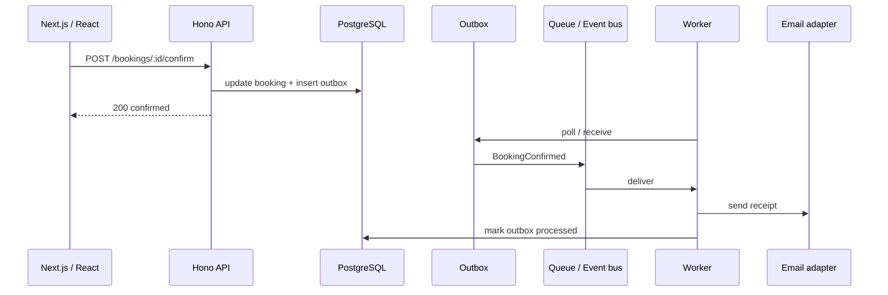

# Event-Driven Architecture

## One-line Definition

Components communicate by producing and consuming **events** (facts that something happened), enabling loose coupling, asynchronous side effects, and independent scaling of producers and consumers.

## Problem It Solves

Synchronous request chains couple services and modules: a booking confirm that directly emails, indexes search, updates billing, and notifies chat becomes fragile and slow. Events let the write path finish quickly while other work happens asynchronously.

## When to Use It

- Side effects that need not complete inside the user request (email, analytics, search index, webhooks)
- Multiple consumers interested in the same fact
- Growing SaaS / marketplace with cross-module workflows
- Team comfortable with eventual consistency and observability
- Workers/queues already in the stack (or planned)

## When Not to Use It

- Simple CRUD where sync calls are clearer
- Strong immediate consistency required across all reads with no tolerance for lag
- Team lacks tooling for poison messages, retries, idempotency, and tracing
- Using events as a disguised remote procedure call (request/response over a bus)

## Best Fit by Application Type

| Application type | Fit | Why |
|---|---:|---|
| Small React SPA | Poor | UI still needs request/response; events are backend concern |
| Large React dashboard | Medium | UI may subscribe to realtime; core EDA is server-side |
| Next.js App Router app | Medium | Server actions publish; UI polls or uses realtime |
| Hono API | Good | Producers in use cases; clear integration edge |
| Background worker | Good | Primary consumer runtime |
| Mobile app API | Good | Fan-out notifications and sync without blocking mobile |
| Marketplace / booking system | Good | Booked/paid/cancelled fans out to many parties |
| Internal admin panel | Medium | Useful for audit/notifications; often optional |

## Frontend, Backend, or Both?

Primarily **communication style** and **cross-cutting system design** on the backend; frontend may consume realtime projections.

In React + Next.js + Hono:

- Hono use cases publish domain/integration events (outbox → queue/bus)
- Workers consume and call other modules or external APIs
- Next.js/React read updated state via TanStack Query, SSE, or Supabase Realtime
- Do not drive core form submits only through an event bus

## Core Rules

- Events are **past tense facts** (`BookingConfirmed`), not commands (`ConfirmBooking`) mixed casually without clear intent
- Producers must not require a specific consumer to be online (unless using sync in-process handlers deliberately)
- Consumers must be **idempotent** (at-least-once delivery is the default assumption)
- Publish events **after** successful state change, preferably via transactional outbox
- Domain modules do not import worker code; workers import module public APIs
- React components do not publish integration events directly to the bus
- Schema version events; never “fix” payload shapes silently

## Dependency Diagram



## Recommended Folder Structure

### 1. React frontend

```text
apps/web/src/
  features/booking-status/
    useBookingStatus.ts              # query + optional realtime invalidation
  shared/realtime/subscribe.ts
```

### 2. Next.js App Router frontend

```text
apps/web/
  app/bookings/[id]/page.tsx
  src/features/booking-status/useBookingStatus.ts
```

### 3. Hono backend + worker

```text
apps/api/src/modules/booking/
  application/confirm-booking.ts     # writes state + outbox
  domain/events.ts
  infrastructure/outbox-publisher.ts

apps/worker/src/
  consumers/
    booking-confirmed.email.ts
    booking-confirmed.search.ts
  main.ts

packages/events/
  src/booking-confirmed.ts           # shared event contract (zod)
```

### 4. Monorepo

```text
apps/api/
apps/worker/
packages/events/                     # versioned event schemas
packages/module-booking/             # optional extract
```

## Implementation Example

```ts
// packages/events/src/booking-confirmed.ts
import { z } from "zod";

export const bookingConfirmedEvent = z.object({
  type: z.literal("booking.confirmed"),
  version: z.literal(1),
  occurredAt: z.string().datetime(),
  payload: z.object({
    bookingId: z.string().uuid(),
    guestId: z.string().uuid(),
    totalCents: z.number().int().nonnegative(),
  }),
});

export type BookingConfirmedEvent = z.infer<typeof bookingConfirmedEvent>;
```

```ts
// apps/api/.../confirm-booking.ts
export async function confirmBooking(bookingId: string, db: Db) {
  await db.transaction(async (tx) => {
    const booking = await tx.bookings.confirm(bookingId);
    await tx.outbox.insert({
      type: "booking.confirmed",
      version: 1,
      occurredAt: new Date().toISOString(),
      payload: {
        bookingId: booking.id,
        guestId: booking.guestId,
        totalCents: booking.totalCents,
      },
    });
  });
}
```

```ts
// apps/worker/src/consumers/booking-confirmed.email.ts
import { bookingConfirmedEvent } from "@repo/events";

export async function onBookingConfirmed(raw: unknown, mail: MailPort) {
  const event = bookingConfirmedEvent.parse(raw);
  await mail.sendReceipt({
    guestId: event.payload.guestId,
    bookingId: event.payload.bookingId,
    // idempotency key:
    key: `${event.type}:${event.payload.bookingId}:v${event.version}`,
  });
}
```

## Testing Strategy

- **Unit:** producers build correct event payloads; consumers handle duplicates
- **Integration:** outbox write + consumer processing against real queue/DB
- **Contract:** Zod event schemas in `packages/events` as the contract suite
- **E2E:** confirm booking → eventually receive email / see search update
- **Mocking:** fake bus in unit tests; use real queue in staging integration

## Common Mistakes

- Calling events as remote functions and waiting for “response events” everywhere
- Publishing before the DB commit (listeners see lies)
- No idempotency keys — duplicate charges/emails
- Giant god-topics with unrelated payloads
- Leaking internal DB row shapes as the public event contract

## Migration Path

1. Identify blocking side effects in hot paths (email, webhooks)
2. Introduce outbox table + worker for one event type
3. Keep the HTTP response based on primary state only
4. Add idempotency and metrics before adding more consumers
5. Expand to cross-module integration events once stable

## Related Architectures

| Other architecture | Relationship | Why |
|---|---|---|
| DDD | Natural combination | Domain events as integration mechanism |
| CQRS | Natural combination | Events update read models |
| Event Sourcing | Natural combination | Store events as source of truth (stronger commitment) |
| Modular monolith | Natural combination | In-process bus or outbox without network services |
| Microservices | Natural combination | Primary integration style between services |
| Serverless | Natural combination | Functions as consumers |
| Sync-only layered monolith | Possible but requires discipline | Start sync; add events at edges |
| BFF | Possible but requires discipline | BFF stays request/response; backend may be event-driven |
