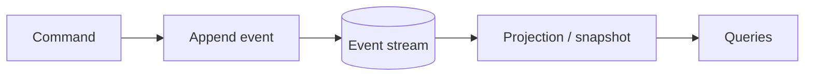
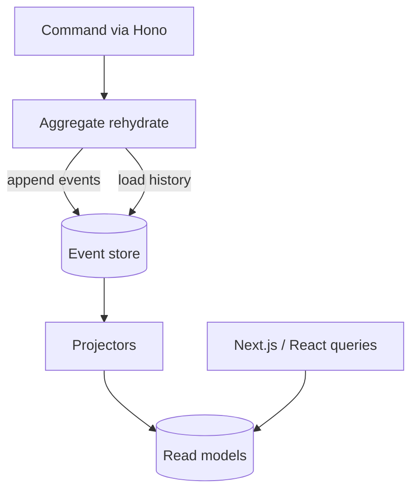

# Event Sourcing

## One-line definition

Event Sourcing stores the **sequence of domain events** as the source of truth for state; the current state is derived by replaying or projecting those events, rather than only persisting the latest row snapshot.

## Problem it solves

When you need a complete audit trail, time-travel debugging, rebuildable read models, or complex temporal business questions (“what was the booking state at time T?”), overwriting rows loses history. Event Sourcing keeps every change as an immutable fact.

---

## 1. Dummy — 30-second picture

No "current row" as truth — append **events**; rebuild state by folding them. Snapshots optional.



**Why it exists:** audit, time travel, and multiple read models from one fact log.

---

## 2. When to use / when not

### When to use

- Strong audit, compliance, or dispute requirements
- Need to rebuild projections in multiple shapes from the same history
- Domain already thought in events with clear aggregate boundaries
- Team skilled in versioning, snapshots, and idempotent projections
- High long-term maintenance budget for infrastructure complexity

### When not

- Typical SaaS CRUD without audit/replay needs
- Team new to messaging and eventual consistency
- Reporting can be solved with updated_at + audit table
- Low-complexity domains where event versioning will dominate delivery
- Using ES only because “CQRS is cool”

### Fit by application type

| Application type | Fit | Why |
|---|---:|---|
| Small React SPA | Poor | No benefit for simple client apps |
| Large React dashboard | Medium | Reads from projections; writes stay event-sourced on server |
| Next.js App Router app | Medium | Same — UI reads projections |
| Hono API | Good | Command API appends events |
| Background worker | Good | Projectors and reactors live here |
| Mobile app API | Medium | Only if domain warrants it |
| Marketplace / booking system | Medium | Useful for disputes/payments history; costly if blanket |
| Internal admin panel | Medium | Audit value; often overkill for the whole panel |

### Frontend, backend, or both?

**Backend / read-write design** (persistence strategy). Frontend consumes projections and sends commands — it does not store event streams.

In React + Next.js + Hono:

- Hono commands append to an event store (Postgres table or dedicated store)
- Workers/projectors build SQL read models for Next.js and TanStack Query
- Never expose raw event streams as the primary UI API unless building an audit viewer

## 3. Working — folders and a thin example

### Core rules

- Events are immutable; corrections are new events (`BookingCancellationCorrected`)
- Load aggregate by streaming events for its identity (optionally from snapshot)
- Commands validate against rehydrated state, then append new events
- Projections are disposable and rebuildable
- Do not update projection tables from the command handler ad hoc without a defined projector path
- Version events; upcasters or dual-read strategies required for old payloads
- Domain must not depend on React/Hono/ORM query builders

### Dependency diagram (this monorepo)




### Folder structure


### 1. React frontend

```text
apps/web/src/
  features/booking-timeline/
    useBookingTimeline.ts            # audit projection query
  features/confirm-booking/
    useConfirmBooking.ts             # command only
```

### 2. Next.js App Router frontend

```text
apps/web/
  app/bookings/[id]/page.tsx         # reads projection
  app/bookings/[id]/history/page.tsx # optional audit view
```

### 3. Hono backend

```text
apps/api/src/modules/booking/
  domain/
    booking.aggregate.ts
    events.ts                        # BookingCreated, BookingConfirmed...
  application/
    confirm-booking.command.ts
  infrastructure/
    pg-event-store.ts
    snapshots.ts
  queries/                           # optional sync reads if needed
    booking-detail.sql.ts

apps/worker/src/projectors/
  booking-detail.projector.ts
  booking-calendar.projector.ts
```

### 4. Monorepo

```text
packages/booking-events/             # event schemas + upcasters
apps/api/
apps/worker/
```

### TypeScript


```ts
// domain/events.ts
export type BookingEvent =
  | { type: "BookingCreated"; bookingId: string; listingId: string; nights: number; totalCents: number }
  | { type: "BookingConfirmed"; bookingId: string; at: string }
  | { type: "BookingCancelled"; bookingId: string; reason: string; at: string };
```

```ts
// domain/booking.aggregate.ts
import type { BookingEvent } from "./events";

export class BookingAggregate {
  status: "pending" | "confirmed" | "cancelled" = "pending";
  totalCents = 0;

  static from(events: BookingEvent[]) {
    const b = new BookingAggregate();
    for (const e of events) b.apply(e);
    return b;
  }

  apply(e: BookingEvent) {
    switch (e.type) {
      case "BookingCreated":
        this.totalCents = e.totalCents;
        this.status = "pending";
        break;
      case "BookingConfirmed":
        this.status = "confirmed";
        break;
      case "BookingCancelled":
        this.status = "cancelled";
        break;
    }
  }

  confirm(now: string): BookingEvent {
    if (this.status !== "pending") throw new Error("invalid transition");
    return { type: "BookingConfirmed", bookingId: "", at: now }; // id filled by caller
  }
}
```

```ts
// application/confirm-booking.command.ts
export async function confirmBooking(bookingId: string, store: EventStore) {
  const history = await store.load("booking", bookingId);
  const agg = BookingAggregate.from(history);
  const event = { ...agg.confirm(new Date().toISOString()), bookingId };
  await store.append("booking", bookingId, event, history.length);
}
```

## 4. Rich — seams, failures, tests

### Seams worth testing


- **Unit:** aggregate decide/apply pure functions; upcasters
- **Integration:** append/load concurrency (optimistic version checks)
- **Contract:** event schema compatibility tests across versions
- **E2E:** command → projection visible in UI
- **Mocking:** in-memory event store for aggregate tests; real store for projector tests

### Failure modes

| Failure | Who owns it |
|---------|-------------|
| Corrupt projection | Rebuild from stream; snapshot checkpoint |
| Unknown event version | Upcaster in application boot |
| Unbounded stream growth | Snapshot + archival policy |

### Anti-patterns


- Event Sourcing the entire product instead of one bounded context
- Mutable “updates” to old events
- Fat events that embed UI-only data and break when UI changes
- No snapshots → aggregates with huge streams become slow
- Confusing audit logs (append-only table of changes to a row model) with true ES


---

## 5. Professional / CTO

### Cost

| Dimension | ES cost |
|-----------|---------|
| Team | High — versioning, migrations, debugging streams |
| Delivery | Excellent audit; slower feature iteration |
| Ops | Stream storage, snapshot jobs, replay tooling |
| Evolution | Only after DDD aggregate boundaries are stable |

### Evolution

1. Audit/outbox events without making them source of truth.
2. One aggregate stream + snapshots when replay cost hurts.
3. Pair with [CQRS](cqrs.md) projections; keep other contexts state-based.

### ADR triggers

Choosing ES for a context · snapshot strategy · GDPR delete on streams.

### Automate

- Upcasters in CI for every event version bump
- Projection rebuild scripts in staging before prod deploy

## Migration


1. Start with audit/outbox events **without** making them the source of truth
2. Pick one aggregate with real audit needs (Payment, Booking dispute)
3. Dual-write snapshot + events temporarily, or migrate with a rebuild
4. Move read APIs to projections
5. Keep the rest of the system on state-based persistence

## Related concepts

[CQRS](cqrs.md) · [Event-driven](event-driven.md) · [DDD](domain-driven-design.md)

## Where in this repo

Teaching reference only unless walkthrough adds a stream — pair with [cqrs.md](cqrs.md).
